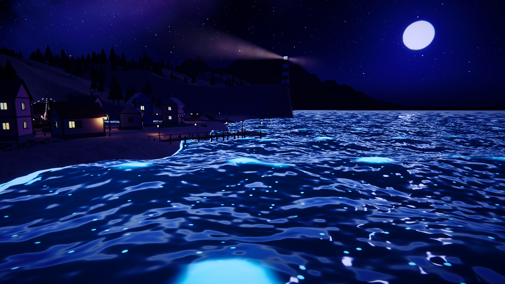
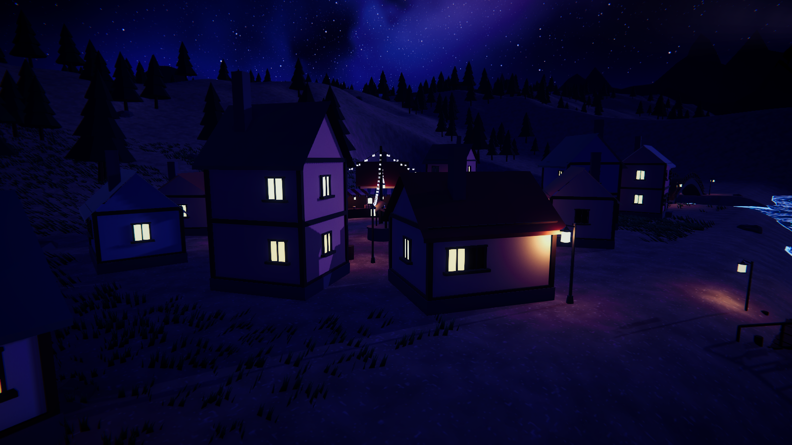
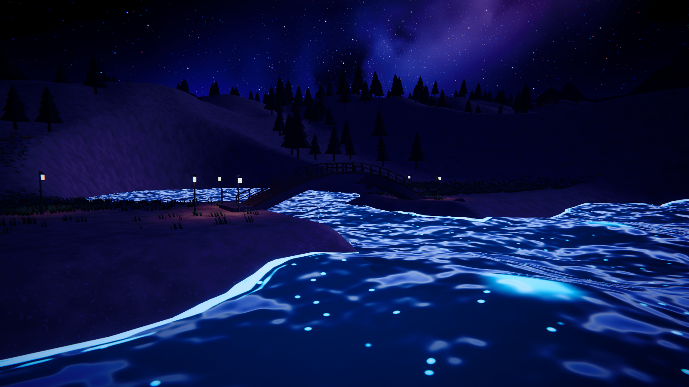
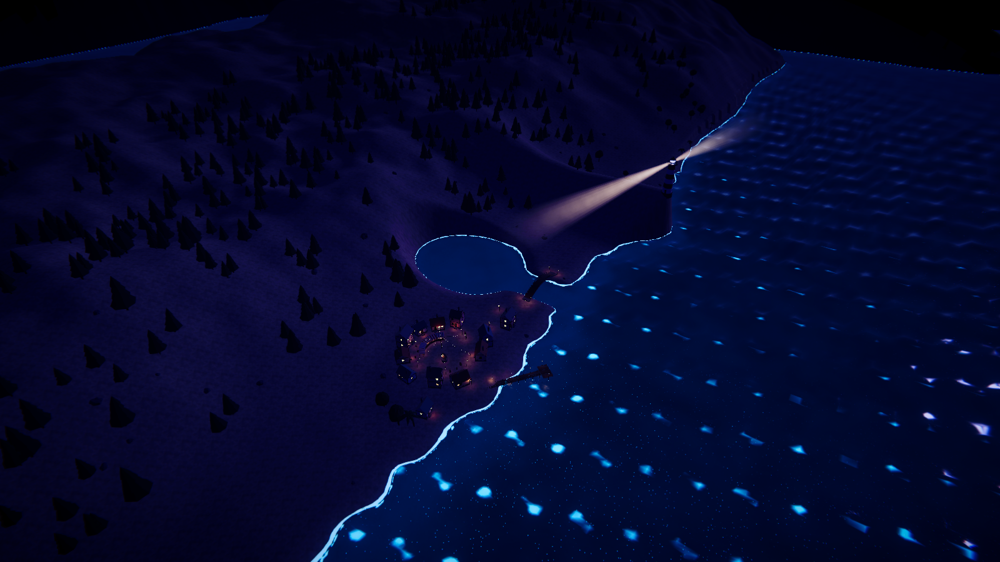

# Starlit Tides — Phase 2: The Environment

Goal for this phase: the complete night bay. That means the bioluminescent ocean, the procedural night sky, the village with houses, square, market stalls and lanterns, the pier, the arched bridge over the lagoon, grassland, forest, the lighthouse on its cliff, and three layers of mountains. It also covers fog, lighting and post-processing.

Everything in this folder has been **compiled and test-rendered in Unity 6000.5.10f1 with URP 17.5**, with no errors. The screenshots in [`Preview/`](Preview/) were rendered from exactly these files.

| | |
|---|---|
|  |  |
|  |  |

---

## 1. What's in this folder

```
Phase2/_StarlitTides/
├── Shaders/
│   ├── StarlitOcean.shader         ★ the hero: waves, depth colour, foam, bioluminescence
│   ├── StarlitNightSky.shader      skybox: stars, Milky Way, moon, aurora, storm, sunset
│   ├── StarlitLightBeam.shader     fake volumetric lighthouse beam / god rays
│   ├── StarlitGlowParticle.shader  additive glow for fireflies, plankton, sparkles
│   └── StarlitNoise.hlsl           shared noise functions
├── Scripts/Environment/            (runtime)
│   ├── OceanController.cs          tide, wave height for floating objects, glow points
│   ├── WaterDisturber.cs           makes plankton glow around boat/rocks/jellyfish
│   ├── SkyController.cs            moon, fog, ambient; storm/aurora/sunset/lightning
│   ├── LighthouseBeam.cs           sweeping beam (+ "is this point lit?" for Bonus 8)
│   ├── LanternFlicker.cs           candle flicker for lights and glow
│   ├── ReflectionProbeRefresher.cs keeps the sea's reflections up to date
│   └── ProcMesh.cs                 procedural houses, stalls, trees, rocks, lighthouse...
└── Scripts/Editor/
    ├── EnvironmentBuilder.cs       ★ menu: Starlit Tides > 4. Build Environment
    └── EnvironmentAssetOverrides.cs  optional: use downloaded models instead
```

---

## 2. Install (about 5 minutes)

1. **Close Unity** (or keep it open; Unity picks up new files either way).
2. In Finder, open `CG project/Phase2/_StarlitTides/` and **copy the `Shaders` and `Scripts` folders into** `StarlitTides/Assets/_StarlitTides/`. Let Finder **merge** them with the existing folders; don't replace them.
3. Back in Unity, wait for the import and compile spinner (bottom-right) to finish. The Console must show **no red errors**.
4. Check the URP settings from Phase 1 (the ocean needs them). Select `Settings/URP/URP_High` (and the other two):
   - **Rendering → Depth Texture ✔** and **Opaque Texture ✔**
   - **Quality → HDR ✔**
5. Open **`_StarlitTides/Scenes/StarlitBay`**.
6. Menu **Starlit Tides → 4. Build Environment → Build**. It takes about 20–40 seconds.
7. **File → Save** (Cmd+S).
8. Look through the **Game** view. In the **Scene** view, turn on the effects toggle → **Always Refresh** so the sea and sky animate while you work.

> **Rebuild any time.** Running the menu again deletes `== STARLIT ENVIRONMENT ==` and rebuilds it. Hand changes *inside* that object are lost, so put extra decoration **outside** it (for example in a `Decor` object). Generated meshes, textures, materials and terrain data are saved in `Assets/_StarlitTides/Generated/`. You can edit those materials freely, but a rebuild resets them too. To keep a tweak, copy the material, change the copy, and change its default values in `EnvironmentBuilder.cs`.

### What gets built (Hierarchy)

```
== STARLIT ENVIRONMENT ==
├── Controllers              SkyController + OceanController
├── Terrain                  800 × 800 m: sea floor, beach, plateau, lagoon basin, channel, cliff, hills
├── Ocean                    300 × 300 grid, 2.4 km to the horizon
├── Village
│   ├── House_1 … House_12   each with a Windows child (55% lit, 25% warm, 20% dark)
│   ├── Village Square       well, festoon-light pole, 6 lantern posts, 5 market stalls
│   └── lantern posts along the pier path and the bridge path
├── Pier                     25 m deck, posts into the sea floor, T-end, railing, lanterns
├── Bridge                   arched wood deck on a stone arch, railings, 4 lanterns
├── Lighthouse               striped tower, glass lamp room, rotating head with 2 beams
├── Forest                   ~650 trees (pines on hills, round trees, palms on the beach), boulders
├── Mountains                3 ridges at 640 / 900 / 1250 m + a western range
├── Ambient VFX              3 firefly swarms, plankton motes drifting on the tide
└── Ocean Reflection Probe
```

It also sets up the **Moonlight**, the **skybox**, a **Global Volume** with the post-processing profile `Generated/Settings/PP_StarlitNight`, and the **Main Camera** (HDR, post-processing on, SMAA, far clip 3000 m).

---

## 3. Two design decisions (worth explaining in your presentation)

### a) The ocean and sky are hand-written HLSL, not Shader Graph

Your brief says "Shader Graph" for the water. I wrote the ocean and sky as **URP HLSL shaders** instead, for three reasons:

1. **It needs things Shader Graph can't do cleanly:** an array of 32 "disturbance points" (the glow around the boat, rocks and jellyfish), a loop over the village's lantern lights for reflections, and a ray-marched aurora.
2. **The gameplay needs the exact same maths on the CPU.** `OceanController.GetWaterHeight()` copies the shader's Gerstner wave formula line for line, so the boat and obstacles bob *exactly* on the waves you see. With a graph, the two copies would slowly drift apart.
3. **For a Computer Graphics course, hand-written shader code shows more understanding.** Every step is commented and explained below. That's material for your report.

You still use Shader Graph in this course: section 6 below builds the **wind-sway foliage shader** in Shader Graph node by node, and Phase 3–4 add more graphs (orb glow, jellyfish pulse). **If your lecturer requires the ocean itself in Shader Graph, tell me** and I'll write a node-by-node Shader Graph version (with fewer features).

### b) Dynamic lighting instead of baked lightmaps

The brief mentions baked lights and light probes. Starlit Tides changes its sky **during play**: sunset → night in the intro, storms, lightning and aurora. Baked lightmaps freeze the lighting at bake time, so a lightning flash or a storm darkening wouldn't reach any baked surface. So:

- **Moonlight, ambient light and fog are realtime.** `SkyController` blends them between Night / Storm / Sunset presets.
- **All ~45 lantern and window lights are realtime point lights.** **Forward+** (Phase 1) makes that cheap, because it has no 8-lights-per-object limit.
- **Emissive materials** (windows, lamp glass, bulbs) plus **Bloom** make things *look* like they cast light.
- **The reflection probe** is realtime but rendered only when needed (`ReflectionProbeRefresher`), not every frame.

The result is fully dynamic weather, no bake times, and no lightmap memory.

---

## 4. How the shaders work (for your report)

### 4.1 Ocean: `StarlitOcean.shader`

**Vertex stage: the shape of the waves**

1. **World position.** Each vertex of the ocean grid is moved to world space.
2. **The tide.** We sample the waves at `position + (0, 0, _TideOffset)`. `_TideOffset` grows every frame (tide speed × time), so the whole wave pattern *flows toward the camera*. The boat seems to move forward while it actually stays near the origin.
3. **Four Gerstner waves.** Each wave has a direction, steepness and wavelength. A Gerstner wave moves points in *circles*, not just up and down. Points bunch together at the crests (sharp peaks) and spread out in the troughs (flat valleys), which is how real water looks.
   - `k = 2π / wavelength`, `speed c = √(9.8 / k)` (real deep-water physics)
   - `f = k · (dir · p − c · t)`, `amplitude a = steepness / k`
   - `offset = (dir.x · a · cos f,  a · sin f,  dir.z · a · cos f)`
4. **Exact normals.** While summing the waves we also sum their tangent and binormal derivatives. `normal = cross(binormal, tangent)`, so there's no extra texture lookup.
5. **Amplitude control.** Waves fade out far away (no flicker at the horizon) and inside the **calm lagoon** ellipse, and they're multiplied by `_WaveScale`, which the weather raises during storms.

**Fragment stage: the colour of each pixel**

6. **Ripples.** A procedural noise height field scrolls in two directions. Its slope (finite differences) tilts the normal, adding small sparkling ripples without any textures.
7. **Water depth.** We read the **camera depth texture** behind the water and subtract the water's own depth. That gives how many metres of water we're looking through.
8. **Refraction.** The **opaque texture** (the scene rendered before the water) is sampled with a UV offset by the normal, so the sea floor near the shore wobbles. If the offset would show something *in front* of the water, we cancel it.
9. **Absorption (Beer–Lambert).** `exp(−depth × absorption)`, with red absorbed fastest, so shallow water is clear teal and deep water turns navy.
10. **Fresnel reflection.** Looking straight down you see *into* the water; at grazing angles you see the *sky*. `F = 0.02 + 0.98·(1−N·V)^5` blends refraction and the reflection probe (stars, moon, village lights).
11. **Moonlight.** A sharp Blinn-Phong glint plus a "moon path" of glittering cells toward the moon.
12. **Lantern reflections.** We loop over URP's additional lights (Forward+ cluster loop) and add a specular streak per lantern.
13. **Foam.**
    - **Shore foam:** where the water is shallower than `_FoamDistance`, animated sine bands roll toward the beach, broken up by noise.
    - **Crest foam:** on the highest parts of the waves.
14. **Bioluminescence (the neon glow).** The sum of:
    - faint **ambient plankton** in drifting patches
    - **wave crests** glowing in "bloom patches"
    - **breaking surf** along every beach
    - **twinkling plankton sparkles** (one random blinking dot per grid cell)
    - **disturbance glow:** for each of up to 32 points from `OceanController` (boat, obstacles, wake ripples), a bright core plus an expanding ring
    - **Starburst:** `_SeaGlowBoost` lights up the entire sea (Extra Feature 3)

    These values are HDR (greater than 1), so **Bloom** makes them glow.
15. **Fog.** URP fog so the far sea melts into the horizon.

### 4.2 Night sky: `StarlitNightSky.shader`

The skybox is drawn on a cube around the camera. The **view direction** of each pixel is all we need:

- **Gradient:** zenith navy → purple → a thin teal glow at the horizon.
- **Stars:** the sky sphere is split into a 3D grid of cells. Each cell randomly gets one star (hash function), with a random colour and brightness, twinkling with `sin(time)`. There are three layers: dim and dense, bright and sparse, and extra-dense inside the Milky Way.
- **Milky Way:** a Gaussian band around a tilted great circle (`dot(dir, galaxyNormal) ≈ 0`), shaped by 3D noise, with dark dust lanes and a warm core.
- **Moon:** a disc of angular radius `_MoonSize` around `_MoonDirection` (taken from the Moonlight's rotation), with darker "seas", craters, limb darkening and a two-part halo.
- **Aurora (Feature 4):** 20 horizontal slices are stacked. In each one a wavy ribbon is projected onto a plane higher than the last, so together they form glowing *vertical curtains* with streaky rays, green at the bottom and violet at the top.
- **Storm (Feature 4):** projected noise clouds hide the stars, lit from inside by `_LightningFlash`.
- **Sunset (Feature 6):** an orange → pink → blue dusk gradient with a sun disc, blended out as night falls.
- **Horizon fog blend:** near the horizon the sky fades to the *scene fog colour*, so the mountains melt into the sky with no visible seam.

### 4.3 Lighthouse beam: `StarlitLightBeam.shader`

URP has no volumetric lights, so we fake them with an **open cone mesh** and **additive blending**:
- `(1 − uv.y)^falloff`: bright at the lamp, fading along the beam
- `|N·V|^softness`: the cone's edges (seen side-on) fade out, so you never see a hard cone outline
- **depth fade:** soft where the beam touches the cliff or sea
- **scrolling 3D noise:** drifting mist inside the beam
- **fog intensity:** fades to black in fog, which is correct for additive light

---

## 5. Tweak it in the Inspector (no code)

| To change… | Select… | Field |
|---|---|---|
| Sea glow colour | `Generated/Materials/M_Ocean` | **Bioluminescence Colour** (HDR) |
| More / fewer sparkles | `M_Ocean` | **Plankton Sparkle Density / Intensity** |
| Bigger waves | `M_Ocean` | **Wave A–D** (z = steepness, w = wavelength). Keep the steepness values summing to below about 0.6. |
| Wider shore foam | `M_Ocean` | **Shore Foam Distance** |
| Tide speed | `Controllers → OceanController` | **Tide Speed** |
| Test storm / aurora / sunset | `Controllers → SkyController` | the **Storm / Aurora / Sunset** sliders (try them in Play mode!) |
| Moon size / brightness | `M_NightSky` | **Moon Size / Moon Colour** |
| Milky Way angle | `M_NightSky` | **Galaxy Plane Normal** |
| Fog / ambient | `SkyController` | the **Night** preset |
| Overall look | `Global Volume (Starlit Night)` | Bloom, Color Adjustments, Split Toning… |
| Lighthouse speed | `Lighthouse → Lamp Head` | **LighthouseBeam → Rotation Speed** |
| Lantern brightness | any `Lantern Post → Point Light` | Intensity / Range |

**Using downloaded models (optional):** **Assets → Create → Starlit Tides → Environment Asset Overrides**, then drag tree, palm, rock and boat prefabs (for example from the Quaternius Stylized Nature MegaKit or the Kenney Watercraft Kit) into the lists and rebuild. Empty lists keep the procedural models. Kenney and Quaternius FBX files import with URP-compatible materials. For Asset Store packs made for the Built-in pipeline, run **Window → Rendering → Render Pipeline Converter → Material Upgrade** first.

---

## 6. Shader Graph lesson: wind-swaying foliage (`SG_FoliageWind`)

The trees are static meshes. This graph makes their leaves sway in the wind on the GPU: the tops move, the trunks stay planted, and every tree moves slightly differently.

**Create it:** `_StarlitTides/Shaders` → right-click → **Create → Shader Graph → URP → Lit Shader Graph** → name it `SG_FoliageWind` → double-click to open.

### Blackboard properties (the **+** button on the Blackboard)

| Name | Type | Default |
|---|---|---|
| `BaseColor` | Color | (0.07, 0.19, 0.15) |
| `BaseMap` | Texture2D | white |
| `WindStrength` | Float | 0.12 |
| `WindSpeed` | Float | 1.3 |
| `HeightInfluence` | Float | 0.12 |
| `GustScale` | Float | 0.05 |
| `RimColor` | Color (**HDR**) | (0.25, 0.35, 0.7) |

### Vertex stage (top of the Master Stack)

| # | Node (right-click → Create Node) | Settings / inputs | Purpose |
|---|---|---|---|
| 1 | **Position** | Space = **Object** | the vertex in the tree's own space |
| 2 | **Split** | In ← (1) | take **G** = height above the tree's base |
| 3 | **Multiply** | A ← (2).G, B ← `HeightInfluence` | 0 at the roots, larger higher up |
| 4 | **Saturate** → **Power** | Power B = 2 | the top bends much more than the middle (quadratic) |
| 5 | **Object** node → **Split** its *Position* | | the tree's world position |
| 6 | **Add** (5).R + (5).B → **Multiply** by 0.37 | | a per-tree **phase**, so trees don't sway in sync |
| 7 | **Time** → **Multiply** by `WindSpeed` → **Add** (6) → **Sine** | | main sway, −1..1 |
| 8 | **Time** → **Multiply** by `WindSpeed`×2.3 (Multiply twice) → **Add** (6)×1.7 → **Sine** → **Multiply** 0.35 | | a faster secondary flutter |
| 9 | **Add** (7) + (8) | | combined sway |
| 10 | **Position** (Space = **World**) → **Swizzle** "xz" → **Multiply** by `GustScale` → **Add** (Time × 0.1) → **Gradient Noise** (Scale 1) | | slow wind gusts rolling across the forest |
| 11 | **Remap** (10): In Min Max (0, 1) → Out Min Max (0.4, 1.3) | | gusts never fully stop the sway |
| 12 | **Multiply** (9) × (11) × `WindStrength` × (4) | | final sway amount for this vertex |
| 13 | **Transform**: From **World** To **Object**, Type **Direction**, In = Vector3 (1, 0, 0.5) | | wind direction expressed in the tree's own space |
| 14 | **Multiply** (13) × (12) | | the offset vector |
| 15 | **Add** (1) + (14) → **Vertex › Position** | | moved vertex |

### Fragment stage

| # | Node | Connect to |
|---|---|---|
| 16 | **Sample Texture 2D** (Texture ← `BaseMap`) → **Multiply** by `BaseColor` | **Base Color** |
| 17 | **Fresnel Effect** (Power 4) → **Multiply** by `RimColor` → **Multiply** 0.4 | **Emission**: a soft moonlit rim on the silhouettes, which looks great at night |
| 18 | Float 0.1 | **Smoothness** |

Graph Inspector (gear tab): **Allow Material Override ✔** and **GPU Instancing ✔** (we have about 650 trees).

**Save Asset** (top-left), then use it: select `Generated/Materials/M_PineLeaves`, `M_RoundLeaves` and `M_PalmLeaves` → **Shader** dropdown → **Shader Graphs/SG_FoliageWind** → set **BaseColor** to their old colours. Press Play to see the forest sway.

> Imported trees (Quaternius) work the same way: put `SG_FoliageWind` on their *leaf* material only. Their trunks should stay on a normal Lit material.

---

## 7. Tips to make it look even more beautiful

- **Composition:** the default camera puts the glowing village on the left third, the lighthouse near the centre and the moon on the right third, with the moon path leading to the viewer. Keep that "rule of thirds" for your menu orbit and screenshots.
- **Less is more with glow.** If everything glows, nothing does. Keep the sea mostly dark navy and let the *disturbances* (boat wake, obstacles) and the *surf* carry the neon. The defaults follow this.
- **Warm against cool.** Gold lanterns against a cyan sea and a purple sky is the core palette. Avoid adding green or red lights in the village.
- **Bloom threshold 0.85** means only HDR things glow. When you add new glowing materials, give them emission **above 1** (the HDR colour picker's *Intensity* slider).
- **Try the weather sliders in Play mode:** SkyController → **Aurora = 1** looks spectacular, and **Storm = 0.8** with OceanController → **Wave Scale = 1.8** gives a stormy sea.
- **Hide the edges:** the terrain ends 300 m to the right of the play lane and the ocean reaches 2.4 km. If you fly the Scene camera very far, you'll see the edges, but the gameplay camera never does.
- **Performance:** if you drop below 60 FPS, first lower **Ocean Reflection Probe → Resolution** to 128, then **Terrain → Detail Distance** to 70, then switch to the Medium quality level. Phase 6 adds a proper optimisation pass.

---

## ✅ Phase 2 checklist

- [ ] Shaders and Scripts copied into `Assets/_StarlitTides/` with no Console errors
- [ ] URP assets: Depth Texture, Opaque Texture and HDR on
- [ ] `StarlitBay` opened → **Starlit Tides → 4. Build Environment** → scene saved
- [ ] Game view shows the night bay (compare with `Preview/preview_main.png`)
- [ ] Played with the SkyController sliders (storm / aurora / sunset)
- [ ] `SG_FoliageWind` Shader Graph built and applied to the leaf materials
- [ ] (Optional) Environment Asset Overrides with downloaded tree prefabs

When you're done, tell me and we'll start **Phase 3: core gameplay**: the glowing paper boat (procedural mesh plus a floating script that uses `GetWaterHeight`), the Input System controls, the Cinemachine follow camera, the light meter, orbs, obstacles (rocks, logs, jellyfish), object pooling and difficulty scaling.
