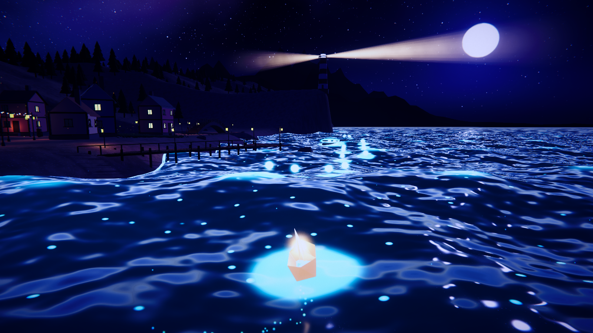
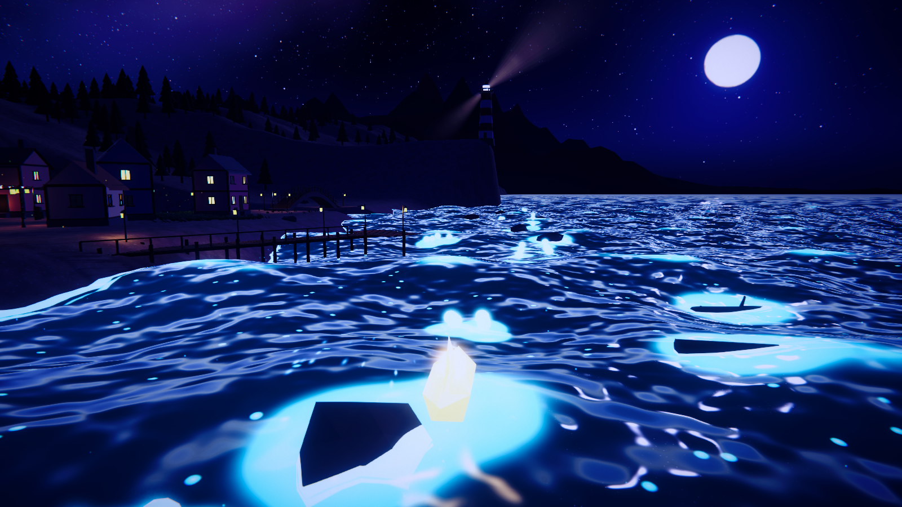

# Starlit Tides — Phase 3: Core Gameplay

Goal for this phase: a fully playable game loop. You steer a glowing paper boat, collect plankton orbs to keep its light alive, and dodge rocks, drifting logs and pulsing jellyfish. Each crash costs light. The game gets faster and denser over time, and when the light runs out, darkness swallows the boat.

Everything here was **compiled, built and play-tested in Unity 6000.5.10f1 (URP 17.5, Cinemachine 3.1.8)**. A test bot played the game in Play mode for 45 seconds per run, steering toward orbs and dashing, with no errors. In the final run it collected 47 orbs and recovered from several crashes. An earlier run (bot not steering) checked the full game-over flow. The screenshots below are from those runs.

| | |
|---|---|
|  |  |

---

## ⚠️ First: check your Cinemachine version

While testing I found that **Cinemachine 3.1.2, which the Phase 1 setup script pinned, does not compile on Unity 6000.5** (`error CS0619 … GetInstanceID` in `CinemachineStoryboard.cs`). I've updated the Phase 1 script and guide to **3.1.8**.

**Window → Package Manager → Cinemachine.** If it shows 3.1.2, open the **Version History** tab and **update to 3.1.8**. If your Console showed red errors from `com.unity.cinemachine` after Phase 1, this is why.

---

## 1. What's in this folder

```
Phase3/_StarlitTides/
├── Shaders/
│   ├── StarlitJellyfish.shader     NEW  pulsing, glowing jellyfish (vertex animation)
│   └── StarlitOcean.shader         UPDATED  overlapping glow no longer blows out
├── Scripts/Core/
│   ├── StarlitInput.cs             new Input System: keyboard + gamepad
│   ├── GameManager.cs              state machine: Menu / Intro / Playing / Paused / GameOver
│   ├── DifficultyManager.cs        speed, density and drain rise over time
│   ├── ScoreManager.cs             distance + orbs x multipliers
│   ├── PoolManager.cs + PooledObject.cs   object pooling
├── Scripts/Gameplay/
│   ├── BoatController.cs           steering, dash, floating on the real waves, banking
│   ├── LightMeter.cs               the fading light (drives light radius + glow)
│   ├── DriftingObject.cs           base: drift with the tide, float, despawn
│   ├── Orb.cs / OrbSpawner.cs      plankton orbs in patterns
│   ├── Obstacle.cs / Jellyfish.cs / ObstacleSpawner.cs
│   ├── BoatWake.cs                 glowing wake that streams away on the tide
│   ├── VfxLibrary.cs, PooledParticle.cs, FaceCamera.cs
├── Scripts/CameraFX/HitFeedback.cs  shake + flash + hit-stop
├── Scripts/UI/DebugHUD.cs           temporary HUD (replaced in Phase 6)
├── Scripts/Environment/WaterDisturber.cs   UPDATED  caps ripple rate during dashes
└── Scripts/Editor/GameplayBuilder.cs        menu: Starlit Tides > 5. Build Gameplay
```

---

## 2. Install (about 5 minutes)

1. Copy `Phase3/_StarlitTides/Shaders` and `Scripts` into `StarlitTides/Assets/_StarlitTides/`. Let Finder **merge** the folders, and choose **Replace** for the two updated files (`StarlitOcean.shader`, `WaterDisturber.cs`).
2. Wait for Unity to compile. The Console must show **no red errors**.
3. Open `Scenes/StarlitBay` (with the Phase 2 environment already built).
4. **Starlit Tides → 5. Build Gameplay → Build.**
5. **Cmd+S**, then press **▶ Play**.

### Controls

| Action | Keyboard | Gamepad |
|---|---|---|
| Steer | **WASD** or **Arrow keys** | Left stick / D-pad |
| Dash (short burst, brief invincibility) | **Space** | A / Cross |
| Pause / resume | **Esc** | Start |
| Retry after game over | **R** | Y / Triangle |

### What the builder creates

**Prefabs** (in `Prefabs/Gameplay` and `Prefabs/VFX`; edit them freely):
`PaperBoat`, `Orb`, `Rock_1-3`, `Log`, `Jellyfish`, `VFX_OrbBurst`, `VFX_Splash`, `VFX_DashBurst`

**Scene** (`== STARLIT GAMEPLAY ==`):
```
Managers         StarlitInput, GameManager, DifficultyManager, ScoreManager, VfxLibrary, DebugHUD
 └ Hit Feedback  CinemachineImpulseSource + HitFeedback
Spawners         OrbSpawner, ObstacleSpawner
PaperBoat        BoatController, LightMeter, WaterDisturber, Wake particles, light
CM Gameplay Camera   CinemachineCamera + Follow + Rotation Composer + Impulse Listener
Hit Flash Volume     post-processing used for the crash flash
```
The Main Camera gets a **CinemachineBrain**.

---

## 3. How it works

### The game loop

```
           ┌──────── DifficultyManager (Level 0 → 1 over 4 minutes) ────────┐
           │ tide speed ↑      drain rate ↑      spawn rates ↑              │
           ▼                                                                ▼
   OceanController.tideSpeed ──► everything drifts toward the camera   Spawners
           │                                                                │
   ScoreManager: +1 point per metre                       orbs / rocks / logs / jellyfish
                                                          (pooled, spawned at Z ≈ 110 m)
   BoatController ◄── StarlitInput (WASD / stick / Space)
     │  trigger collider touches…
     ├── Orb      → LightMeter.Add(+12%)  ScoreManager.AddOrb  burst + ripple
     └── Obstacle → LightMeter.Damage(-25%)  shake + flash + hit-stop + splash
   LightMeter drains every second ── reaches 0 ──► GameManager.GameOver
                                                     boat sinks, darkness, "press R"
```

### Key ideas (good material for your report)

- **Fixed lane, moving world** (the Phase 1 decision in action). The boat never leaves the area around the origin. `DriftingObject` moves every orb and obstacle toward −Z at the tide speed, and the ocean shader scrolls its waves at the same speed, so the world flows past.
- **Floating on real waves.** `BoatController`, orbs and obstacles call `OceanController.GetWaterHeight()`, which is the same Gerstner formula as the shader, so they ride the visible waves. The boat also tilts to the wave's normal and banks into turns.
- **Frame-rate independent steering.** `velocity = Lerp(velocity, target, 1 − e^(−acceleration·dt))` feels identical at 30, 60 or 144 FPS.
- **Extra Feature 1 groundwork: the light is physical.** `LightMeter` drives the boat's point-light range (3 m → 14 m), its intensity, the paper's emissive glow and the plankton glow under the boat. As your light dies, you literally see less of the sea. Below 25% it flickers as a warning. Phase 4 adds darkness closing in on the screen.
- **Readable obstacles at night.** Each rock, log and jellyfish has a `WaterDisturber`, so the plankton glows in a ring around it. Dark obstacles are outlined by light, which is both pretty and fair.
- **Object pooling.** `PoolManager` re-uses switched-off objects instead of `Instantiate`/`Destroy`. After the first seconds the game allocates nothing new, which means no garbage-collector stutter. Prefabs are pre-warmed at start.
- **Fair spawning.** `ObstacleSpawner.IsFair()` rejects positions that overlap other obstacles or that would close every gap in a "row" of the lane. There's always a way through at least 3.2 m wide. `OrbSpawner` never puts orbs on top of obstacles and lays them out in lines, arcs, zigzags and clusters that you can "draw" a path through.
- **Game juice on crashes** (`HitFeedback`), all in the same frame:
  - **Cinemachine Impulse** screen shake
  - a second **post-processing Volume** (chromatic aberration, desaturation, dark vignette, lens distortion) flashed to full weight and faded out
  - 60 ms of **hit-stop** (time almost freezes)
  - a **splash** and a glowing **ripple**
  - 1 second of blinking invulnerability

  The dash gets a lighter version.
- **The jellyfish shader** (`StarlitJellyfish.shader`, additive glow):
  - in the vertex shader, the bell pulses (wider and flatter, then relaxes), with the strongest motion at the rim
  - the tentacles sway in travelling sine waves that grow toward the tips
  - each jellyfish gets its own phase from a hash of its world position
  - in the fragment shader, a Fresnel rim glow, radial veins, and brightness that rises on every pulse

### Difficulty curve (defaults)

| | Start | After 4 min |
|---|---|---|
| Tide (world) speed | 7 m/s | 16 m/s |
| Light drain | 3.5% / s | 7.5% / s |
| Time between obstacles | 1.7 s | 0.5 s |
| Time between orb groups | 2.4 s | 1.6 s |
| Jellyfish chance | 10% | 40% |
| Log chance | 15% | 35% |

The ramp follows an **AnimationCurve** (Managers → DifficultyManager → *Ramp Curve*): gentle for the first minute, then steeper. Drag its keys to reshape it. The first 2.5 seconds of every run are a **grace period** with no drain and no obstacles.

---

## 4. Tuning without code

| To change… | Select… | Field |
|---|---|---|
| Boat speed / handling | `PaperBoat` prefab → BoatController | Lateral / Forward Speed, Acceleration |
| Dash | same | Dash Speed / Duration / Cooldown |
| How much an orb heals | `Orb` prefab → Orb | Light Value (0.12 = 12%) |
| How much a crash hurts | `Rock_x` / `Log` / `Jellyfish` → Obstacle | Light Damage |
| How far the boat's light reaches | `PaperBoat` → LightMeter | Light Range (empty → full) |
| Game length / pace | Managers → DifficultyManager | Ramp Duration, the start → max ranges |
| Shake strength | Managers → Hit Feedback | Hit / Dash Shake Force |
| Camera position | CM Gameplay Camera → CinemachineFollow | Follow Offset (2, 5.2, −11) |
| Where the camera looks | PaperBoat → Camera Look Target | its local position |

> Prefab changes survive a rebuild only if you don't run **5. Build Gameplay** again, because it regenerates the prefabs. Once you like the setup, stop running the builder and edit the prefabs directly.

---

## 5. Shader Graph lesson: the plankton orb (`SG_OrbGlow`)

Right now orbs use a simple emissive Lit material. This graph makes them look like living balls of light: a swirling bright core, a glowing rim and a heartbeat pulse.

**Create:** `_StarlitTides/Shaders` → right-click → **Create → Shader Graph → URP → Unlit Shader Graph** → name it exactly **`SG_OrbGlow`**.

In the **Graph Inspector → Graph Settings**: Surface Type **Opaque**, **Cast Shadows ✘**.

### Blackboard properties

| Name | Reference | Type | Default |
|---|---|---|---|
| CoreColor | `_CoreColor` | Color (**HDR**) | (0.4, 2.6, 3.2), intensity about +1 |
| RimColor | `_RimColor` | Color (**HDR**) | (1.5, 3.5, 4.5) |
| PulseSpeed | `_PulseSpeed` | Float | 4 |
| SwirlScale | `_SwirlScale` | Float | 5 |
| SwirlSpeed | `_SwirlSpeed` | Float | 0.6 |

### Fragment nodes

| # | Node | Inputs / settings | What it does |
|---|---|---|---|
| 1 | **Fresnel Effect** | Power = 2.5 (Normal and View Dir default to world space) | 0 facing you, 1 at the edges: the **rim** |
| 2 | **Multiply** | (1) × `RimColor` | glowing rim colour |
| 3 | **Position** (Space **Object**) → **Swizzle** "xy" | | a 2D coordinate across the orb |
| 4 | **Time** → **Multiply** by `SwirlSpeed` | | scroll amount |
| 5 | **Add** (3) + (4) → **Gradient Noise** (Scale = `SwirlScale`) | | moving plankton swirl |
| 6 | **Power** (5), B = 3 | | sharpens the swirl into bright strands |
| 7 | **Lerp**: A = `CoreColor` × 0.3, B = `CoreColor` × 1.6, T = (6) | | dark spaces and bright strands inside the core |
| 8 | **Time** → **Multiply** by `PulseSpeed` → **Sine** → **Remap** (−1, 1 → 0.75, 1.25) | | heartbeat pulse |
| 9 | **Add** (7) + (2) → **Multiply** by (8) | | final light |
| 10 | (9) → **Base Color** of the Unlit Master Stack | | HDR values > 1 trigger Bloom |

**Save Asset**, then either:
- run **Starlit Tides → 5. Build Gameplay** again (the builder automatically uses `SG_OrbGlow` when it exists), or
- select `Generated/Gameplay/M_Orb` → **Shader → Shader Graphs/SG_OrbGlow**.

> Explain it in your report as "**Fresnel rim + animated gradient-noise core + sine pulse**". That covers three classic real-time graphics techniques in one small shader.

---

## 6. Tips to make it feel even better

- **Play with sound off first.** If crashes feel strong with no audio, the visual juice works. Audio comes in Phase 6.
- **The light radius is the difficulty you can see.** Low light means you see obstacles later. Play a run where you deliberately skip orbs to feel it.
- **The camera looks ahead and to the left** (Camera Look Target), so the village, pier and lighthouse are always in shot. That's your course requirement on screen the whole time, not just in a menu.
- **Keep obstacles dark.** Their silhouettes against the glowing sea are what makes them readable. Don't add emission to rocks or logs.
- **Gamepad:** the stick gives analogue steering (half-tilt = half speed), which feels great with this boat.

---

## ✅ Phase 3 checklist

- [ ] Cinemachine is 3.1.8 (not 3.1.2)
- [ ] Phase 3 files copied (merge; replace the two updated files), no Console errors
- [ ] **Starlit Tides → 5. Build Gameplay** run in `StarlitBay`, scene saved
- [ ] You can steer, dash, collect orbs, crash, pause, lose and retry
- [ ] `SG_OrbGlow` Shader Graph built and used by the orbs
- [ ] (Optional) tuned speed, damage and difficulty to your taste

When you're done, tell me and we'll start **Phase 4: Extra Features 1–6**: Dynamic Light Meter vision, the Combo System and growing light trail, the Golden Shooting Star "Starburst", Dynamic Weather (storm → aurora), Near-Miss slow motion, and the Day-to-Night intro cinematic with Timeline.
