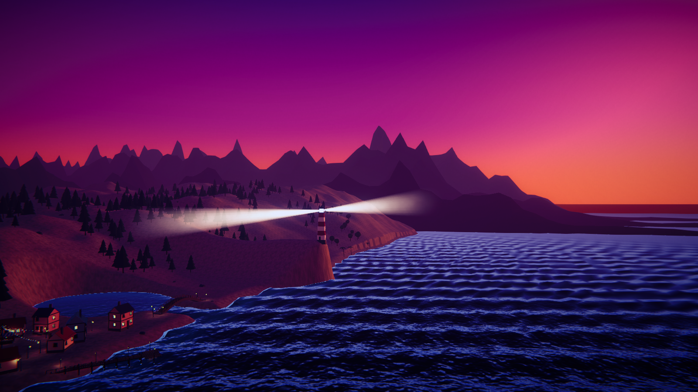
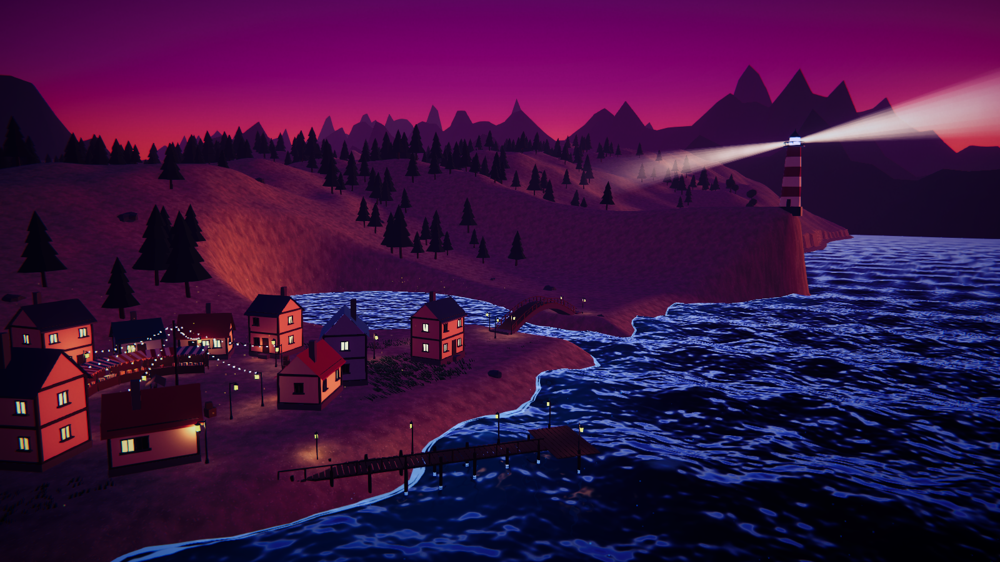
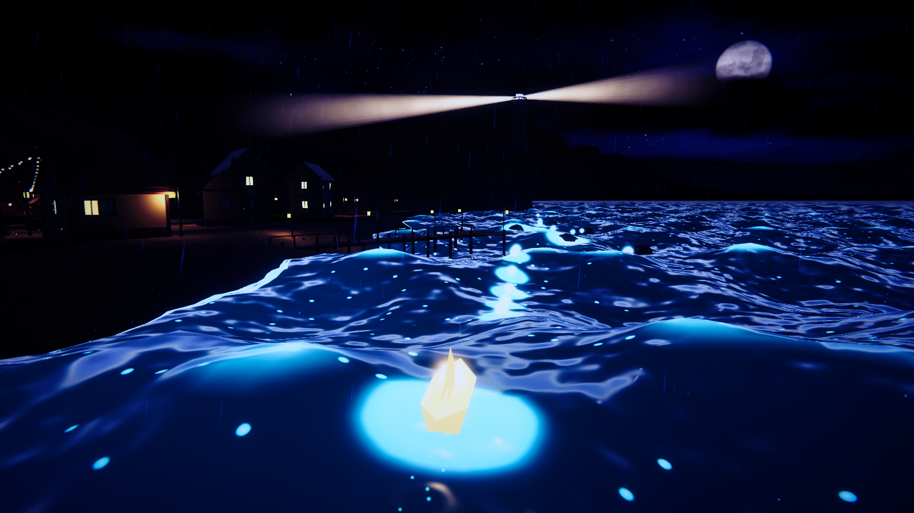
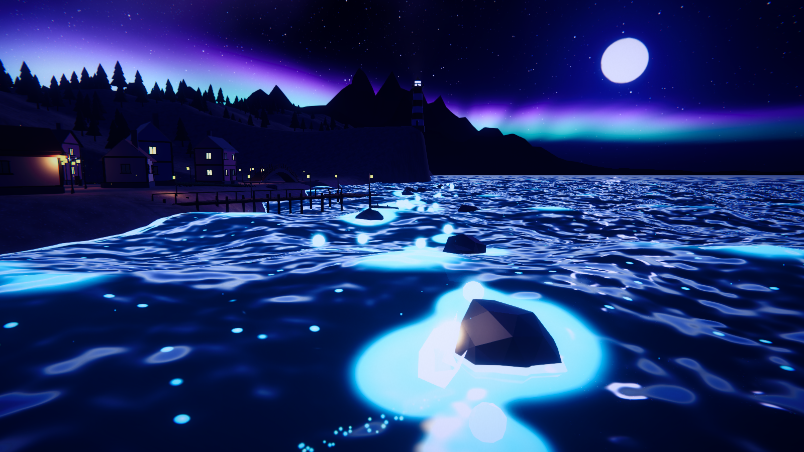
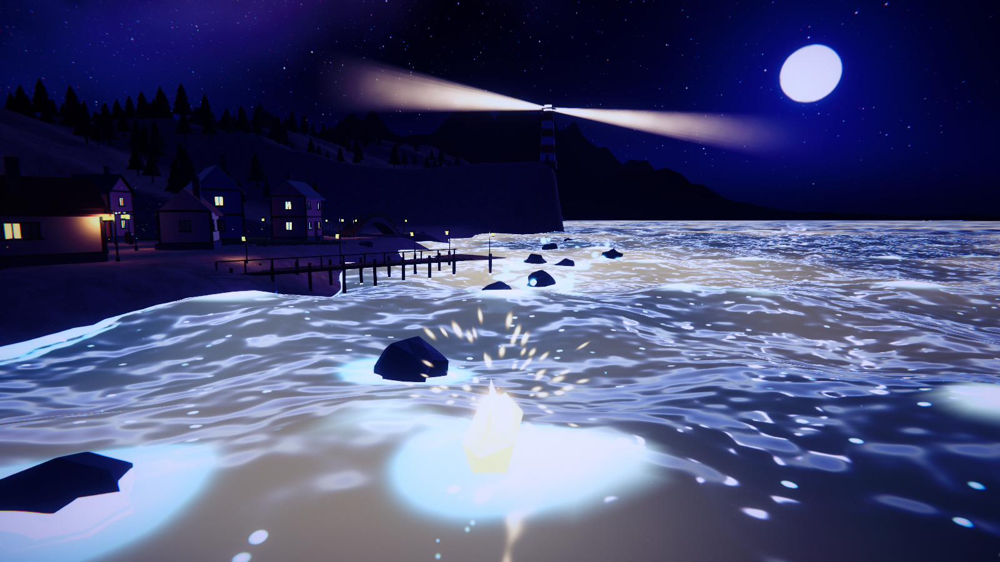
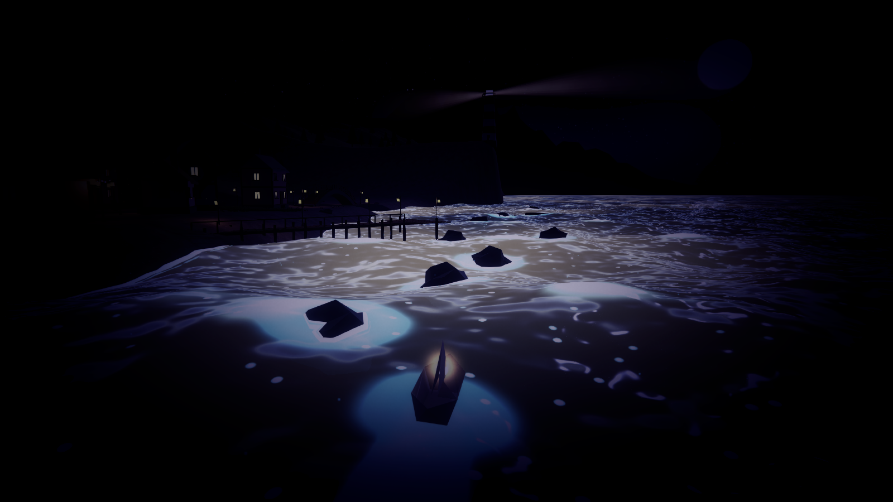

# Starlit Tides — Phase 4: Extra Features 1–6

The six numbered extra features for the course. Each one has its own script with a header comment naming the feature, so they're easy to point at in your demo.

Everything was **compiled, built and play-tested in Unity 6000.5.10f1**. A test bot played through the intro and about 80 seconds of gameplay. Every feature fired: the intro ran and started the run, Starburst triggered twice, combos reached 33, near misses were awarded, and the weather went Calm → Storm → Aurora. All screenshots below come from those runs.

| | |
|---|---|
|  **6. Intro:** sunset over the mountains |  **6. Intro:** the village at dusk |
|  **4. Storm:** clouds, rain, rough sea |  **4. Aurora night** |
|  **3. Starburst:** the sea turns gold |  **1. Light at 15%:** darkness closes in |

---

## 1. Install (2 minutes)

The files are **already copied into your project** (`StarlitTides/Assets/_StarlitTides`). This `Phase4/` folder keeps a copy for the guide and for GitHub.

1. Click into the Unity window and wait for it to finish compiling. The Console must show **no red errors**.
2. Make sure **StarlitBay** is the open scene.
3. **Starlit Tides → 6. Build Features → Build**
4. **Cmd+S** to save the scene.
5. Press **▶ Play**. The intro plays first (**Space / Enter** skips it), then the run starts.

**Updated files** (already replaced in your project): `StarlitInput.cs` (Skip action), `GameManager.cs` (Resume always restores normal speed), `Orb.cs` (`Collect` is now `virtual`), `OceanController.cs` + `StarlitOcean.shader` (night glow and a softer, golden Starburst), and `DebugHUD.cs` (shows the new features).

**New:** `Scripts/Features/` (9 scripts) and `Scripts/Editor/FeaturesBuilder.cs`.

---

## 2. The six features

### Feature 1 — Dynamic Light Meter (`LightVision.cs` + Phase 3's `LightMeter.cs`)
Your light physically shrinks. The boat's point-light range drops from 14 m to 3 m, and the paper and the water around the boat dim. Below 50% light, a **darkness post-processing Volume** (heavy black vignette, −1.3 exposure, desaturation) fades in, so the world closes around you. Near empty it pulses like a dying flame. Collecting orbs pushes it back.
*Graphics idea:* gameplay state driving rendering. A Volume's `weight` is blended from the meter every frame.

### Feature 2 — Combo System (`ComboSystem.cs`)
- Each orb collected within **2.6 s** of the previous one adds to the combo.
- **Every 5** in a row adds **×0.5** to the score multiplier, up to **×6**.
- The boat's **wake grows longer and brighter**: `BoatWake.comboBoost` raises the particle count, lifetime and size, and the water trail glows stronger and lasts longer.
- A crash, or waiting too long, ends the combo.

### Feature 3 — Golden Shooting Star → "Starburst" (`PowerUpManager.cs`, `ShootingStar.cs`, `StarPickup.cs`)
- White shooting stars cross the sky every 6–14 s just for atmosphere.
- Every **40–70 s** (first one after 25 s) a **golden** star falls toward the far end of the lane. Its **reflection** then drifts toward you on the water.
- Catch it and **Starburst** starts for **5 s**: the whole sea shimmers gold (`OceanController.seaGlowBoost`, used by the ocean shader) and **every point is doubled**.

### Feature 4 — Dynamic Weather (`WeatherManager.cs`)

| Score | Weather | What changes |
|---|---|---|
| 0 – 2,999 | **Calm night** | default |
| 3,000 – 7,499 | **Storm** | storm clouds hide the stars, fog thickens, waves ×1.7, rain (follows the camera), lightning every 3–8 s, and every raindrop sparks the plankton |
| 7,500+ | **Aurora night** | the storm clears, aurora curtains fill the sky |

Transitions blend over 8 seconds. When a transition finishes, the sea's reflection probe is re-rendered so the reflections match the new sky.
*Tip for your demo:* select **Weather (Feature 4)** in Play mode and tick **Force Weather** to switch weather instantly.

### Feature 5 — Near-Miss Bonus (`NearMissDetector.cs`)
Pass within **1.6 m** of an obstacle's edge without touching it and you get:
- **+150 × combo** points
- a **slow-motion** moment (eases down to 35% speed and back, about 0.6 s)
- a burst of cyan sparkles

Every obstacle records its closest approach to the boat, and the check happens once it's behind you. Dashing *through* an obstacle (while invulnerable) doesn't count. Slow motion has a 2-second cooldown, so it never gets annoying.

### Feature 6 — Day-to-Night Intro Cinematic (`IntroCinematic.cs`, `Timeline/IntroTimeline.playable`)
A real **Timeline** asset (open it in **Window → Sequencing → Timeline** with the *Intro Cinematic* object selected). It has two tracks:
- **Cinemachine track:** 5 shots (sunset over the mountains → village → bridge and lagoon → forest and lighthouse → the sea awakens). Clips overlap by 1 s, so Cinemachine blends smoothly between them. Each camera also drifts slowly (`CameraDrift`), like a dolly move.
- **Animation track:** animates `SkyController.sunset` from 1 to 0 (the sky shader moves from sunset colours to the starry night, and the light swings from the sun to the moon) and `OceanController.nightGlow` from 0 to 1 (the plankton wakes up).

When it ends, or you skip it, the camera blends into the gameplay camera and the run starts. You can edit the shots in the Timeline window: drag the clips, or move the cameras under *Intro Cameras*.

---

## 3. Tuning (Inspector, Play mode friendly)

| Change | Object (under `== STARLIT FEATURES ==`) | Field |
|---|---|---|
| When darkness starts | Light Vision | Start Below (0.5) |
| Combo window and steps | Combo System | Combo Window, Orbs Per Step, Max Multiplier |
| Golden star frequency | Power Ups | Golden Star Interval, First Golden Star |
| Starburst length | Power Ups | Starburst Duration |
| Weather score thresholds | Weather | Storm At Score, Aurora At Score |
| Near-miss distance and slow-mo | Near Miss | Near Miss Distance, Slow Time Scale, Slow Duration |
| Skip the intro while testing | Intro Cinematic | untick **Play On Start** (and tick *Auto Start Gameplay* on Managers → GameManager) |

---

## 4. Shader Graph lesson: the golden star (`SG_GoldenStar`)

The golden pickup uses a glowing Lit material by default. This graph gives it a shimmering, faceted gold look.

**Create:** `_StarlitTides/Shaders` → right-click → **Create → Shader Graph → URP → Unlit Shader Graph** → name it exactly **`SG_GoldenStar`**. In Graph Settings, set **Cast Shadows ✘**.

**Blackboard:** `GoldColor` (Color, **HDR**, about (3.5, 2.2, 0.6)), `EdgeColor` (Color, **HDR**, (5, 4.5, 3.5)), `ShimmerSpeed` (Float, 3), `ShimmerScale` (Float, 8).

| # | Node | Inputs / settings | Purpose |
|---|---|---|---|
| 1 | **Fresnel Effect** | Power 3 | bright edges |
| 2 | **Multiply** (1) × `EdgeColor` | | white-gold rim |
| 3 | **Normal Vector** (Space **World**) → **Swizzle** "xy" | | the facets point different ways, so each facet gets a different value |
| 4 | **Time** × `ShimmerSpeed` → **Add** to (3) → **Multiply** by `ShimmerScale` → **Sine** | | each facet flickers at its own phase |
| 5 | **Remap** (4): −1..1 → 0.5..1.5 | | shimmer strength |
| 6 | **Multiply** `GoldColor` × (5) | | glittering gold body |
| 7 | **Add** (6) + (2) → **Base Color** | | HDR → Bloom |

**Save Asset**, then run **Starlit Tides → 6. Build Features** again. The builder uses `SG_GoldenStar` automatically when it exists.
*For your report:* "per-facet shimmer from flat-shaded normals + Fresnel rim".

---

## 5. Tips

- **Demo order:** let the intro play in full once. It shows every course requirement (village, square, stalls, pier, bridge, lagoon, grassland, forest, mountains) in 22 seconds.
- **Show weather on demand** with *Force Weather* rather than waiting for 3,000 points.
- If slow motion ever feels too strong, raise *Slow Time Scale* to 0.5.

---

## ✅ Phase 4 checklist

- [ ] No Console errors after Unity recompiles
- [ ] **Starlit Tides → 6. Build Features** run in StarlitBay, scene saved
- [ ] Intro plays and can be skipped; the run starts afterwards
- [ ] Seen: combo ×1.5+, a near miss, Starburst, storm, aurora, darkness at low light
- [ ] (Optional) `SG_GoldenStar` built

Next is **Phase 5, bonus features 7–11**:
- 7: the glowing whale event
- 8: the living village (windows switching on and off, the lighthouse revealing hidden orbs)
- 9: Photo Mode
- 10: adaptive audio
- 11: high score and stats, plus the online leaderboard on the Game Over screen
