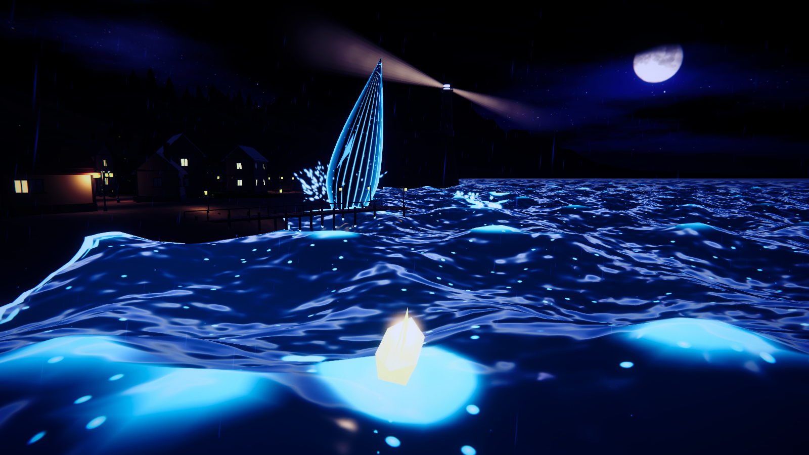
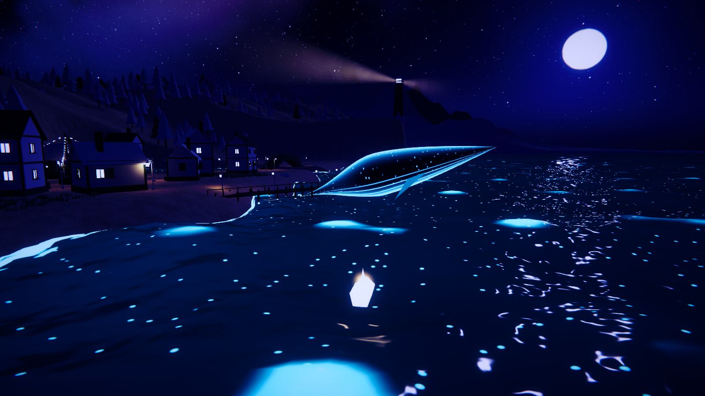
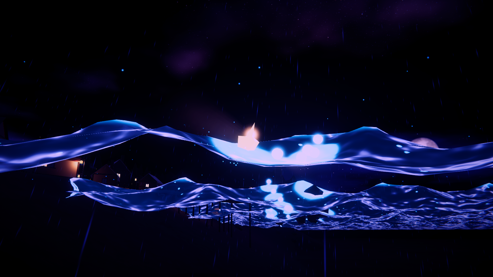
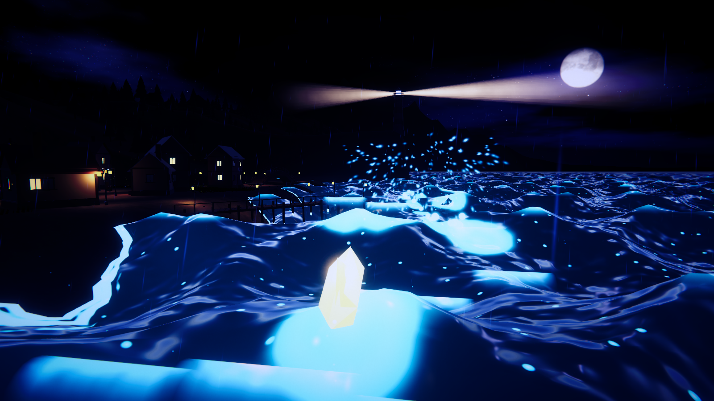

# Starlit Tides — Phase 5: Bonus Features 7–11

Five bonus features on top of the six required ones. As before, every feature has its own script with a header comment naming it.

All of this was **compiled, built and play-tested in Unity 6000.5.10f1**. In the test run:
- the whale event fired all three stages (warning, breach, splashdown) and its waves spawned
- Photo Mode froze time, changed filter and restored the game afterwards
- hidden orbs were revealed by the lighthouse
- all the sounds were generated
- a run was recorded as a new high score

The screenshots below come from those runs.

| | |
|---|---|
|  **7. The whale breaches** |  **7. The procedural whale model** |
|  **9. Photo Mode** (low orbit, *Dreamy* filter, depth of field) |  **7. Whale waves rolling in** (with the crash flash) |

---

## 1. Install (2 minutes)

The files are **already copied into your project**.

1. If Unity is in **Play mode, stop it first**: Unity won't import new scripts while playing. Wait for compiling to finish, with no red errors.
2. **Starlit Tides → 7. Build Bonus Features → Build**
3. **Cmd+S**
4. Press **▶ Play**. Try **P** for Photo Mode. To see the whale right away, use **Starlit Tides → Test: Trigger Whale Now** while playing.

**Updated scripts** (already replaced):
- `Orb.cs`: hidden orbs can't be seen or collected until revealed
- `OceanController.cs`: a `swell` value for the whale's waves
- `WeatherManager.cs`: an `OnLightning` event, used for thunder
- `StarlitInput.cs`: typing your name doesn't trigger R or P
- `GameManager.cs`: Esc closes Photo Mode instead of pausing
- `DebugHUD.cs`: whale warning, stats screen and leaderboard

**New:** `Scripts/Bonus/` (8 scripts), `Shaders/StarlitWhale.shader`, `Shaders/StarlitWaveCrest.shader`, `Scripts/Editor/BonusBuilder.cs`.

---

## 2. The five bonus features

### Bonus 7 — The Glowing Whale (`WhaleEvent.cs`, `WhaleWave.cs`, `StarlitWhale.shader`)
About every 1.5 minutes (first at 55 s):
1. **Warning:** the sea ahead glows brighter, the camera rumbles, and "Something stirs beneath the tide…" appears.
2. **Breach:** a 30 m whale leaps sideways across the lane along a **parabola**, turning to face its direction of travel, with a slow barrel roll. There's a huge glowing splash when it leaves and re-enters the water.
3. **Waves:** three rows of glowing waves roll toward you, faster than the tide. **Each row has one gap.** Steer into it or dash through. The whole sea also swells up for a few seconds (`OceanController.swell`).

**How the whale is made:**
- **Mesh:** a *loft*. 30 rings of ellipses get fatter, then thinner, along the body, with a thin tail stock and a round head. Flat triangles form the tail flukes and pectoral fins.
- **Shader:**
  - a swimming wave in the vertex shader, strongest at the tail
  - wrapped moonlight
  - twinkling plankton spots (one random dot per cell)
  - glowing belly grooves (`pow(abs(sin(u·70)), 24)` on the underside)
  - a cyan Fresnel rim

### Bonus 8 — Living Village (`LivingVillage.cs`, `HiddenOrbs.cs`)
- All 84 house windows switch on and off over time. Early in a run about 80% are lit; the village gradually goes to sleep, down to 35% after 4 minutes.
- Lanterns flicker, fireflies drift and the lighthouse beam sweeps (all from Phase 2).
- **Hidden orbs:** every 7–13 s an *invisible* orb drifts down the lane. It can't be collected until the **lighthouse beam passes over it** (`LighthouseBeam.IsLit`). Then it sparkles into view, worth **20% light + 100 bonus points**.

### Bonus 9 — Photo Mode (`PhotoMode.cs`)
Press **P** (gamepad: Select) while playing or paused.

| Key | Action |
|---|---|
| A/D, W/S (or right-mouse drag / right stick) | orbit / tilt around the boat |
| Q/E (or mouse wheel / triggers) | zoom |
| Z / X | more / less depth-of-field blur (focus stays on the boat) |
| 1–5 or Tab | filter: Natural, Moonlit, Golden, Noir, Dreamy |
| Space / Enter | save a PNG (editor: `StarlitTides/Photos/`, build: the player's data folder) |
| P / Esc | back to the game |

How it works:
- Time freezes (`Time.timeScale = 0`), and the Cinemachine Brain is set to `IgnoreTimeScale` so the photo camera can still move.
- The camera position is calculated from **spherical coordinates** (yaw, pitch, distance) around the boat.
- The filters and depth of field live on a separate post-processing Volume. It's edited through `volume.profile`, a runtime copy, so your saved asset never changes.

### Bonus 10 — Adaptive Audio (`AudioManager.cs`, `ProceduralAudio.cs`)
**Every sound is synthesised in code**, so no audio files are needed. It's generated on a background thread at startup and takes about a second.

| Sound | How it's made |
|---|---|
| Music, calm layer | Am–F–C–G pad chords (detuned sines, 1 s crossfades) + random pentatonic bells, 16 s seamless loop |
| Music, intense layer | same chords as a plucked 16th-note arpeggio + pulsing bass, perfectly in sync (`PlayScheduled`) |
| Waves | brown noise, low-passed, with slow volume swells |
| Wind / rain | band-filtered noise / high-passed noise + random drop clicks |
| Orb chime | a bell (4 sine partials, exponential decay); **its pitch climbs a pentatonic scale with your combo** |
| Dash / crash | noise with a sweeping filter / a sine thump that drops in pitch |
| Thunder | a crack and a long low rumble, played 0.3–1.4 s **after** each lightning flash (light travels faster than sound) |
| Whale | a sliding, wobbling low hum with echoes |
| Near miss, Starburst, game over | bell arpeggio / swelling chord / sinking minor chord |

**Adaptive mix:**
- The intense music layer fades in with difficulty, combo, storms and Starburst.
- Rain only plays during storms, wind grows with the storm, and the waves get louder with the wave height.
- Menus, the intro and game over always stay calm.

To use real recordings (for example from Pixabay), drag them into the clip slots on **Audio (Bonus 10)**. Empty slots stay generated.

### Bonus 11 — High Score and Stats (`HighScoreManager.cs` + the Game Over panel)
- Your best score, best distance, best combo, total runs and total orbs are saved with **PlayerPrefs**, so they survive closing the game.
- The **Game Over screen** shows this run's score (with your best), orbs, distance, time, best combo, near misses, the number of runs, and **NEW HIGH SCORE!** when you've earned it.
- **Global leaderboard:** type your name and click **Submit score**. It's sent to your Vercel and Neon API, and the **World Top 10** is shown next to your stats.
- The game-over panel uses the temporary debug UI. Phase 6 gives it the proper styled screen.

---

## 3. Tuning

| Change | Object (under `== STARLIT BONUS ==`) | Field |
|---|---|---|
| Whale timing | Whale Event | First Whale At, Interval |
| Whale wave difficulty | Whale Event / `WhaleWave` prefab | Wave Rows, Row Spacing / Light Damage |
| How fast the village sleeps | Living Village | Lit Fraction, Sleep After |
| Hidden orb frequency and reward | Hidden Orbs | Spawn Interval, Light Value, Bonus Points |
| Music / ambience / SFX volume | Audio | the three volume sliders |
| Reset high scores | High Scores (Bonus 11) | the component's **⋮** menu → *Reset All High Scores* |

---

## 4. Tips for the demo

- **Trigger the whale on cue** with *Starlit Tides → Test: Trigger Whale Now* instead of waiting 55 s.
- **Photo Mode is a great live demo of graphics features:** orbit around the boat, then show depth of field (Z/X) and the five post-processing filters. It explains Volumes, DOF and colour grading in 20 seconds.
- **Talk about the audio:** "every sound you hear is generated from sine waves and filtered noise". That's an unusual feature for a graphics project.

---

## ✅ Phase 5 checklist

- [ ] Unity not in Play mode while it imports, no Console errors
- [ ] **Starlit Tides → 7. Build Bonus Features** run, scene saved
- [ ] Seen the whale (Test: Trigger Whale Now), dodged its waves
- [ ] Photo Mode: orbit, blur, filters, and a saved photo
- [ ] Heard the music change in a storm and with a big combo
- [ ] Game Over: stats shown, score submitted to the World Top 10

Next is **Phase 6: UI, audio polish, optimisation and the .exe build**:
- an animated main menu and the real TextMeshPro HUD
- pause, settings (volume, quality), game over and how-to-play screens
- fade transitions
- the Low/Medium/High quality presets wired in
- a performance pass and a Windows build
