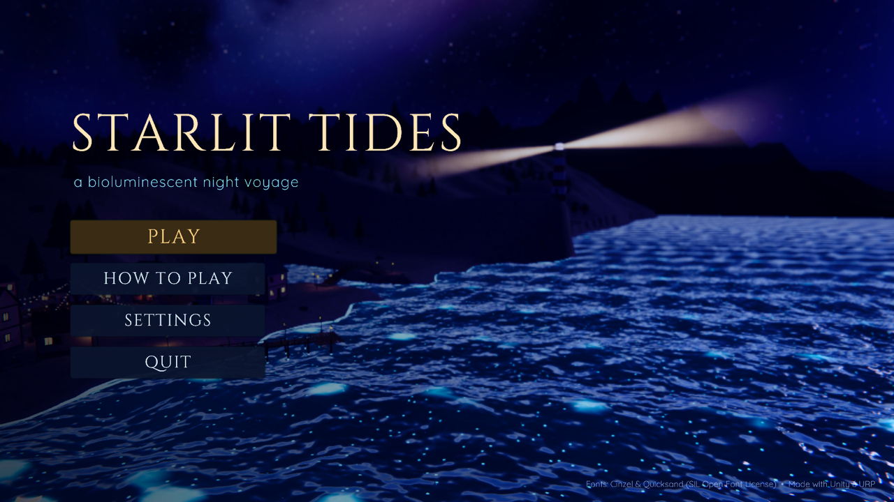
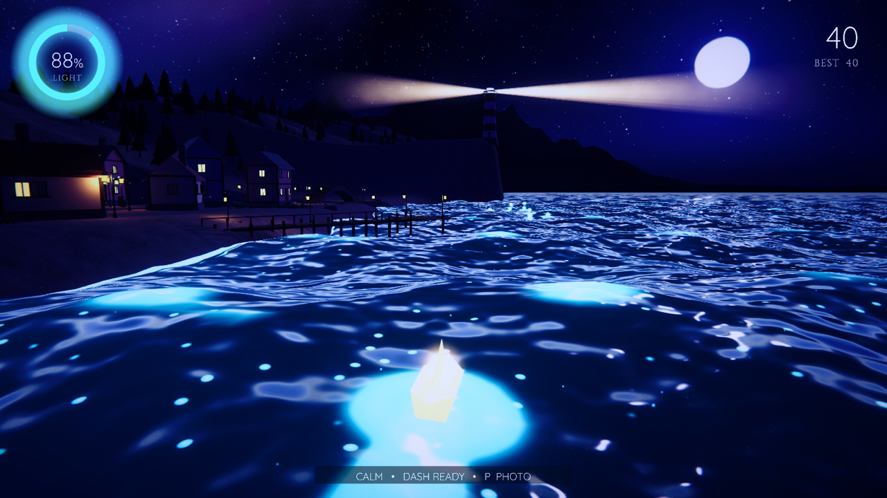
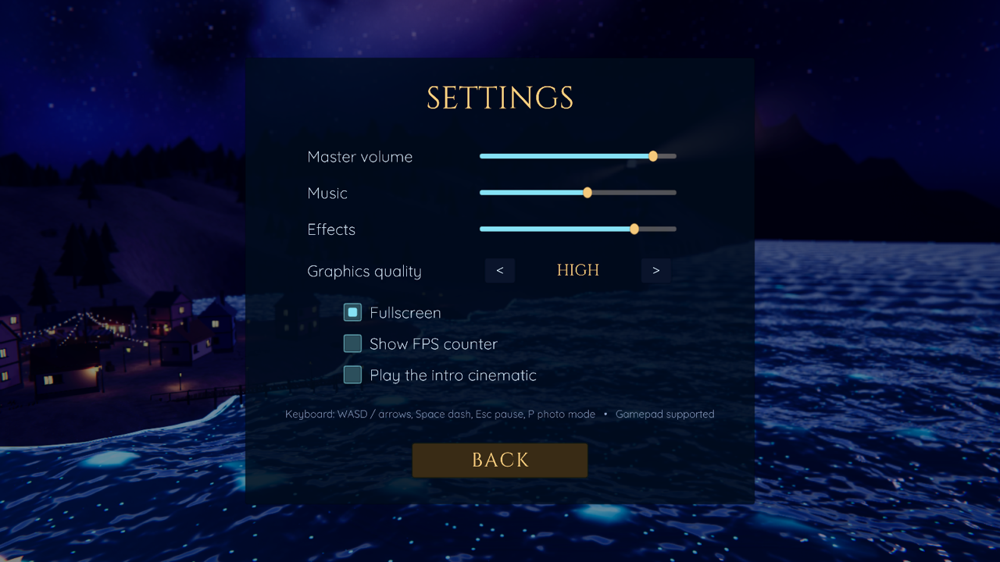
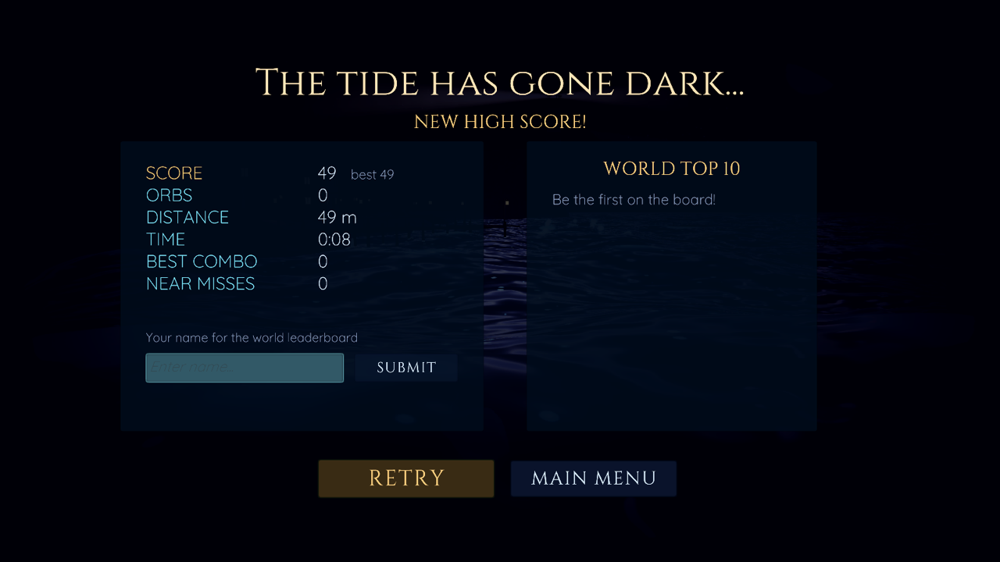
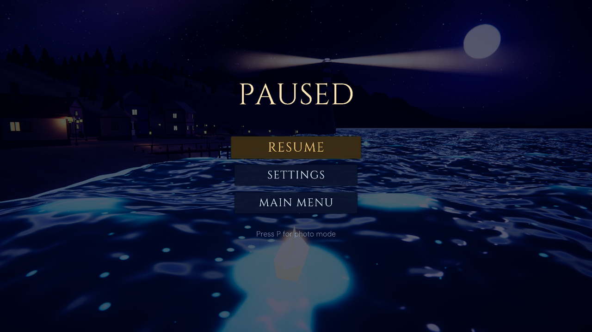

# Starlit Tides — Phase 6: UI, Audio, Polish & Build

The last phase turns the prototype into a finished game:
- a main menu with a living 3D background
- a proper HUD
- How to Play, Settings, Pause and Game Over screens
- saved settings, with three graphics quality presets
- UI sounds and smooth fades between every screen
- a one-click build of the final game

All of this was **compiled, built and play-tested in Unity 6000.5.10f1**. The automated run went:
- Menu → Settings → Play → Esc (pause) → Esc (resume) → light runs out → Game Over → Retry, which went straight into a new run
- the settings toggles were read back correctly
- the quality presets Low / Medium / High were created

The screenshots below come from that run.

| | |
|---|---|
|  **Main menu** (swaying camera, depth of field) |  **HUD** (radial light meter, score, status line) |
|  **Settings** |  **Game Over** (run stats + world leaderboard) |
|  **Pause** | |

---

## 1. Install

**This has already been done in your project.** The files were copied in, TextMeshPro's Essential Resources were imported, the UI builder was run, and `StarlitBay` was saved. Just open the project in Unity Hub and press **▶ Play**.

To rebuild it yourself (for example after changing `UIBuilder.cs`):
1. Make sure Unity is **not in Play mode**.
2. **Starlit Tides → 8. Build UI & Polish**.
   - On a fresh project the first run imports *TMP Essential Resources*. If it asks, run it a second time once the import finishes.
3. **Cmd+S** / **Ctrl+S**.

**Updated scripts** (already replaced):
- `AudioManager.cs` and `ProceduralAudio.cs`: a soft UI click sound
- `StarlitOcean.shader`: a cheaper "Low quality" version (see section 4)

**New:**
- `Scripts/UI/` (7 scripts)
- `Scripts/Core/SettingsManager.cs`
- `Scripts/Editor/UIBuilder.cs`, `Scripts/Editor/GameBuilder.cs`
- `UI/Fonts/` (Cinzel and Quicksand, both under the SIL Open Font License; the licences are next to the fonts)

**What the builder also changes in the scene:**
- the game no longer starts by itself; it waits on the menu
- the intro cinematic plays when you press **Play** (once per session, and it can be turned off in Settings)
- the old `DebugHUD` is switched off (the new HUD replaces it)
- Photo Mode hides the HUD while it's open

---

## 2. The screens

`UIManager.cs` decides which screen is showing:

```
Main Menu ──(fade)──> Intro cinematic ──> Playing (HUD)
   │                                         │ Esc
   ├─> How to Play                           ├─> Pause ──> Settings / Main Menu
   └─> Settings                              │ light runs out
                                             └─> Game Over ──> Retry / Main Menu
```

- Every screen is a `CanvasGroup`. Showing one sets `alpha`, `interactable` and `blocksRaycasts` together, so hidden screens can't be clicked.
- **Fades:** `ScreenFader.cs` fades a black full-screen image using `Time.unscaledDeltaTime`, so it still works while the game is paused (`timeScale = 0`).
- **Retry** reloads the scene. A `static bool retryRequested` survives the reload, so the new scene skips the menu and starts a run immediately.
- **Keyboard and gamepad:** each screen selects a first button, so arrow keys or a stick plus Enter/A can drive every menu. `ButtonFeedback.cs` grows a button slightly, turns its text gold and plays a click when it's hovered or selected.

### Main menu
- **Background camera** (`MenuCamera.cs`): a Cinemachine camera with priority 50 while in the menu, then 0, so the Brain blends to the gameplay camera when you press Play.
  - It sits out at sea and swings slowly left and right like a pendulum (`angle = base + sin(t·2π / period) · swing`).
  - It also bobs gently up and down, so the lighthouse, village and bay stay in frame.
  - It uses `Time.unscaledTime`, so it keeps moving even if time is paused.
- **Menu Volume:** a second post-processing Volume with Gaussian depth of field (start 70 m, end 300 m) and a light vignette. `MenuCamera` fades its `weight` from 1 to 0 when the game starts, so the blur melts away during the camera blend.
- **Left-side shade:** a generated gradient sprite darkens the left of the screen, so the title and buttons stay readable without a box around them.

### HUD (`HudView.cs`)
- **Radial light meter** (top-left):
  - The ring is an `Image` with `Image.Type.Filled` / `Radial360`; `fillAmount` = the light value.
  - A soft halo sprite behind it pulses faster and the ring fades toward red as your light runs low.
  - The percentage is drawn in the middle.
- **Score** (top-right): counts up smoothly toward the real score, with the best score underneath.
- **Combo** and **Starburst**: groups with a shrinking timer bar that fade in only while active.
- **Status line** (bottom): weather, whether Dash is ready, and the Photo Mode key, on a dark backing so it reads over the bright sea.
- **FPS counter:** optional, turned on in Settings.

### Game Over (`GameOverView.cs`)
- **Stats:** score (and best), orbs, distance, time, best combo and near misses. TextMeshPro's `<pos=55%>` tag lines the numbers up in a column.
- **Leaderboard:** type a name (up to 16 characters) and press Submit to send the score to the world leaderboard (`LeaderboardClient`, Vercel + Neon). The top 10 load on the right.
- **Typing safety:** while the name field has focus, `StarlitInput.TextFieldFocused` stops R and P from triggering Retry or Photo Mode.

---

## 3. Settings (`SettingsManager.cs`, `SettingsView.cs`)

All settings are saved with `PlayerPrefs` and applied on start:

| Setting | Key | What it does |
|---|---|---|
| Master / Music / Effects volume | `ST_MasterVolume`, `ST_MusicVolume`, `ST_SfxVolume` | Master sets `AudioListener.volume`; Music and Effects set the `AudioManager`'s music and sound-effect levels |
| Graphics quality | `ST_Quality` | Low / Medium / High (see below) |
| Fullscreen | `ST_Fullscreen` | Switches `Screen.fullScreen` (only in the built game; the editor ignores it) |
| Show FPS counter | `ST_ShowFps` | Shows or hides the HUD's FPS text |
| Play the intro cinematic | `ST_PlayIntro` | Skips the Timeline intro when off |

`SettingsView.Refresh()` sets the sliders and toggles from the saved values with a `refreshing` flag, so showing the screen doesn't fire the change events and save the same values back.

---

## 4. Graphics quality and optimisation

The builder creates three URP assets (`Settings/URP/URP_Low/Medium/High`) and three quality levels that use them. **Medium** is the default for a fresh install, which is safe for mid-range laptops.

| | Low | Medium | High |
|---|---|---|---|
| Render scale | 0.8 | 1.0 | 1.0 |
| MSAA | off | 2× | 4× |
| Shadow map / distance / cascades | 512 / 40 m / 1 | 1024 / 70 m / 2 | 2048 / 100 m / 4 |
| Soft shadows | off | on | on |
| Grass distance / density | 55 m / 45% | ~88 m / 72% | 120 m / 100% |
| Reflection probe | 64 px | 128 px | 256 px |
| Max rain drops / s | 500 | 950 | 1400 |
| Ocean shader | cheap path | full | full |

All three keep the **depth texture, opaque texture and HDR**: the ocean shader needs the first two, and bloom needs HDR.

**The cheap ocean path** (`#pragma multi_compile _ STARLIT_QUALITY_LOW`):
- `SettingsManager` turns on the global keyword `STARLIT_QUALITY_LOW` on Low.
- The shader then uses one 2-octave ripple noise instead of two (about 3× cheaper), and skips the per-lantern reflection loop.
- That's the most expensive part of the most expensive shader in the game, since it covers half the screen.

**Other optimisations already in the game:**
- **Object pooling** (`PoolManager`): orbs, obstacles, jellyfish and particle effects are reused, never instantiated or destroyed during play, so there are no garbage-collection spikes.
- **Forward+ rendering:** the many small village and lantern lights cost very little.
- **Reflection probe:** it updates *on demand* (`ReflectionProbeRefresher`), not every frame.
- **Overlay canvases** are split into HUD, Menu and Fade canvases, so animating the HUD doesn't rebuild the menu's geometry.
- **Audio:** all sounds are synthesised on a background thread at start-up, so nothing loads from disk mid-game.

**Tip for your report:** turn on the FPS counter and compare Low and High on the same machine, ideally on the Windows build. A short table of the numbers makes the optimisation section concrete.

---

## 5. Building the game

**Windows `.exe`** (the deliverable):
1. Unity Hub → **Installs** → 6000.5.10f1 → ⚙ → **Add modules** → tick **Windows Build Support (Mono)** → Install.
2. Restart Unity, then **Starlit Tides → 9. Build Windows (.exe)**.
3. The game is written to `StarlitTides/Builds/Windows/`. **Zip the whole folder**, not just the `.exe`: it needs `StarlitTides_Data` and `UnityPlayer.dll` next to it.

**macOS `.app`** (to try it on your Mac now): **Starlit Tides → Build macOS (.app)** → `Builds/macOS/StarlitTides.app`.

`GameBuilder.cs`:
- checks that the module is installed, and tells you how to add it if not
- sets the company and product name, 1920×1080 and fullscreen
- builds every scene listed in Build Profiles, then reports the size and time and opens the folder

`Builds/` is ignored by git, so the large binaries stay out of the repository.

---

## 6. Techniques worth mentioning in the presentation

- **Signed distance field text (TextMeshPro):** the fonts are stored as distance fields, so text stays sharp at any size. The title's soft gold **glow** is just a material setting (`GLOW_ON`, glow colour, outer and power) in the same shader.
- **Procedural UI sprites:** the ring, halo and side gradient are generated in code from maths (e.g. the halo's alpha is `exp(−((d − 0.7) / 0.18)²)`, faded to zero at the edge), so there are no image files to draw.
- **Radial fill:** the light meter is a single sprite with `Image.fillMethod = Radial360`. The UI system cuts the quad itself, with no custom shader.
- **Camera blending:** menu → intro → gameplay are all Cinemachine cameras switched by priority, and the Brain blends between them.
- **Post-processing per state:** two Volumes (gameplay and menu) cross-faded by `weight`.
- **Unscaled time:** fades, menu camera and button animations use unscaled time, so they keep running while the game is paused.

---

## 7. Troubleshooting

| Problem | Fix |
|---|---|
| Text is pink or missing | TMP Essentials missing: **Window → TextMeshPro → Import TMP Essential Resources**, then run **8. Build UI & Polish** again |
| "Scripts have compiler errors" when building the UI | Stop Play mode and wait for compiling to finish, then try again |
| The game starts without the menu | Run **8. Build UI & Polish** again and save; it turns off `autoStartGameplay` |
| The `.exe` menu item says the module is missing | Install **Windows Build Support (Mono)** (section 5) and restart Unity |
| Settings seem stuck | Settings live in PlayerPrefs; clear them with **Edit → Clear All PlayerPrefs** |
| The game is slow on a laptop | Choose **Low** in Settings; check with the FPS counter |

---

## Credits

- **Fonts:** [Cinzel](https://github.com/google/fonts/tree/main/ofl/cinzel) and [Quicksand](https://github.com/google/fonts/tree/main/ofl/quicksand), SIL Open Font License 1.1 (licence files included).
- Everything else (models, shaders, sounds, music) is generated by the project's own code.
