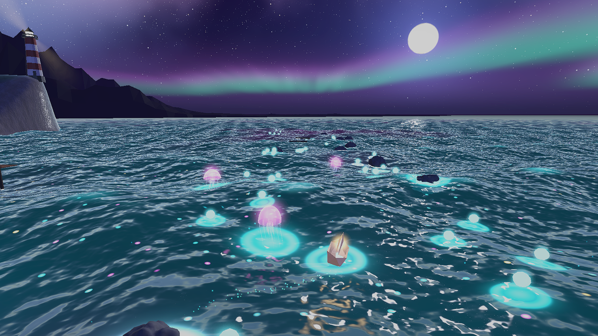
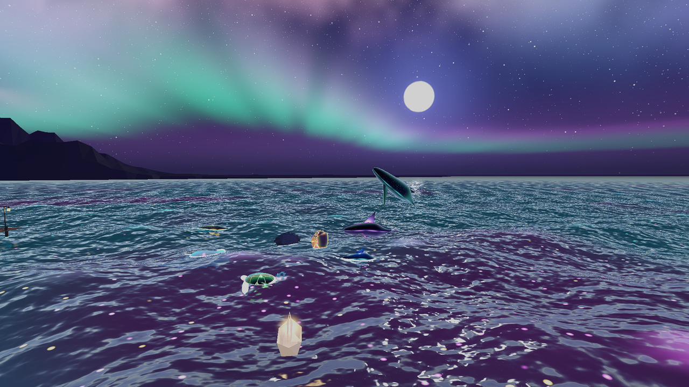
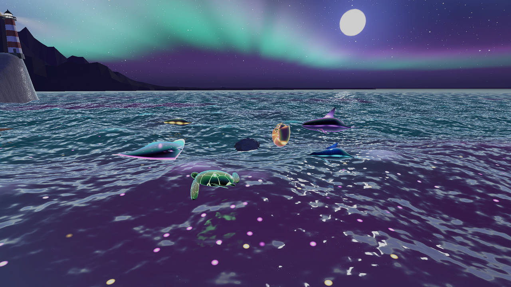
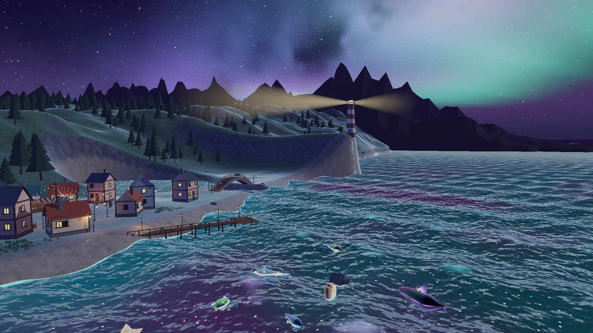
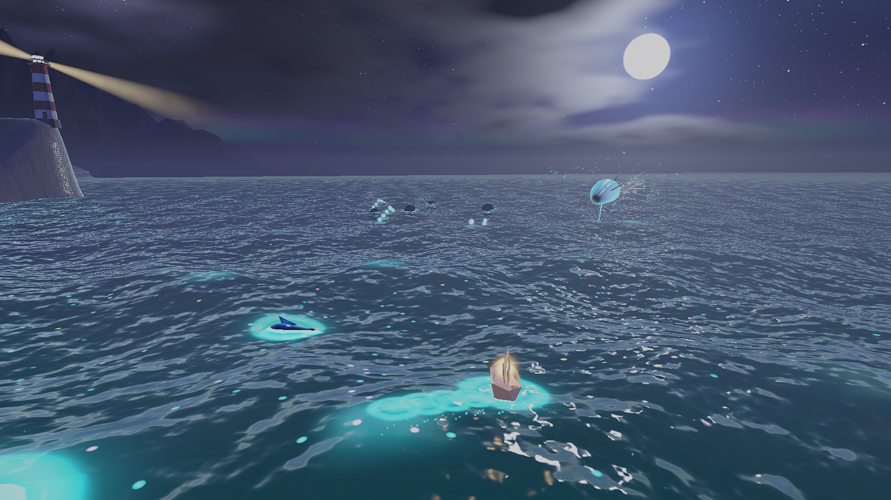
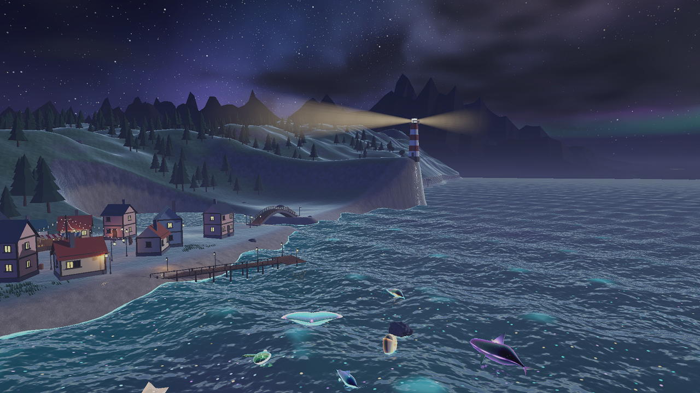

# Starlit Tides — Phase 7: Out to Sea (visual upgrade + sea creatures)

This pass came from three pieces of playtest feedback:
1. *"The game is low-res and blurry."*
2. *"The boat should sail out into the sea, not sideways along the beach."*
3. *"Add beautiful sea creatures as obstacles, and make it sharper and more detailed."*

Everything here is built by the editor scripts, like the earlier phases. To apply it:

1. Open the project and wait for Unity to finish compiling.
2. **Starlit Tides → Rebuild Everything**. This runs steps 4–8 and the new step 10, then saves `StarlitBay`.
3. Press **▶ Play**.

---

## 1. Sailing out to sea (`WorldLayout.cs`)

Gameplay always flows along world **+Z**: the tide moves everything toward the camera (−Z). The coast had been laid out along that same axis, so the boat sailed *parallel to the beach*.

The fix turns the **land**, not the gameplay. The bay is still designed on a "layout map" with the coast along +Z, and every builder converts layout positions with `WorldLayout.ToWorld()`, a 38° turn about the origin:

```
world = Quaternion.Euler(0, -38°, 0) * layout
```

- **Turned:** village, pier, bridge, lighthouse, forest, mountains, fireflies, the intro shots of the land, the menu camera's orbit, and the ocean's calm zone over the lagoon.
- **Not turned** (they belong to the lane or the sky): the ocean grid, the moon, the plankton motes and the gameplay camera.

Now the beach and village are **behind** the boat, with the lighthouse cliff fading away on the left. Open sea, the moon and its glittering path are straight ahead.

**The terrain** can't be rotated: Unity terrains are always axis-aligned. So the terrain now covers a world-space rectangle (1100 × 1100 m), and each heightmap, splat and grass sample is converted back to the layout map (`WorldLayout.ToLayoutXZ`) before the height function runs. `GroundY()` does the reverse, so houses and trees still sit exactly on the ground.

To change the angle, edit `WorldLayout.Yaw` and run **Rebuild Everything**. At 0° you get the old layout. At 90° the land is straight behind you.

---

## 2. Sharp image instead of blurry

| Cause of blur | Fix |
|---|---|
| Low rendered at 80% resolution with bilinear upscaling | Low renders at 85% but upscales with **FSR** (which sharpens). Medium/High render at native resolution |
| Medium used 2× MSAA plus soft post AA | Medium/High use **4× MSAA** and no post-process AA. Only Low uses SMAA (`SettingsManager`) |
| Film grain 0.15, constant chromatic aberration 0.04 | Both are **0** now (hits still flash chromatic aberration) |
| Bloom threshold 0.85 and wide scatter turned every light into haze | threshold **1.0**, intensity 1.1, scatter 0.6 |
| Ocean refraction read a **half-resolution** copy of the scene | full-resolution opaque texture on Medium/High |
| 256 px terrain textures, no anisotropic filtering | **1024 px** textures + matching **normal maps**, trilinear, 8× anisotropic |
| Default quality was Medium | **High** by default. Saved settings reset to High once (settings v2) |

**New: contrast-adaptive sharpening** (`StarlitSharpen.shader`). It's a URP **Full Screen Pass** renderer feature that runs after post-processing, and it works like AMD's CAS:

```
amp    = sqrt( min(min, 1 - max) / max )   over the pixel + 4 neighbours
weight = amp * -1 / lerp(8, 5, sharpness)
result = (c + (n + s + e + w) * weight) / (1 + 4 * weight)
```

Flat, soft areas get crisper, and edges that are already sharp are left alone, so there's no halo or ringing. `SettingsManager` sets the global `_StarlitSharpness` for each quality level.

High quality also gets 64-bit HDR (no colour banding in the dark sky gradients), 4096 shadow maps and high-quality soft shadows.

---

## 3. More detail

- **Rocks** (`ProcMesh.Rock`): a subdivided icosphere with **642** vertices (obstacle rocks: **2562**) instead of 12. It is displaced by 4 octaves of noise plus ridged "crack" noise, and smooth-shaded. The old rocks were 80 flat triangles.
- **Ocean**: the grid went from 300² to **420²** cells for smoother waves. A new micro-ripple layer adds crisp sparkle to nearby water and fades out with distance so it never shimmers (skipped on Low).
- **Terrain**: about 1 m per height sample (1025² heightmap) instead of 1.6 m, and a lower pixel error, so beaches and cliffs keep their shape.

---

## 4. Sea creatures (`CreaturesBuilder.cs`, `SeaCreature.cs`, `StarlitSeaCreature.shader`)

**Starlit Tides → 10. Build Sea Creatures** makes three new obstacles and adds them to the `ObstacleSpawner`. All three are procedural meshes: no imported models.

| Creature | Mesh | Behaviour |
|---|---|---|
| **Manta ray** | a lofted wing (top surface + belly), cephalic fins, a whip tail | glides across your path in an S-curve. 45% of the time it **leaps** out of the water and splashes back down |
| **Sea turtle** | domed shell, plastron, head, 4 flippers | paddles slowly across at the surface; front and back flippers alternate |
| **Dolphin** | a lofted body with melon, dorsal fin, pectoral fins and flukes | **porpoises** across in a chain of arcing leaps |

**Animation lives in the vertex colours.** One shader animates all three:

| Channel | Meaning |
|---|---|
| R | fin weight. The fin moves in a loop (lift + sweep) that lags toward the tip, so manta wings ripple |
| G | body wave. A wave travels head → tail along `_SwimAxis`: sideways for the manta's tail, **vertical** for the dolphin's flukes |
| B | glow mask (where the bioluminescent pattern may appear) |
| A | fin phase (turtle front and back flippers are half a stroke apart) |

**Shading:**
- wet skin: wrapped moonlight, sky ambient, and nearby lanterns/boat light through the Forward+ light loop
- a sharp Blinn-Phong highlight
- glowing patterns: twinkling spots, **Voronoi scute seams** on the turtle shell (distance F2 − F1), flank stripes with a pulse racing along the dolphin, and glowing manta wing edges
- a Fresnel rim

`DepthOnly` and `DepthNormals` passes use the same vertex animation, so the ocean's refraction, depth colour and SSAO all see the moving shape.

**Fair play:**
- Creatures start near one edge of the lane. Their speed is chosen so they cross your path about when the tide brings them to the boat.
- While a creature is more than ~1 m in the air, its collider is off. A manta leaping over you is a spectacle, never a cheap hit.
- Spawn chances ramp from 18% to 30% (`DifficultyManager.creatureChance`). Jellyfish and logs were rebalanced so rocks still appear.

---

## 5. Second pass: wider sea, better light, crisper finish

More playtest feedback: *"expand the playable area; it's still blurry and low-res; the lighting is bad."*

**Wider playable area**
- The boat's lane is now ±13 m (it was ±7 m), and it can move 4 m further forward and back.
- Obstacles, orbs and hidden orbs spawn across ±12–14 m. Jellyfish swim across the whole width, the whale's wave rows are 28 m wide, and sea creatures aim up to 9 m past the middle of the lane.
- Obstacles and orbs come more often, so the bigger area isn't empty.
- The gameplay camera sits higher and further back (offset 0.5, 8, −16; FOV 58°) so the whole lane fits on screen.

**Lighting**
- **Sky fill light.** The moon is in front of the boat, so before this the camera only saw the unlit side of everything, which made flat dark silhouettes. A soft, cool directional light from behind the camera (sky light, no shadows) now shows the shape of the boat, rocks and creatures.
- **Moonlight** is brighter (0.8 → 1.5) with stronger shadows. The ambient light is darker near the ground, so shapes have contrast instead of uniform grey-blue.
- **Boat lantern:** up to 5 intensity and 20 m range, raised and set back, so it throws a warm pool of light on the sea around the boat (warm against the cool moonlight).
- **Water:** sharper and brighter moon glints, a brighter moon path, sharper reflections, and a reflection probe of up to 512 px (it was 256 px).
- **Grade:** more contrast (22), and bloom only on the brightest highlights (threshold 1.1, scatter 0.5).

**Crisper finish**
- **Glow under objects:** the plankton glow under every object used to be a wide soft pool. It is now a tight bright core, a crisp ring and a faint halo.
- **Ripples:** finer (scale 0.35 → 0.5).
- **Paper boat:** it was 16 triangles with strong emission, so it rendered as a blown-out white blob. Now:
  - every panel is subdivided and gently crumpled, keeping the flat facets of folded paper
  - the central sail is folded down the middle
  - it has a generated paper texture (fibres, faint creases)
  - its inner glow is soft, so the folds stay visible
- **Terrain bug fixed:** the hills were 100% sand, because the splat (ground-layer) textures were painted before the TerrainData asset existed and were never saved, so Unity fell back to "layer 0 everywhere". `BuildTerrain` now re-applies them after creating the asset and stores them as sub-assets. Grass finally shows, and the pale hills no longer wash out the sea's reflections.
- **Sea colour:** the plankton glow on wave crests used to tint the entire sea teal. It is turned down (0.7 → 0.1) and gathers in drifting blooms, so the open sea is deep moonlit navy and the glowing things stand out.
- **Sharpening:** stronger (0.65 on High, 0.85 on Low).
- **Editor Game view:** `GameViewSharpness.cs` turns off Unity's *Low Resolution Aspect Ratios* and resets the zoom to 1× whenever scripts reload and whenever you press Play. On a Retina Mac that option renders the Game view at half resolution, which looks blurry even when the game itself is sharp. You can also run it from **Starlit Tides → Fix Game View Sharpness**.

---

## 6. Third pass: colourful stylized look, exotic creatures, real-world scale

Feedback: *"beautiful stylized and colourful AAA graphics, beautiful and exotic sea creatures; the whales are too small, scale them correctly."*

| | |
|---|---|
|  **In play** |  **Humpback breaching** |
|  **The creatures** |  **Menu** |

**Colour**
- **Sky:** an indigo zenith, a violet middle band and a magenta horizon with a teal glow. The Milky Way is brighter and more saturated, and the moon has a bigger halo. A faint aurora always shimmers on clear nights (`SkyController.ambientAurora`); storms and the intro sunset hide it.
- **Water:** turquoise in the shallows, deep indigo further out, and a violet sheen at grazing angles.
- **Multi-colour plankton:** large drifting blooms shift between cyan and magenta, and each sparkle is cyan, magenta or gold (`_BioColor2`, `_SparkleColor3`).
- **Grade:** saturation 34, violet shadows, peach highlights, and a touch of magenta in the white balance.

**Stylized creature shading** (`StarlitSeaCreature.shader`)
- **Iridescence:** a thin-film rainbow sheen whose hue shifts with the viewing angle.
- **Toon banding:** soft steps of light for a painted look.
- **Belly edge:** a controllable belly edge, so the orca gets a crisp black-and-white line instead of a blend.

**Real-world scale** (the paper boat is ~3 m)

| Creature | Before | Now |
|---|---|---|
| Manta ray | 4.6 m wingspan | **7.4 m** |
| Sea turtle | 2.2 m | **2.8 m** |
| Dolphin | 2.7 m | **4 m** |
| Orca *(new)* | – | **7 m**, 1.7 m dorsal fin |
| Narwhal *(new)* | – | **4.5 m** + 2.4 m tusk |
| Nautilus *(new)* | – | **~3 m** giant shell |
| Humpback whale *(new, scenery)* | – | **16 m**, 4.8 m pectoral fins |
| Glowing whale (event) | 30 m | 30 m (unchanged) |

Colliders, leap heights, glow radii and lights scale with each creature.

**New creatures**
- **Cetacean generator:** one lofted-body generator (`CetaceanMesh`) makes the dolphin, orca, narwhal and humpback from a few numbers: length, radius, beak, dorsal fin, pectoral length, fluke span and tusk.
- **Orca:** glossy black and white with violet glow lines. It porpoises across in big 3.6 m leaps.
- **Narwhal:** a mottled blue-grey body and a long spiral tusk. The tusk's UVs wind around it, so the stripe pattern becomes glowing golden spiral grooves.
- **Nautilus:** a logarithmic-spiral shell tube (radius ∝ e^(0.18θ), 2.1 turns) of cream nacre with glowing tiger bands, plus a fringe of glowing tentacles.
- **Humpback whale** (`AmbientWhale.cs`): every 20–40 s it breaches 26–40 m off to one side of the lane. It arcs 14 m high, rolls onto its side and crashes down with a huge splash and ripple. It is scenery and never hits the boat.

---

## 7. Fourth pass: atmosphere (the moody theme, back and deeper)

Feedback: *"it's sharp but the atmospheric ambience and the theme are gone. I want stylized, beautifully crafted, scenic graphics."*

| | |
|---|---|
|  **In play** |  **Menu** |

The colourful pass pushed saturation and magenta too far, and the night lost its mood. The games referenced (Ghost of Tsushima, Shadow of the Colossus, Horizon) get their scenic look mostly from **atmosphere**: air you can see, light scattering in it, and depth fading into haze. This pass adds that and pulls the palette back.

**Atmosphere pass** (`StarlitAtmosphere.shader`, a URP Full Screen Pass *before* post-processing, so bloom and tonemapping treat it as light):
1. **Exponential height fog**, integrated analytically along every view ray. The world position is rebuilt from the depth buffer:
   `fog = 1 − exp(−ρ · e^(−k·h_cam) · d · (1 − e^(−k·Δy)) / (k·Δy))`
   It is thick as sea mist near the water and thin with altitude, so the coast, mountains and far sea melt into haze while the sky stays clear. It starts 26 m out, so the play area stays crisp.
2. **Moon scattering**: the haze glows silver looking toward the moon (two forward-scattering lobes, `pow(cos θ, 8)` and `pow(cos θ, 60)`).
3. **God rays**: from each pixel the shader marches 28 steps toward the moon's screen position, gathering bright sky pixels (from depth). Clouds and the coastline cut the light into shafts.

It is all driven from `SkyController` (mist density and falloff, start distance, maximum, god-ray strength). Storms thicken and darken the air, and the intro sunset tints it.

**Night clouds** (`StarlitNightSky.shader`): two noise layers projected on a dome, so they pile into soft banks at the horizon. They drift with the wind and hide stars and the aurora. Their thin edges near the moon catch **silver linings**, and they veil the moon as they pass.

**Palette, back to a moody night:** deep navy sky and sea, teal only in the shallows, saturation 34 → 14, cool navy shadows with warm moon and lantern highlights, and slightly softer bloom so highlights glow into the mist. The aurora is faint and far away (0.15, low on the horizon). Violet plankton blooms are rare; cyan dominates, with an occasional gold sparkle.

---

## Files

**New:**
- `Scripts/Editor/WorldLayout.cs`
- `Scripts/Editor/GameViewSharpness.cs`
- `Scripts/Bonus/AmbientWhale.cs`
- `Scripts/Editor/CreaturesBuilder.cs` (also adds **Rebuild Everything**)
- `Scripts/Gameplay/SeaCreature.cs`
- `Shaders/StarlitSeaCreature.shader`
- `Shaders/StarlitSharpen.shader`
- `Shaders/StarlitAtmosphere.shader`

**Changed:**
- `EnvironmentBuilder.cs`
- `FeaturesBuilder.cs`
- `UIBuilder.cs`
- `GameplayBuilder.cs`
- `ProcMesh.cs`
- `Obstacle.cs`
- `ObstacleSpawner.cs`
- `DifficultyManager.cs`
- `SettingsManager.cs`
- `StarlitOcean.shader`
- `BoatController.cs`, `OrbSpawner.cs`, `Jellyfish.cs`, `LightMeter.cs`, `HiddenOrbs.cs`, `WhaleEvent.cs`, `SkyController.cs` (second pass)
