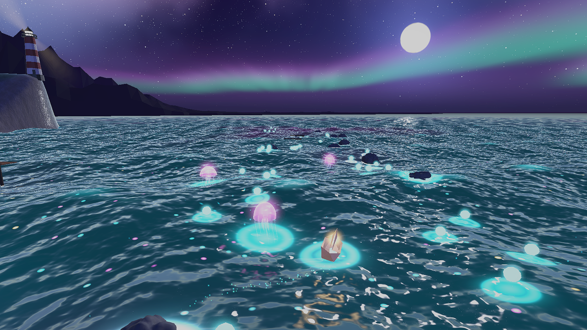
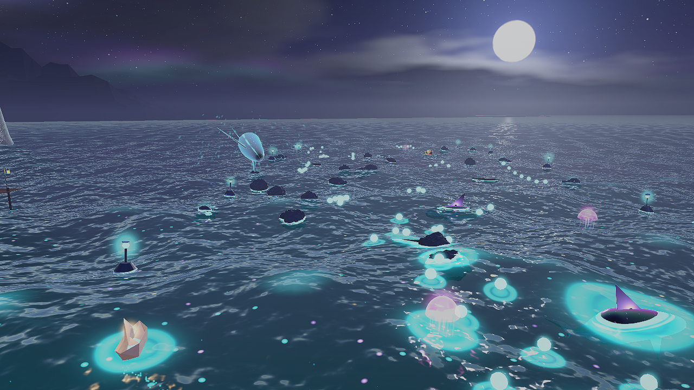
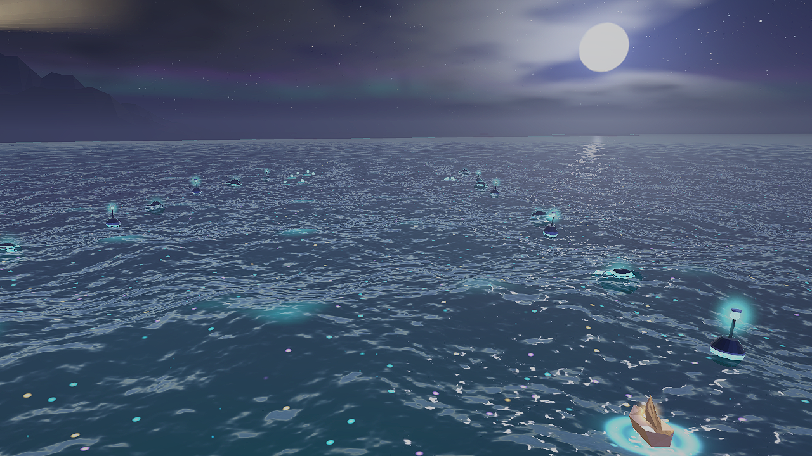
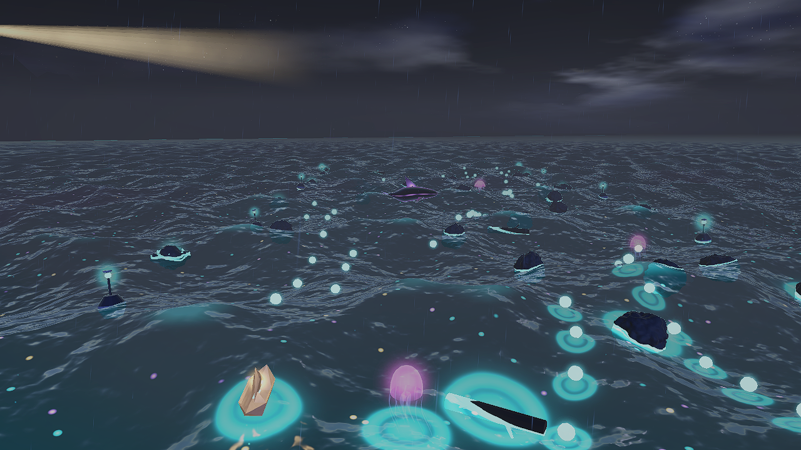
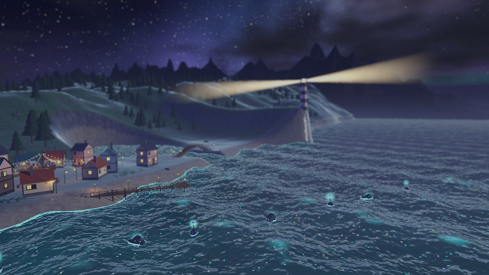

# Starlit Tides — Phase 8, Step 1: a wider sea that fills the screen

**Feedback:** *"The play area is too narrow. The camera shows a wide view, so only a small part of the map has objects in it."*

| Before (Phase 7) | After (Step 1) |
|---|---|
|  |  |

To apply it:

1. Open the project and let Unity finish compiling.
2. **Starlit Tides → Rebuild Everything** (the lane, camera, buoys, moon and land position are all built by the editor scripts).
3. Press **▶ Play**.

---

## 1. Why the screen looked empty

The camera had a 58° vertical field of view, which is about **89° across** on a 16:9 screen. Where obstacles spawn (~130 m from the camera), the screen covers about **250 m** of sea. The lane was only **28 m** wide, so everything spawned in a strip about 11% of the screen wide and funnelled toward the boat. The rest of the screen was empty water.

Two changes fix it. The lane gets wider, and the camera gets a narrower lens, so the lane fills much more of the picture.

---

## 2. One place for the lane size: `PlayArea`

Before, the lane width was copied into five scripts (boat ±13, obstacles ±14, orbs ±12.5, hidden orbs ±12, whale waves 28). Now a `PlayArea` component on **Managers** holds it, and everything reads it:

| Value | Default | Used by |
|---|---|---|
| `laneHalfWidth` | **22 m** (was 13) | boat limits, orbs (minus `orbInset` 0.5 m) |
| `obstacleOverhang` | 2 m → obstacles to **±24 m** | obstacle spawner, jellyfish darts, whale-wave rows |
| `edgeMarkerX` | **27 m** | the channel buoys and reefs |
| `laneZ` | −4 … 16 m | the boat's forward/back limits |

Obstacles spawn a little past the boat's reach, so hugging the edge is never a free safe zone. Orbs stay a little inside it, so every orb can be reached.

### Keeping the difficulty the same

The difficulty numbers were tuned for the Phase 7 lane, and a wider lane with the same spawn rate would be far emptier (and easier). `PlayArea.DensityScale` is the width ratio:

```
DensityScale = obstacle half width / 14  =  24 / 14  ≈ 1.71
obstacle interval = DifficultyManager interval / DensityScale
orb group interval = DifficultyManager interval / DensityScale^0.75
```

So obstacles per square metre stay the same. Orb groups scale a little less (power 0.75) because a group is a long trail that already covers more sea.

To keep the wide lane playable:

- Boat sideways speed is **12 → 15 m/s**, dash **24 → 27 m/s**.
- **Whale-wave rows:** each row's gap is now within 3 segments of the previous row's gap. In a 48 m lane a random gap could be 40 m away, which you couldn't reach in time.

---

## 3. The new camera

| | Phase 7 | Step 1 |
|---|---|---|
| Lens (vertical, 16:9) | 58° | **48°** (≈ 77° across) |
| Follow offset | (0.5, 8, −16) | **(0, 11, −19)** |
| Looks at | boat + (−1.5, 0.5, 26) | anchor + **(0, 1, 34)** |
| Follows the boat sideways | 100% | **55%** (`CameraAnchor`) |

- **`CameraAnchor`** is the new follow target. It copies the boat's forward/back position but only 55% of its sideways position. When you steer to the edge, the camera drifts only half way, so the boat moves across the screen and you can see the buoys at the channel edge. It runs after `BoatController` and before Cinemachine, so there is no one-frame lag.
- **`CameraAspectFit`** keeps the *horizontal* view the same on every screen shape:

  ```
  horizontal = 2·atan( tan(48°/2) · 16/9 )        (the 16:9 view)
  vertical   = 2·atan( tan(horizontal/2) / aspect )
  ```

  A 21:9 monitor no longer shows extra empty sea at the sides, and a 4:3 one gets a slightly taller view (clamped to 36–62°). Dashing adds a small **+4° FOV kick** that reads as a burst of speed.

At spawn distance the screen now covers about 205 m of sea, and the lane plus its buoys cover about 55 m of it: roughly **27%** of the width instead of 11%.

---

## 4. You can see where the channel ends

- **Channel buoys and reefs** (`LaneMarkers`, `LaneMarker`): a line of glowing buoys (a rounded float, a moon-white band, a breathing cyan lamp) alternates with small reefs (half-sunk rocks crusted with glowing cyan lichen). They sit along x = ±27 m every 16 m with a little random jitter. They drift with the tide all the time (menu, intro and play) and have **no colliders**: they are decoration only, and the boat can't reach them.
- **Ocean channel tint** (`StarlitOcean.shader`): past the lane the water is 14% darker and the plankton 40% dimmer, so the lane reads as a glowing channel. It fades out far to the sides and behind the boat, so the bay looks the same as before. `PlayArea` sends the width to the shader as the global `_StarlitLaneHalfWidth` (0 switches the tint off).
- **Edge bump:** steering hard into the edge (faster than 6 m/s) gives a small bounce back and a glowing ripple, instead of a dead stop at an invisible wall.

| Steering into the right edge | Storm, late in a run |
|---|---|
|  |  |

---

## 5. Two knock-on fixes

**The land was in the way.** With the 38° turn, the shoreline crossed the boat's start line only ~25 m to the left, right where the new lane edge is: beach sand showed up next to the boat. `WorldLayout` now also **slides the land 18 m to the left** after turning it:

```
world = Rotation · layout + Offset          Offset = (−18, 0, 0)
```

`ToLayout` undoes both. Velocities (the intro shots' camera drift) use the new `ToWorldDirection`, which only turns. The menu and intro still frame the village and lighthouse; see the menu below.

**The moon was cut off.** The higher camera pitch pushed the moon off the top of the screen, so it was lowered from about 12° to **8° above the horizon** (`EnvironmentBuilder`, Moonlight direction). It now sits in the upper sky with its glitter path on the sea straight ahead.



---

## 6. How it was checked

Everything was run in a batch-mode copy of the project with Unity 6000.6.11f1:

1. **Rebuild Everything**: compiles with no errors and builds the scene.
2. **A 90-second bot playtest in Play mode.** A bot keyboard device steers hard right into the edge, then hard left, then dodges obstacles and chases orbs. Results:
   - The boat covered the whole lane (x from −21.0 to +21.4) and the soft edge held.
   - About 27 obstacles were active on average (66 at peak), and none spawned outside ±24 m.
   - 18–21 channel markers were active at all times.
   - The bot survived the full 90 s with its light between 0.4 and 1.0.
   - No exceptions or shader errors.
3. The screenshots in this guide were rendered during that run at 1280×720 (16:9, FOV 48°).

---

## Files

**New:** `Scripts/Core/PlayArea.cs`, `Scripts/Features/CameraAnchor.cs`, `Scripts/Features/CameraAspectFit.cs`, `Scripts/Gameplay/LaneMarker.cs`, `Scripts/Gameplay/LaneMarkers.cs`

**Changed:** `BoatController`, `ObstacleSpawner`, `OrbSpawner`, `Jellyfish`, `HiddenOrbs`, `WhaleEvent`, `WeatherManager`, `SkyController`, `StarlitOcean.shader`. Editor scripts: `GameplayBuilder` (PlayArea, markers, camera rig), `WorldLayout` (offset), `FeaturesBuilder` (intro drift), `EnvironmentBuilder` (moon).

**Generated by the rebuild:** `Prefabs/Gameplay/ChannelBuoy.prefab`, `ChannelReef_1/2.prefab`, plus their meshes and materials in `Generated/Gameplay/`.

**Next:** Step 2 of the plan, the stylized shading model (`StarlitStylized.shader`). See `Phase8_Plan_Stylized_Visuals.md`.
