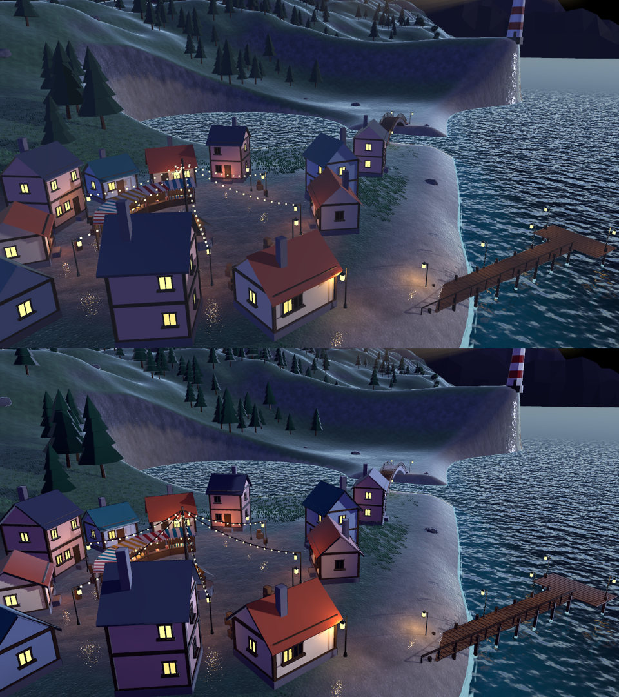
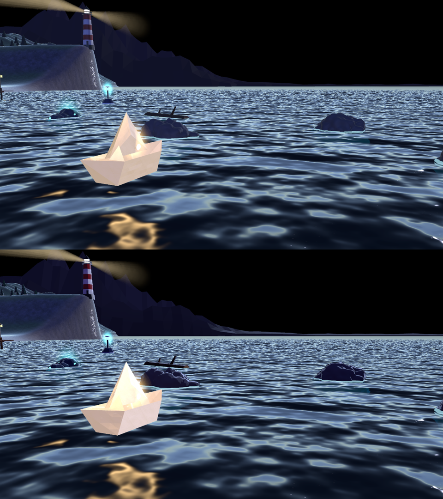
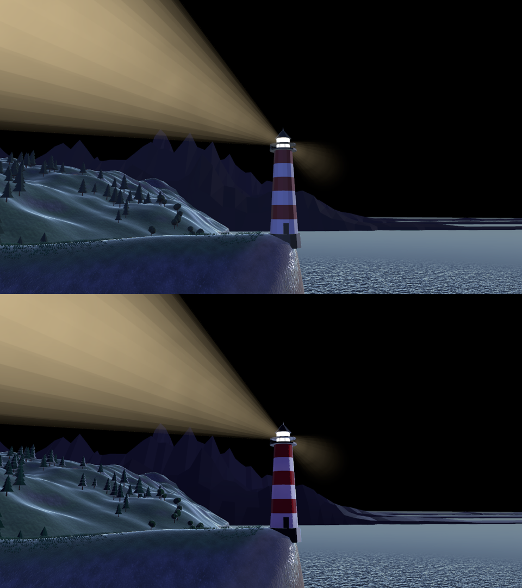
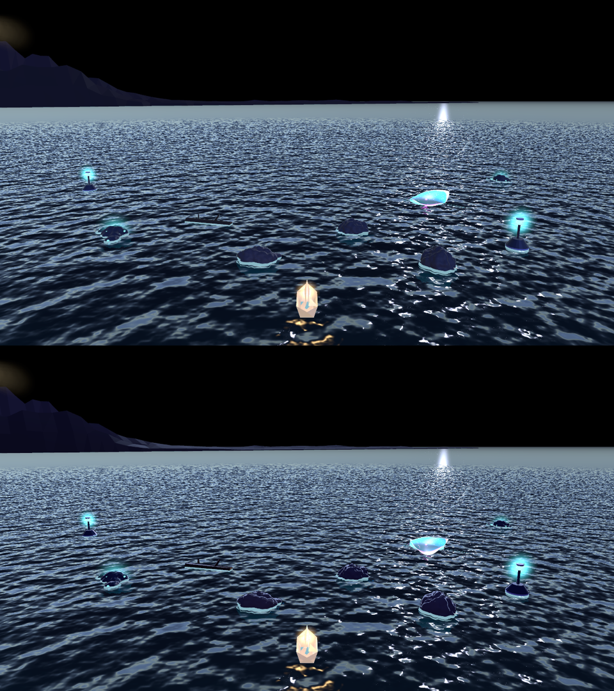

# Starlit Tides — Phase 8, Step 2: the stylized shading model

**Feedback:** *"The graphics are too low poly and look bad. Make them stylized and beautiful."*

Step 2 changes **how things are lit**, not their shapes. Every solid prop now uses one hand-written shader, `StarlitTides/Stylized`, instead of Unity's realistic `Universal Render Pipeline/Lit`. Smoother shapes come in Step 3.

To apply it:

1. Open the project and let Unity finish compiling.
2. **Starlit Tides → Rebuild Everything**. Materials are made by the builders, so the rebuild switches them all to the new shader.
3. Press **▶ Play**.

---

## Before / after

Each picture: **top = URP Lit (before), bottom = Stylized (after)**. It's the same scene, camera and props, rendered in the same session with post-processing off, so only the shading differs.

| Village | Boat and obstacles close up |
|---|---|
|  |  |

| Lighthouse | Gameplay camera |
|---|---|
|  |  |

What to look for:
- **Village:** thin indigo outlines on the houses, darker-to-lighter gradients up the walls and trees, warmer lantern light on the roofs, and indigo shadows instead of grey ones.
- **Close-up:** the rocks have a bright moonlit rim and a violet shadow instead of a near-black blob, and the paper boat's light is softer.
- **Gameplay camera:** the difference is smaller from up here, because most of the screen is ocean, which Step 5 restyles.

---

## 1. Why realistic shading looked cheap

URP Lit is a physically based shader. On simple procedural shapes it gives flat grey faces and near-black shadows, which reads as "unfinished low poly" rather than a chosen style. Stylized games instead *paint* light: a few soft tones, coloured shadows and a strong rim. That is what this shader does.

## 2. `StarlitStylized.shader` — the lighting model

It is hand-written URP HLSL, like the ocean, with five passes: **forward**, **outline**, **shadow caster**, **depth only** and **depth-normals**. The depth passes are needed for shadows, SSAO and the ocean's refraction.

**1. Banded light.** N·L, with a little wrap, goes through a soft three-tone ramp:

```
x    = saturate((N·L + wrap) / (1 + wrap)) × shadow
band = smoothstep(t1 ± s, x) × mid + smoothstep(t2 ± s, x) × (1 − mid)
```

That gives shadow → mid tone → lit. `smoothstep` keeps the edges soft, so it reads as painted rather than hard cel shading. Shadows from other objects go through the same ramp.

**2. Coloured shadows.**

```
color = albedo × (ambient + lerp(shadowTint, moonColour, band))
```

The shadow tone is ambient light plus an indigo tint, never black. Ambient comes from the scene's light probe (`SampleSH`), so the sunset intro and the storm still change it. SSAO darkens the ambient part only.

**3. Moonlit rim.** A fresnel band on the silhouette:

```
rim = smoothstep(1 − width, 1 − width + softness, 1 − N·V)
      × (0.35 + 0.65 · towardMoon)   ← brightest when you look toward the moon (the game camera does)
      × moonSide                     ← on the moon side of the object
```

This is what separates dark rocks and buoys from the dark sea.

**4. Specular blob.** Glossy materials get one crisp highlight, `smoothstep` around N·H, instead of a blurry PBR lobe.

**5. Height gradient.** Each object is darker at its base and lighter at the top, measured from the object's origin, like a painted gradient. Trees get a strong one; mountains get a 70 m one.

**6. Paint noise.** Triplanar value noise (three planar lookups blended by the normal) nudges the flat colours by a few percent, like brush strokes. It is skipped on the Low quality preset.

**7. Lanterns and windows.** Extra lights go through the same ramp inside URP's Forward+ light loop.

The property names match URP Lit (`_BaseColor`, `_BaseMap`, `_Smoothness`, `_EmissionColor`). So the builders' colours carried over 1:1, and scripts that animate emission (`LanternFlicker`, `LightMeter`) still work.

## 3. Outlines: the inverted hull

The outline pass draws the mesh a second time:

1. It pushes every vertex out along its normal, in **clip space**, so the line is the same pixel width at any distance (1.6 px at 1080p, scaled with resolution):

   ```
   cs.xy += normalize(normalCS.xy) × widthPx × 2 / screenSize × cs.w
   ```

2. It shows only the **back faces** (`Cull Front`), so only a rim sticks out around the real object.
3. It fills them with a deep indigo, never black, and fades the line out between 35 and 110 m so far objects don't get noisy.

**The flat-shading problem:** our meshes are flat shaded, so each corner has several vertices pointing in different directions. Pushing those out tears the hull apart at every edge. `MeshBuilder` now runs `BakeSmoothNormals`: every vertex at the same position gets the average normal, stored in **UV3**. The outline uses UV3, while the visible shading still uses the flat normals.

**Which materials get outlines.** `StylizedMaterials` turns the pass on or off per material with `SetShaderPassEnabled("SRPDefaultUnlit", …)`:

| Kind | Outline | Used for |
|---|---|---|
| Prop | ✓ | houses, roofs, pier, lighthouse, boat, buoys |
| Natural | ✓ | rocks, logs (more paint noise, stronger rim) |
| Detail | — | windows, lantern metal, cloth awnings (lines would swamp them) |
| Foliage | — | leaves and bark (hundreds of trees would turn into dark blobs); softer wrap |
| Distant | — | mountains (tall gradient, rim on the ridges) |
| Glow | — | lamps, windows, orbs: the emission is the point |

**Low quality:** the outline pass and the paint noise use the existing global keyword `STARLIT_QUALITY_LOW` (set by `SettingsManager`), so Low switches them off with no extra settings code.

---

## 4. How it was checked

1. **Rebuild Everything** in a batch-mode copy: it compiles with no errors, the shader imports with no errors, and 41 materials use the new shader.
2. **90 s bot playtest:** the same results as Step 1 (the boat covered the whole lane, ~26 obstacles active, survived 90 s) and no runtime errors.
3. **Fixed A/B renders** (`StarlitShots`): the same scene, camera and props, rendered once with the stylized materials and again with URP Lit copies of the same materials.

**A note on the batch renders' colours.** This session's batch renders come out much bluer after post-processing than this morning's Step 1 renders. I checked:
- The same blue appears when rendering the **untouched Phase 7 project** in the same way.
- The post profiles, URP assets and lighting values are identical.

So it comes from the batch render environment, not from these changes. That is why the comparisons above have post-processing off. Check the final colours in the Editor.

---

## Files

**New:** `Shaders/StarlitStylized.shader`, `Scripts/Editor/StylizedMaterials.cs`

**Changed:** `Scripts/Environment/ProcMesh.cs` (smoothed normals in UV3). Editor scripts: `EnvironmentBuilder.cs`, `GameplayBuilder.cs`, `FeaturesBuilder.cs` (their material helpers now go through `StylizedMaterials`; the obstacle rock material is now rebuilt fresh each time instead of reusing an old URP Lit copy).

**Not changed yet:** the ocean, sky, terrain, sea creatures, whale and jellyfish keep their own shaders. Creatures move to the stylized look in Step 3, the ocean in Step 5.

**Next:** Step 3, smoother geometry: mountains, trees, houses, lighthouse, rocks and the moon. See `Phase8_Plan_Stylized_Visuals.md`.
