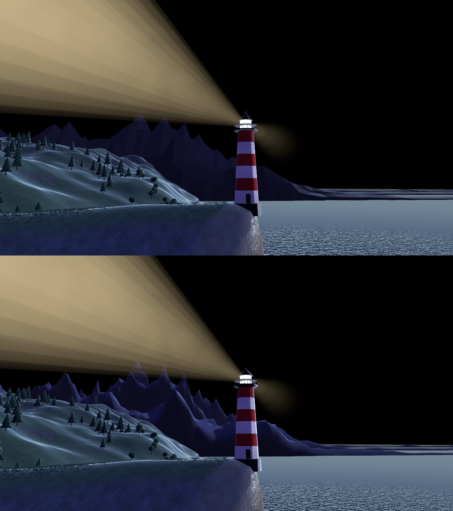
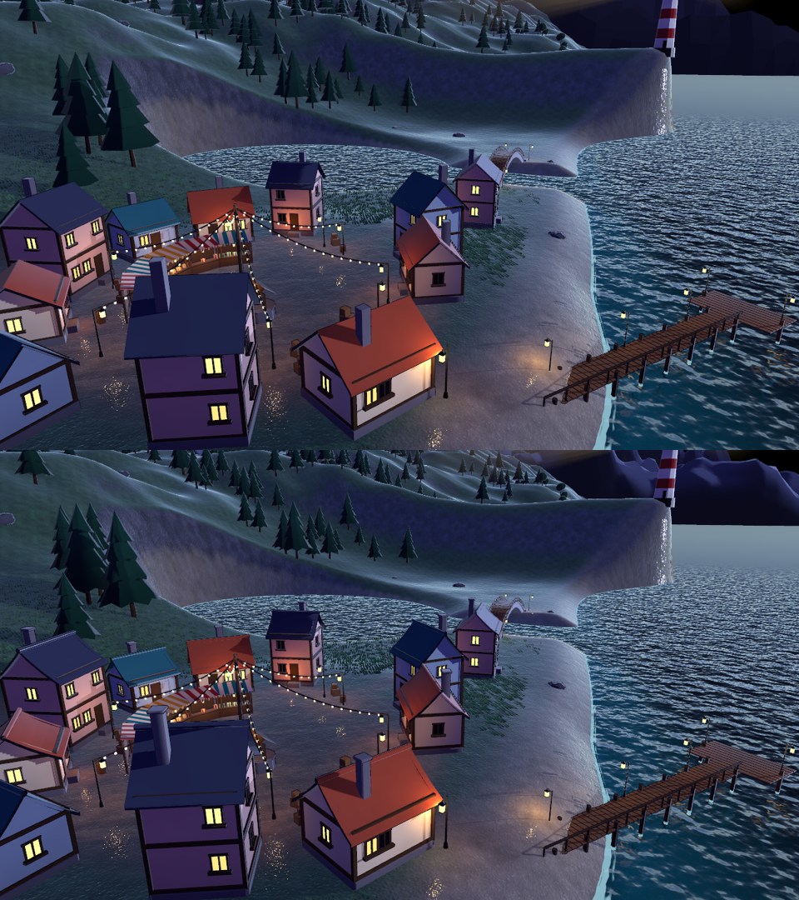
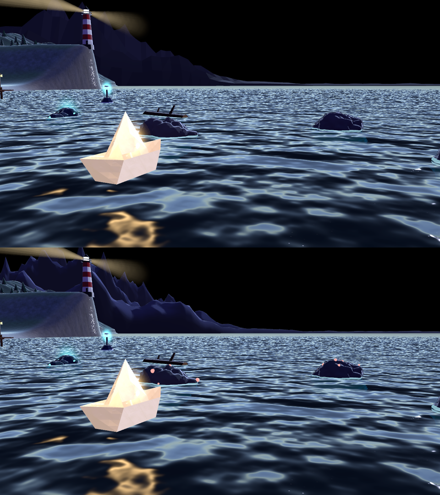
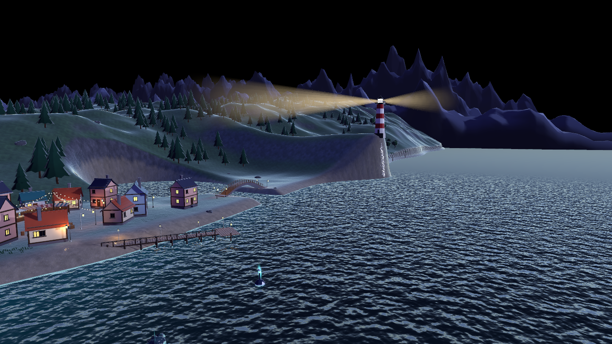
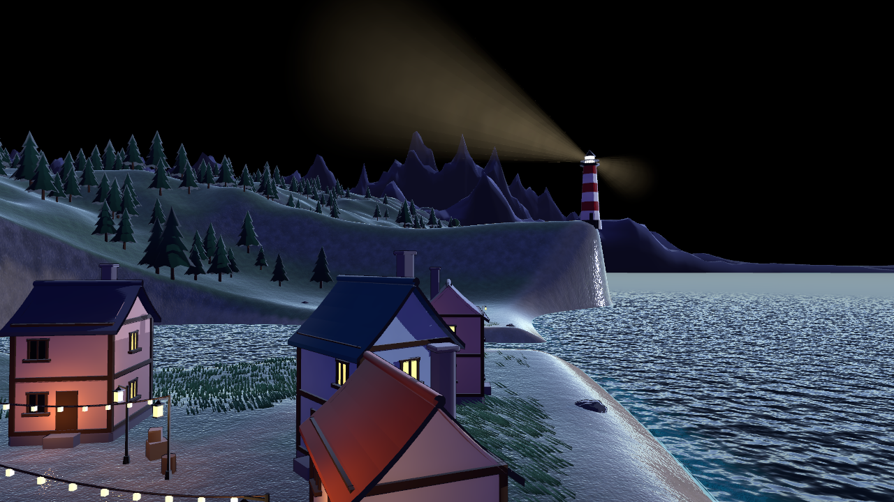

# Starlit Tides — Phase 8, Step 3: smoother, softer shapes

**Feedback:** *"The graphics are too low poly."*

Step 2 changed how things are lit. Step 3 changes **their shapes**: soft rounded silhouettes where the outline shows (mountains, trees, the lighthouse, logs, buoys), bevelled edges on the houses, and small details that catch the light.

To apply it:

1. Open the project and let Unity finish compiling.
2. **Starlit Tides → Rebuild Everything**. All meshes are generated, so the rebuild remakes them.
3. Press **▶ Play**.

---

## Before / after

Each picture: **top = Step 2, bottom = Step 3**. It's the same scene, camera and props, rendered in one session with post-processing off.

| Lighthouse and mountains | Village |
|---|---|
|  |  |

| Rocks, log and boat | Main menu view |
|---|---|
|  |  |



---

## 1. New tools in `MeshBuilder` (`ProcMesh.cs`)

`MeshBuilder` built everything **flat shaded**: every triangle had its own vertices and face normal. That is exactly the "low poly" look. It now has four tools.

### Smoothing groups

```csharp
mb.SmoothGroup = 1;            // 0 = flat (the old look)
mb.Cylinder(...);              // smooth sides
mb.SmoothGroup = 2;            // a different part never blends with group 1
```

When the mesh is finished, the vertices at the same position **and in the same group** get the area-weighted average of their face normals. Faces meeting at more than `SmoothAngle` (65°) are skipped. So a cylinder's sides turn round while its caps stay crisp, and a trunk never smears into its leaves. It's the same idea as smoothing groups in Blender or 3ds Max.

### Sphere normals (the stylized-foliage trick)

```csharp
mb.SphereCenter = crownCentre;
mb.SphereBlend  = 0.55f;   // lean normals 55% toward "outward from the centre"
```

A tree made of several cones shades as several cones. If every leaf normal instead leans out from the crown's centre, the light wraps around the whole crown, and it reads as **one soft, painted blob of foliage**. This is the standard trick in stylized games.

### Bevelled boxes

`ChamferBox` cuts every edge at 45° and puts a small triangle on each corner. The bevels catch the moonlit rim light from Step 2, so a box stops looking like a raw block.

### Accent mask (vertex colour)

`mb.Accent` (or a mesh's vertex colour red) is a 0–1 mask. `StarlitStylized.shader` has a new `_VERTEX_ACCENT` option that blends toward `_AccentColor` where the mask is high. It is used for **snow caps** and **moss**.

---

## 2. What was rebuilt

| Asset | Before | Now |
|---|---|---|
| **Mountains** | 2 rows of quads: each peak was one flat triangle | a **heightfield strip**: 340 columns × 32 rows per range, shared vertices with smooth normals. Each column has a ridge cross-section (rises to a crest, falls away behind), and 2D ridged noise carves **spurs and gullies** down the slopes. Snow mask = high **and** not too steep. Far ranges are darker so they recede into the night |
| **Pine trees** | 4 cones, 7 sides each, flat | 16-sided tiers with a **frilly drooping rim** (alternating long and short "needle" points), a closed underside, smooth shading and sphere normals |
| **Round trees** | 3 icospheres at detail 1 (80 faces) | detail 2 (320 faces), smooth, normals blended between each blob's centre and the crown's |
| **Palms** | 6-sided trunk | 10-sided smooth trunk, smooth coconuts |
| **Lighthouse** | 14 segments, flat | **32 segments**, one smooth tower across all the stripes, a flared corbel under the gallery, 24 railing posts, a smooth glass room and cap, a bevelled door |
| **Houses** | plain boxes | bevelled walls, foundation and chimney; a chimney cap; roof slopes made of **5 gently sagging strips** (they read as rows of old tiles); a **round ridge cap** |
| **Drift log** | 9-sided cylinder | a lofted trunk (20 sides × 10 rings) with **bark grooves** and a slight bulge, smooth, with crisp cut ends; smooth branch stubs |
| **Obstacle rocks** | grey blobs | **moss** on the upward-facing tops (accent mask) and **coral lichen dots**. In the art direction, warm coral means danger and cyan means collect |
| **Channel reefs** | — | moss accent too |
| **Jellyfish** | bell 7 × 20 | 14 × 32: a smoother silhouette |
| **Channel buoys** | flat 20-sided | smooth float and mast, crisp caps |

Not changed: the paper boat stays faceted on purpose (it's folded paper). The moon already had craters, limb darkening and a halo from Phase 2.

---

## 3. Bugs found and fixed while testing

1. **`Quaternion == default` is never true in Unity.** The `==` operator compares with a dot product, and `default(Quaternion)` is (0,0,0,0), so the dot is 0. `ChamferBox` checks the four fields instead.
2. **Invisible mountains: NaN vertices.** At the back edge of the ridge, `cos(π/2)` comes out as −4·10⁻⁸, and `Mathf.Pow(negative, 0.9)` is **NaN**. Unity then saved an empty mesh, with an "abnormal mesh bounds" warning in the log. The fix clamps the value with `Mathf.Max(0, …)` before `Pow`. A mesh probe confirmed ~11k vertices per range and front normals facing the viewer.

---

## 4. How it was checked

- **Rebuild Everything** in a batch copy: no compile errors and no shader errors.
- **Mesh probe:** every mountain range is valid (vertex count, bounds, normals).
- **90 s bot playtest:** the boat covered the whole lane (−21 … +22), ~27 obstacles were active on average, it survived 90 s, and there were no exceptions.
- **Fixed A/B renders** against Step 2: the same props and cameras, with post-processing off. Post is off because of the batch-render colour issue explained in the Step 2 guide.

---

## 5. What's still flat

- **The terrain** (beach, hills, cliffs) still uses Unity's Terrain Lit shader. It's the largest surface in the menu view, and the cliff face in particular reads as plain.
- **Sea creatures, the whale and the jellyfish** keep their own shaders. They have no outline or stylized rim yet.
- **The pier** still has simple planks and posts.
- **Snow caps** are subtle. The mask works, but most slopes are steep, so only the gentler shoulders get snow.

---

## Files

**Changed:** `Scripts/Environment/ProcMesh.cs` (smoothing groups, sphere normals, accent, `ChamferBox`; trees, lighthouse, houses, mountains, rock moss), `Shaders/StarlitStylized.shader` (`_VERTEX_ACCENT` / `_AccentColor`). Editor scripts: `StylizedMaterials.cs` (`SetAccent`, darker distant ranges), `EnvironmentBuilder.cs` (snow and moss accents), `GameplayBuilder.cs` (lofted log, jellyfish bell, rock moss and coral lichen, smooth buoys).

**Next:** Step 4, filling the sea beyond the lane (`AmbientSeaField`: kelp glow, lanterns, sea stacks, distant islands). See `Phase8_Plan_Stylized_Visuals.md`.
