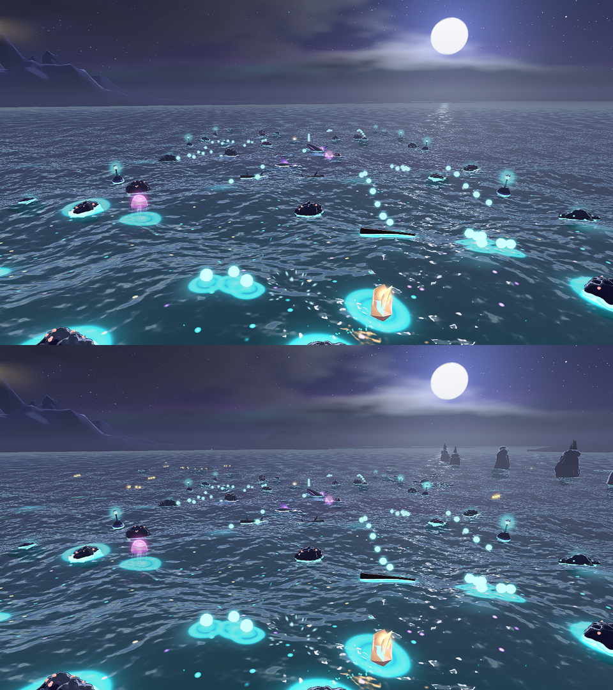
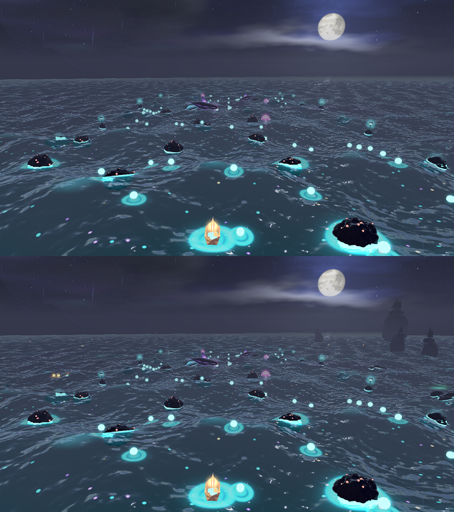
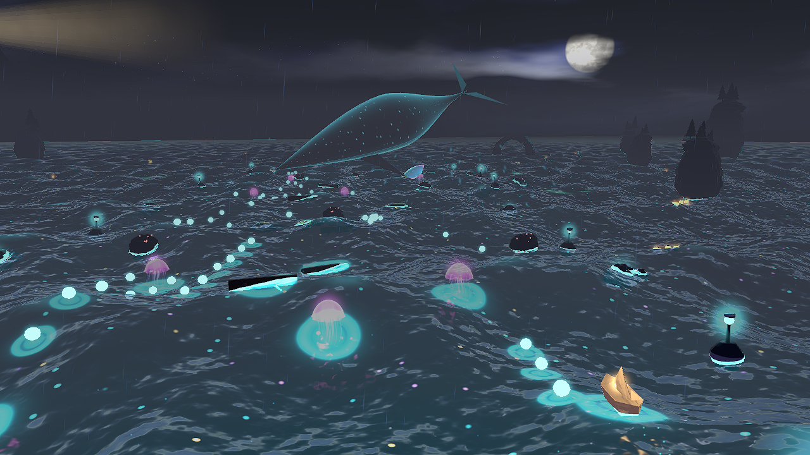
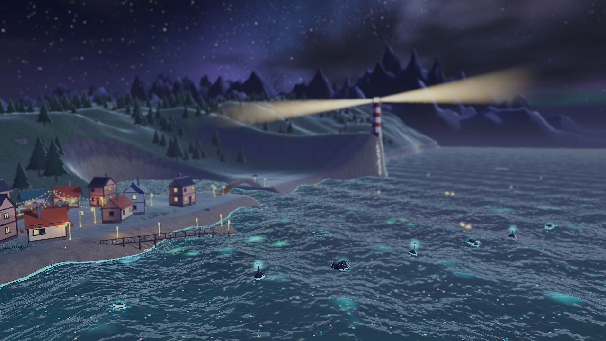

# Starlit Tides — Phase 8, Step 4: filling the sea beyond the lane

**Feedback:** *"…only a small section of the map is filled with objects."*

Step 1 widened the lane and tightened the camera. Even so, the camera still sees ~200 m of sea across, and the lane is ~50 m of it. Step 4 fills the rest with **scenery that drifts past**, so the whole screen reads as a living bioluminescent sea.

To apply it:

1. Open the project and let Unity finish compiling.
2. **Starlit Tides → Rebuild Everything**. This now also runs the new step **11. Build Sea Field**.
3. Press **▶ Play**.

---

## Before / after (the same frame)

Each picture is **one frame rendered twice**, with post-processing off: **top = scenery hidden, bottom = scenery shown**. The obstacles, orbs, boat and camera are identical.

| 30 s into a run | 45 s into a run |
|---|---|
|  |  |

| Storm, with the humpback breaching | Main menu |
|---|---|
|  |  |

---

## 1. What floats past

All of it is procedural, built by `SeaFieldBuilder.cs`. None of it has a collider: it's scenery only, and it never sits in the lane.

| Band (distance from lane centre) | Side | Scenery |
|---|---|---|
| **Near** 28–50 m, every 15 m | both | **glowing algae blooms** (soft mint or cyan patches lying on the water, with floating sparks), **paper lantern clusters**, mossy **rock clusters** |
| **Mid** 55–92 m, every 26 m | right (open sea) | **sea stacks** with little pines on top, a natural **rock arch**, **fishing boats** with a lantern, lanterns |
| **Mid** 55–92 m, every 30 m | left (toward the coast) | fishing boats, algae, lanterns, rocks (smaller things, because the coast is on this side) |
| **Far** 98–145 m, every 44 m | right | a **giant sea stack**, sea stacks, **whales surfacing** with a misty spout every 4–9 s |
| **Far** 98–145 m, every 52 m | left | whales and fishing boats only: tall stacks here stood in front of the lighthouse cliff in the menu view |
| **Horizon** 550–1150 m | static | five **island silhouettes**, a far **lighthouse light** on the biggest island, two **ship lights** |

**Set pieces:** every 38–55 s of play, one of these floats past on a flank:
- a **ring of 12 lanterns** around a mint algae bloom
- a **glowing coral arch** (the rock arch crusted with violet glow)

**Following the art direction:**
- **Warm light is rare.** Lanterns and boats are the only warm accents at sea, so they read as precious against the cool night.
- **Glow colours never mean "danger" out here.** The algae is mint or cyan at low strength, and the coral arch is violet. The scenery rocks have moss but no coral lichen, which stays reserved for the obstacle rocks.
- **The moon's glitter path stays open.** The horizon islands keep 10–30° to the right (where the moon is) clear.

## 2. How it works

**`AmbientSeaField`** (runtime spawner):
- Each band has a distance range, a spacing and the sides it uses. The spawner adds up how far the tide has carried the sea, and each time that passes the band's spacing it spawns a new row at the band's spawn distance (190–280 m out, so things appear in the haze rather than popping in).
- The two sides are offset by half a spacing so they never line up.
- Positions **lean toward the outer edge** of each band: `u = 1 − (1 − r₁)(1 − r₂)`, which skews toward 1. So density rises toward the screen edges and the eye is drawn back to the centre.
- The **whole field is laid out at once** when the scene starts, so the sea is already full in the menu and on the first frame of a run.
- Density follows the quality preset: **45 % on Low, 100 % on High** (~25 vs ~60 objects active).

**`SeaDecor`** (on each prefab, a `DriftingObject`):
- It drifts with the tide like everything else. Optionally it breathes a glow, rocks on the waves, bursts a particle spout, or picks a random size and heading when it leaves the pool.
- **Coast check:** nothing spawns over land or shallows. Scenery the tide carries toward the beach removes itself when the terrain under it rises above −1.2 m (`Terrain.SampleHeight`). This happens off-screen, since the coast is far to the left.

**`DriftingObject.despawnX`:** the base class used to remove anything more than 45 m from the centre line, which suits obstacles but would delete scenery instantly. It's now a field: 45 for gameplay objects, 200–260 for scenery.

**Performance:**
- No real lights: every glow is an emissive material or an additive soft-dot quad.
- Shadows off on all scenery.
- GPU instancing on.
- About 60 objects at High.

## 3. How it was checked

- **Rebuild Everything** in a batch copy: it compiles and logs "Sea field built: drifting scenery in 4 bands, 2 set pieces and the horizon islands".
- **Bot playtests in Play mode** (three runs while tuning):
  - 52–64 scenery objects active the whole time.
  - The boat still covered the whole lane, with about 26–27 obstacles active as before.
  - Zero exceptions.
  - In the last two runs the bot's light ran out at ~68 s. That's right after the first whale-wave event (55 s), which this crude bot can't dodge well. The first Step 4 run reached 90 s, and nothing in Step 4 touches gameplay.
- **Same-frame before/after:** the harness hides the scenery renderers, renders, shows them and renders again (pictures above).
- **Two tuning changes from the first look:**
  - The first mix had too many sea stacks, and they read as a fence of pillars at the same distance. Stacks are now a minority, with more boats, lanterns and whale spouts.
  - Far-band stacks on the left (coast) side stood in front of the lighthouse cliff in the menu view, so tall scenery is now on the open-sea side only.

## Files

**New:** `Scripts/Gameplay/AmbientSeaField.cs`, `Scripts/Gameplay/SeaDecor.cs`, `Scripts/Editor/SeaFieldBuilder.cs` (menu **11. Build Sea Field**)

**Changed:** `Scripts/Gameplay/DriftingObject.cs` (`despawnX`), `Scripts/Editor/CreaturesBuilder.cs` (Rebuild Everything also builds the sea field)

**Generated by the rebuild:** `Prefabs/SeaField/*.prefab` (13 prefabs) and their meshes and materials in `Generated/SeaField/`

**Next:** Step 5, the ocean and atmosphere restyle (softer stylized foam, glowing trails, calmer micro-ripples, colour grading). See `Phase8_Plan_Stylized_Visuals.md`.
