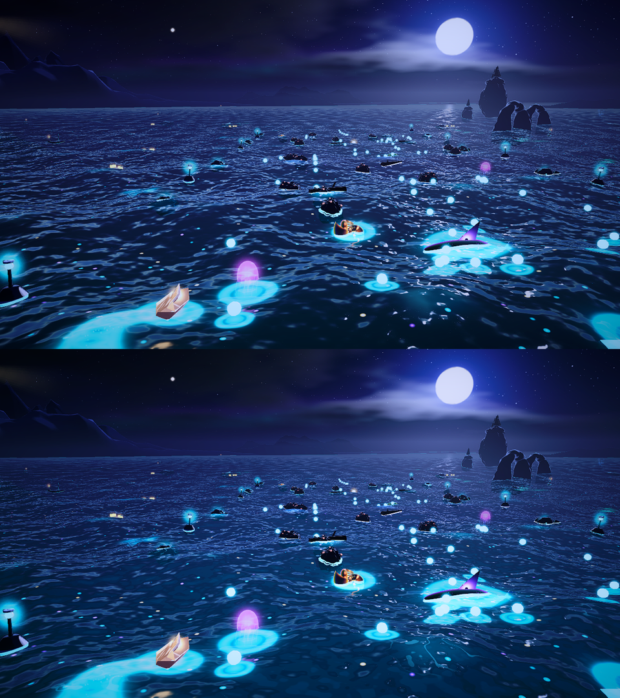
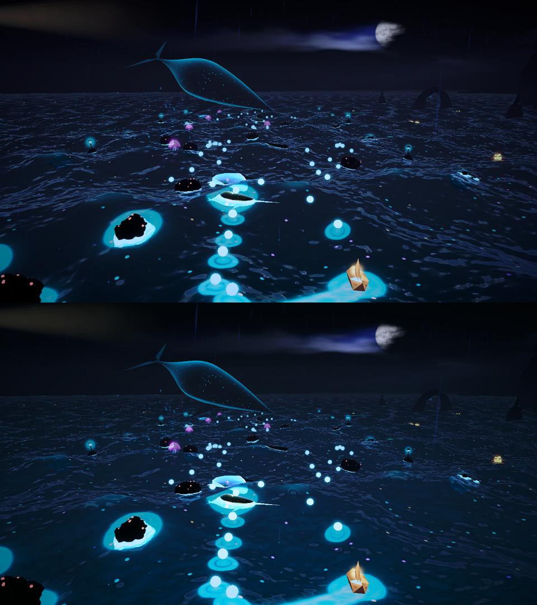
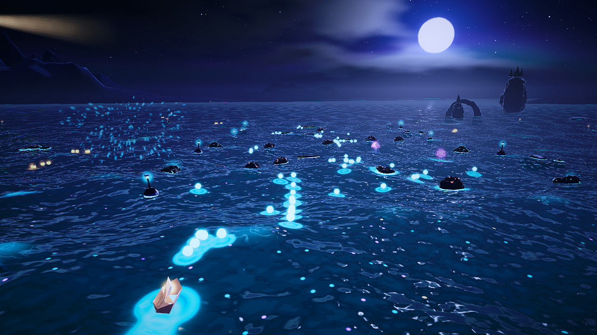
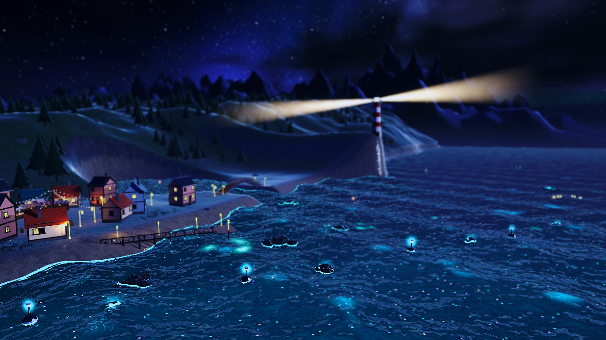

# Starlit Tides — Phase 8, Step 5: a stylized sea and colour grade

The ocean is most of what you see from the gameplay camera, so Step 5 restyles it to match Steps 2–4. It also replaces the old split-toning grade with a **colour-grading LUT built in code**, and fixes a long-standing bug that randomly dropped the whole night grade.

To apply it:

1. Open the project and let Unity finish compiling.
2. **Starlit Tides → Rebuild Everything**.
3. Press **▶ Play**.

---

## Before / after (the same frame)

Each picture is **one frame rendered twice**, with post-processing on:
- **top:** the Phase 7 ocean (`_StylizeAmount = 0`) with no LUT
- **bottom:** the Step 5 ocean with the LUT

| 30 s into a run | 60 s |
|---|---|
|  |  |

| The glowing wake behind the boat | Main menu |
|---|---|
|  |  |

---

## 1. The ocean (`StarlitOcean.shader`)

Every change blends in with one material slider, **`_StylizeAmount`** (0 = the Phase 7 look, 1 = Step 5). That's how the before/after pictures were made.

| Change | How |
|---|---|
| **Painted colour ramp** | Water looking straight down and close to the camera is teal (`_NearColor`); grazing or far water is deep indigo (`_DeepColor`). The blend factor is **softly posterized** into 4 bands: `band = floor(k) + smoothstep(0.5 ± s, frac(k))` with `k = x·n`. Shallow water still shows what is below it (rocks, sand) |
| **No grey reflection wash** | The sky reflection is desaturated and tinted toward a cool lilac-teal (`_ReflectionTint`), and the fresnel term is lightly banded |
| **Star glints instead of pixel speckle** | The old 900-power specular made single white pixels flicker all over the near water. It's now at 20 %. Instead, one **four-point star** per 1.1 m cell twinkles where the moon catches the waves (a broad `N·H` mask). Stars fade out once a cell is under ~6 px wide (`fwidth`), so the distance never shimmers |
| **Calmer micro-ripples** | The fine ripple layer is at 0.22 instead of 0.5 (`_MicroRipple`) |
| **Foam lines** | Crest foam is now soft, flowing **contour lines** of the foam noise (`1 − abs(frac(n·3 + t)·2 − 1)`) on the wave crests, instead of random speckle |
| **Glowing wake** | See below |

### The boat's glowing wake

`OceanController` drops a point behind the boat every 0.1 s (up to 28 points, ~2.8 s of wake). Each point is `(x, z, time, strength)`, stored in **flow coordinates** (world position + the tide offset). That's the same space the shader's wave and plankton patterns live in, so the wake **drifts away with the water** instead of following the boat. Strength rises with steering speed and doubles on a dash.

In the shader, `WakeGlow` finds the distance from each pixel to the ribbon of segments between the points. The ribbon gets **bright edges and a softer middle** (two Gaussians), **widens with age** (`w = width·(1 + 0.9·age)`), fades out, and has a slow noise swirl. Pixels more than 60 m from the boat skip the loop.

## 2. The colour-grading LUT (`EnvironmentBuilder.StarlitGradeLut`)

A LUT (look-up table) is a **32×32×32 colour cube**, stored as a 1024×32 strip: 32 slices, one per blue level; inside a slice, x = red and y = green. URP's Color Lookup feeds every pixel's colour through it. So whatever the grading function does to one colour happens to the whole picture, for the cost of one texture lookup.

`Grade()` does four things to each colour:
1. **Shadows** toward **teal** (green up). The night grade is already cool, so the LUT adds green rather than more blue.
2. **Highlights** toward warm moonlight or lantern gold.
3. A little **extra saturation in the mid-tones**, where the glow colours live.
4. A gentle **S-curve** for depth.

The texture is imported linear (no sRGB), uncompressed and without mipmaps, because compression would band the colours. It replaces the old Split Toning. White balance, ACES tonemapping, bloom and vignette stay as they were.

The **first tuning pass made the picture too blue**: the blue-to-red ratio went from 2.9 to 4.6. The shadow tint was then moved from blue to teal and the saturation boost halved, giving 3.9 with green up as well.

## 3. Bug fix: the night grade disappeared at random

`BuildPostProcessing` (from Phase 2) found "the" global volume by taking **the first global volume in the scene**. On every rebuild after the first, the scene also contains the Hit Flash, Light Vision, Photo Mode and menu volumes, and Unity's search order isn't fixed. So it sometimes:
1. grabbed one of those,
2. renamed it and gave it the night profile, and
3. lost it again when that volume's own builder rebuilt it.

The real night volume was then left pointing at a deleted profile: **no tonemapping, bloom or grade at all**.

This explains why the batch test renders kept changing colour between runs during Steps 1–4. The builder now looks the night volume up **by name** ("Global Volume (Starlit Night)", or the template's "Global Volume"). The playtest confirms it: the volume has its profile, the LUT is valid, and URP's blended stack reports the colour lookup as active.

Your scene as committed (dcd63f2) still had the correct reference. But any earlier "Rebuild Everything" could have broken it, so check that **Global Volume (Starlit Night)** has **PP_StarlitNight** assigned after rebuilding.

**Left as they were:** the low sea mist and the moon god rays (`StarlitAtmosphere`) were already in place from Phase 7 and work with the new look.

---

## 4. How it was checked

- **Rebuild Everything** in a batch copy: no compile or shader errors.
- **90 s bot playtest:**
  - the boat covered the whole lane
  - ~27 obstacles active on average
  - the wake buffer was full (28 points) the whole time
  - zero exceptions
- **Same-frame before/after** for five moments of a run (pictures above), plus average-colour measurements to keep the grade from drifting too blue.

## Files

**Changed:**
- `Shaders/StarlitOcean.shader` (stylized ramp, reflection tint, star glints, foam lines, wake; `_StylizeAmount`)
- `Scripts/Environment/OceanController.cs` (wake recording and the `_TrailPoints` upload)
- `Scripts/Editor/EnvironmentBuilder.cs` (LUT generator in place of split toning; night-volume lookup fix)

**Generated by the rebuild:** `Generated/Textures/T_StarlitGradeLUT.png`

**Next:** Step 6, performance and quality tiers, then updating the README. See `Phase8_Plan_Stylized_Visuals.md`.
