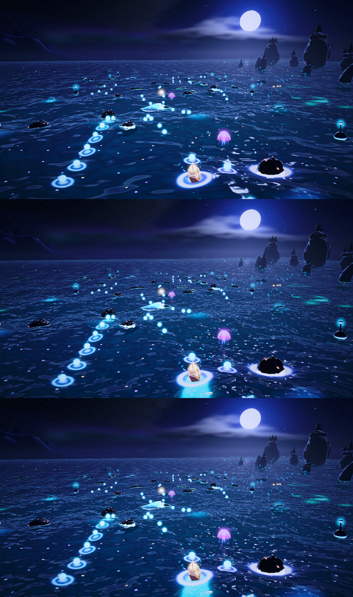

# Starlit Tides — Phase 8, Step 6: performance and quality tiers

Steps 1–5 added scenery, outlines, a new ocean look, a glowing wake and a colour LUT. Step 6 measures what each of these costs, makes the Low / Medium / High presets switch them sensibly, and removes the waste the measurements found.

To apply it: **Starlit Tides → Rebuild Everything** (for the beach-rock and Medium-MSAA changes), then press **▶ Play** and try the presets under **Settings → Quality**.

---

## 1. What each tier does now

| Feature | Low | Medium | High |
|---|---|---|---|
| Stylized shading (bands, rim, coloured shadows) | ✓ | ✓ | ✓ |
| Paint noise on props | — | ✓ | ✓ |
| Outlines | — | ✓ | ✓ |
| Sea field density | 45 % (~25 objects) | ~73 % (~43) | 100 % (~60) |
| Boat wake glow | — | ✓ | ✓ |
| Star glints on the waves | — | ✓ | ✓ |
| Moon god rays | — | — | ✓ |
| Anti-aliasing | SMAA (85 % res, FSR) | **2× MSAA** (was 4×) | 4× MSAA |
| Shadows | 1 cascade, 1024 | 2 cascades, 2048 | 4 cascades, 4096 |

Low already had `STARLIT_QUALITY_LOW`, a global shader keyword set by `SettingsManager`. Step 6 hangs the new features on it, so there's still no per-material bookkeeping. God rays are switched through `SkyController.godRayQuality`, and the sea field reads the preset itself every frame, so a change applies from its next spawns.

## 2. Measuring it

The playtest harness now benchmarks every tier at one moment of a run:
- It renders the gameplay camera 40 times at 1080p and at 1440p.
- It reads back one pixel at the end, which forces the GPU to finish before the clock stops.
- For High at 1440p, it switches features off **one at a time** and re-times the frame (an *ablation*). The difference is what that feature costs.

These are **editor (batch mode) timings on an Apple M4**. A standalone build usually runs faster, so read them as relative costs, not final frame rates.

**Ablation at High, 1440p:**

| Without… | Before Step 6 | After Step 6 |
|---|---|---|
| — (whole frame) | 21.9 ms | **21.0 ms** |
| the ocean (Phase 2/7) | 6.6 ms | **5.6 ms** |
| god rays (Phase 7, now High only) | 1.8 ms | 1.6 ms |
| atmosphere pass | 1.3 ms | 1.5 ms |
| **boat wake** (Step 5) | **1.2 ms** | **≈ 0 ms** |
| **outlines** (Step 2) | 1.0 ms | 1.1 ms |
| post-processing | 0.8 ms | 0.4 ms |
| **sea field + horizon** (Step 4) | 0.45 ms | 0.4 ms |
| **stylized ocean look** (Step 5) | 0.14 ms | 0.1 ms |

So **everything Phase 8 added costs about 1.6 ms** at 1440p. The rest is the ocean shader from Phase 2/7 and about 15 ms for the rest of the scene in this editor session (terrain, 650 trees, shadows, SSAO, MSAA).

**Per tier, gameplay camera:**

| Tier | 1080p | 1440p |
|---|---|---|
| Low | 11.5 ms (87 fps) | 15.8 ms (63 fps) |
| Medium | 13.3 ms (75 fps) | 21.3 ms (47 fps) |
| High | 13.9 ms (72 fps) | 21.5 ms (47 fps) |

All three tiers reach **60 fps at 1080p** in the editor. At 1440p only Low does; Medium and High land around 47 fps in the editor. The plan's target was High ≥ 60 at 1440p, and it isn't met in this measurement. Test a real build before deciding whether the ocean needs more work. Medium also costs nearly the same as High: the frame isn't MSAA-bound, and shadows matter little out at sea.

## 3. The optimisations

| Problem the measurements showed | Fix |
|---|---|
| The **wake** ran its 28-segment loop for every pixel within 60 m of the boat (most of the lower screen) | `OceanController` now sends the trail's **bounding box** (`_TrailBounds`, padded by the widest glow). Pixels outside skip the loop: **1.2 ms → ~0** |
| The **ripple normal** costs ~21 noise lookups per pixel and was computed even for far water, where it's faded to nothing | early-out when the fade is 0: **ocean 6.6 → 5.6 ms** |
| Hundreds of small **beach rocks** had outlines | outline pass off on `M_Rock` (obstacles and props keep theirs) |
| **Medium** used the same 4× MSAA as High | 2× MSAA (in `UIBuilder`, which builds the URP assets, and in `URP_Medium.asset`) |
| God rays ran on every tier | High only (`SkyController.godRayQuality`) |

Rules kept from the plan:
- All scenery has shadows off and uses GPU instancing.
- No real lights out at sea: every glow is emission or an additive quad.
- `StarlitStylized` keeps every material property in `UnityPerMaterial`, so it stays SRP Batcher compatible.

## 4. Checked

- Rebuild in a batch copy: no compile or shader errors.
- 90 s bot playtest with the benchmark: whole-lane coverage, ~27 obstacles active, zero exceptions.
- The tier screenshots show the wake and glints off on Low and on for Medium and High.

## Files

**Changed:**
- `Shaders/StarlitOcean.shader` (wake bounds, far-ripple skip, Low skips wake and glints)
- `Scripts/Environment/OceanController.cs` (`_TrailBounds`)
- `Scripts/Environment/SkyController.cs` (`godRayQuality`)
- `Scripts/Core/SettingsManager.cs` (god rays by tier)
- `Scripts/Gameplay/AmbientSeaField.cs` (density follows the preset live)
- Editor scripts: `EnvironmentBuilder.cs` (no outlines on beach rocks), `UIBuilder.cs` (Medium 2× MSAA)
- `Settings/URP/URP_Medium.asset`

**Possible follow-ups:** a cheaper ocean on Medium (fewer ripple octaves, half-resolution refraction), and a timing pass in a standalone build.
