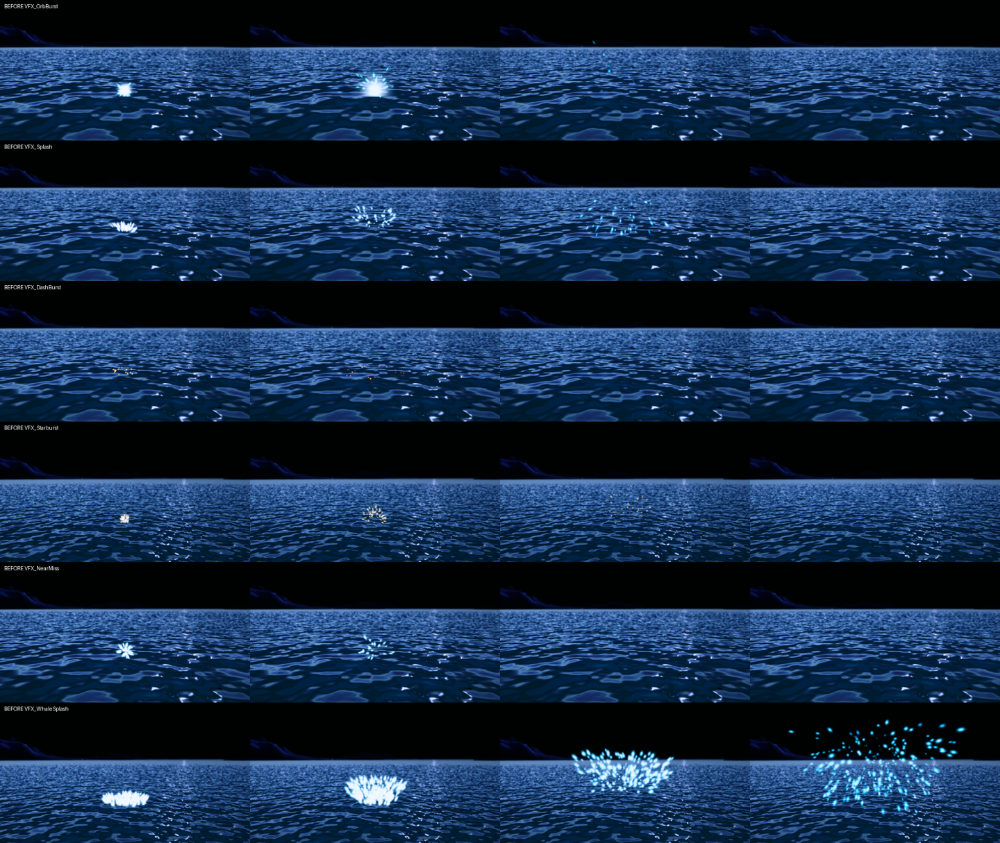
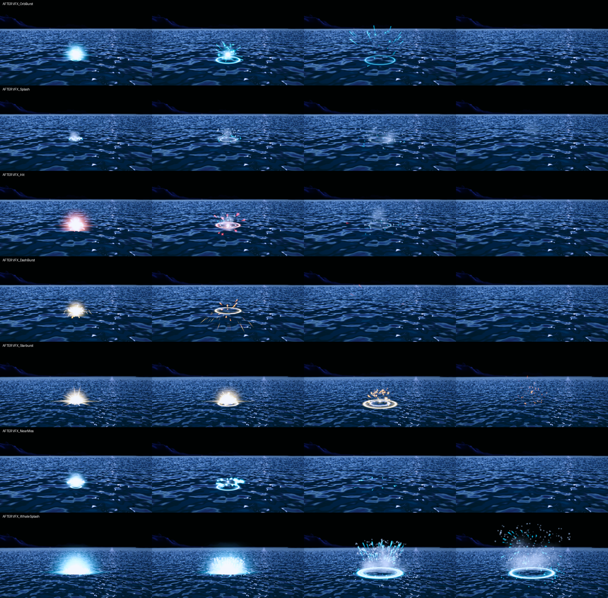
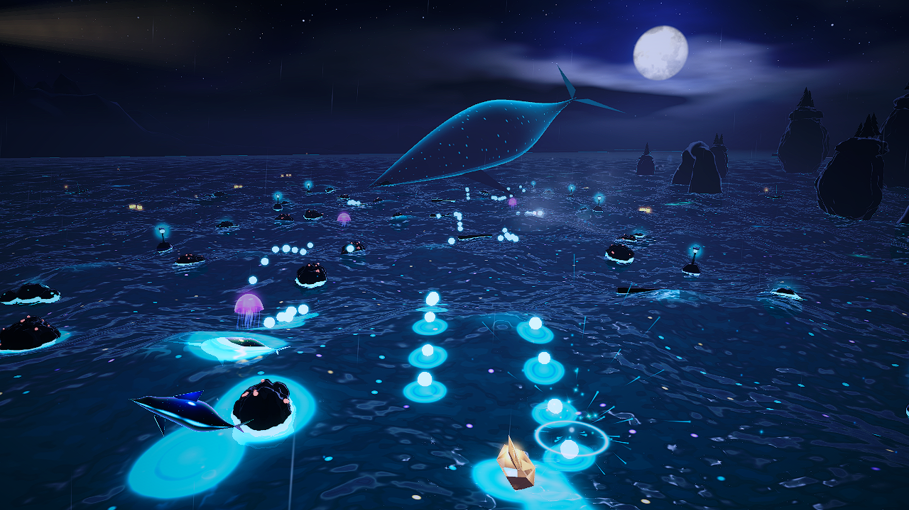

# Starlit Tides — Phase 8, Step 7: VFX polish

**Feedback:** *"The effects, particles and VFX look unfinished or unpolished. Make them super high quality and mind-blowingly beautiful."*

Every particle effect used to be one layer of round soft dots with a linear fade. Step 7 replaces them with **layered effects** built from a shared toolkit: a new particle shader, a procedural texture set, and per-effect timing, size and colour curves.

To apply it:

1. Open the project and let Unity finish compiling.
2. **Starlit Tides → Rebuild Everything**. The effects are generated by the builders.
3. Press **▶ Play**.

---

## Before / after

The same effect, camera and moments (0.08 s, 0.25 s, 0.6 s, 1.1 s after it fires), fast-forwarded with `ParticleSystem.Simulate` in Edit mode so the comparison is frame-exact.

**Before**

**After**

In play, during a storm (an orb pickup next to the boat: shockwave ring and light trails; soft rain):

---

## 1. The particle shader (`StarlitVfx.shader`)

One shader, two blend modes, picked per material:

| Mode | Blend | Used for |
|---|---|---|
| **Additive** ("light") | `One One` | sparks, glows, flares, rings, trails |
| **Premultiplied alpha** ("matter") | `One OneMinusSrcAlpha` | spray, mist, foam, rain |

The features that make it look finished:
- **White-hot core:** `pow(alpha, k) × _CoreBoost` pushes the densest part of each sprite toward white, so every glow has a hot centre and a coloured falloff, like real light.
- **Soft particles:** particles fade where they meet the water or a rock (the depth difference), so there are no hard cut lines. Rings lying *on* the water use a tiny fade distance, or the fade would hide them completely.
- **Near fade:** no screen-filling quads right in front of the camera.
- **Fog:** additive light fades with the fog; alpha particles mix into it.
- **Flipbooks** work as they are (the mist uses a 2×2 sheet with a random frame per particle).

## 2. The texture set (`VfxKit`, generated in code)

All white, with the shape in alpha:

| Texture | Shape |
|---|---|
| glow | soft round light with a bright centre |
| **sparkle** | four-point star with thin diffraction spikes, shorter diagonal spikes and a faint halo |
| ring | thin soft ring (shockwaves, ripples) |
| droplet | teardrop with a bright head (stretched spray) |
| mist | 2×2 flipbook of soft fractal-noise puffs |
| streak | tapered line (speed lines, light rays) |
| flare | anamorphic horizontal flare (flashes) |
| trail | soft line (particle light trails) |

Textures are rewritten in place and materials are updated in place, so their GUIDs never change. A prefab built by one step never loses its material when another step runs on its own.

## 3. The effects

Each effect is a stack of layers with their own timing:

| Effect | Layers |
|---|---|
| **Orb collected** | anamorphic flare + white-hot glow; a cyan **shockwave ring** on the water; 16 twinkling star sparks that **spiral up** (orbital velocity); 22 tiny glows with **light trails** |
| **Splash** (creatures landing) | stretched spray droplets (matter); a foam ring; soft **mist** puffs; cyan plankton sparks |
| **Hit** (new: obstacle impacts) | the splash + a **coral flash**, coral danger sparks with trails, and a coral ring. Warm coral means danger in the art direction, so a hit no longer looks like a creature splashing |
| **Dash** | speed lines streaming back down the lane; a gold flash and ring; gold sparks with trails |
| **Starburst** (golden star) | a huge flare; **two shockwaves** (gold, then white); 16 radiating light rays; 60 trailing gold sparks; golden embers rising for ~2 s |
| **Near miss** / hidden-orb reveal | cool flash; 28 trailing sparkles in a ring; whoosh lines; a cyan ring |
| **Whale splash** | a 220-drop spray column + a 90-drop crown (matter); 22 big mist puffs; a foam ring and a glow ring (24–30 m); a big flash; 70 plankton sparks spreading across the water; 50 trailing column sparks |

The ambient systems are restyled the same way:
- **Boat wake:** twinkling star sparks in cyan and mint.
- **Fireflies:** a white-hot core and short light trails.
- **Plankton motes:** tiny twinkling stars.
- **Rain:** soft pale streaks, plus a new **ripple ring system on the sea**. Its rate follows the rain (`RainRipples`).
- **Shooting star:** a white → gold → violet trail, an anamorphic head and **falling stardust**.
- **Whale spout:** soft rising mist instead of dots.

Two techniques make the rings work:
- **Rings on the real waves:** `PooledParticle` moves the ring layers onto the actual wave height (`OceanController.GetWaterHeight`) just before the effect plays, so rings never vanish under a swell.
- **Curve modes:** Unity requires the x/y/z (and orbital) velocity curves of a particle system to share one curve mode. `VfxKit.Vel` always sets them together.

## 4. How it was checked

- **Rebuild Everything** in a batch copy: no compile errors, no particle-curve errors.
- **One shader bug, found and fixed:** `Luminance()` isn't available with URP's Core include alone, so the additive variant failed to compile and rendered magenta. It now uses the explicit luma dot product.
- **Gallery renders** of all 7 one-shot effects before and after (above).
- **90 s bot playtest:** zero exceptions. Frame time is unchanged (High 1080p: 73 fps, the same as before Step 7).

## Files

**New:**
- `Shaders/StarlitVfx.shader`
- `Scripts/Editor/VfxKit.cs`
- `Scripts/Gameplay/RainRipples.cs`
- generated `Generated/VFX/` (8 textures, ~45 materials) and `Prefabs/VFX/VFX_Hit.prefab`

**Changed:**
- `PooledParticle` (snap rings to the waves)
- `VfxLibrary` (+ `hit`)
- `Obstacle` (plays `hit`)
- Editor scripts: `GameplayBuilder`, `FeaturesBuilder`, `BonusBuilder`, `EnvironmentBuilder`, `SeaFieldBuilder` (build or restyle their effects through `VfxKit`)
