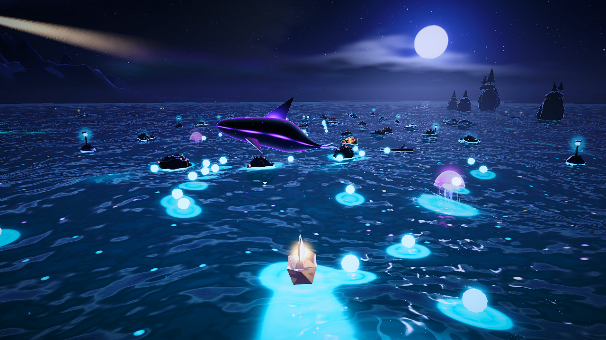
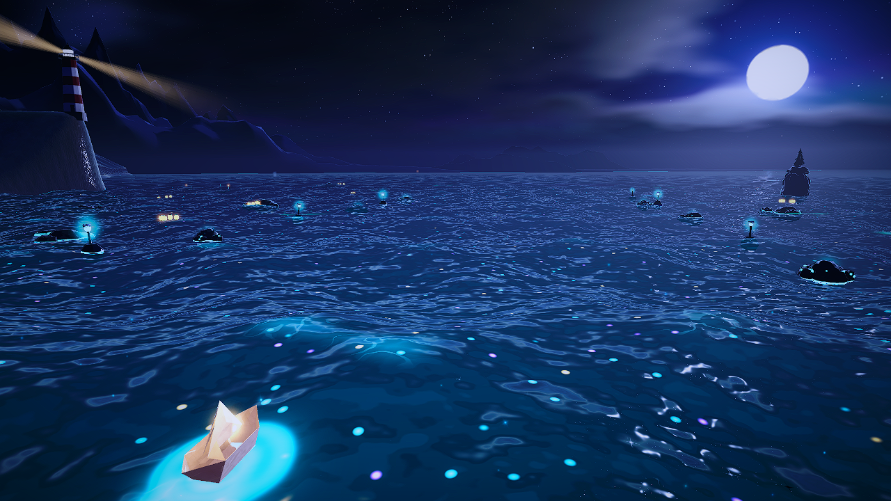

# Starlit Tides — Phase 8, Step 8: missing objects fix, life-size creatures, low camera

**Feedback:** *"Now I can't see any objects. Make the sea creatures scale 1:1: whales, orcas and other large creatures should be larger. The camera should be lower and closer to the boat."*

## 1. Why objects disappeared: glow halos drawn as white squares

The orbs, buoys and the boat's candle each have a soft glow halo. After the last **Rebuild Everything run inside the open editor**, those halo materials had **no texture**, so Unity drew each halo as an opaque white square that covered the object behind it. The night colour-grading LUT went missing the same way.

**Cause:** the builders write PNGs from code and use them immediately. In batch mode (where every test ran) Unity imports synchronously. In an open Unity 6 editor, imports can go to background workers, so:
- `LoadAssetAtPath` briefly returned `null`, and materials were saved without their textures.
- A later synchronous import could reload a just-created material from disk, dropping changes it only held in memory.

**Fix** (`EditorAssetUtil`):
- `ImportTexture` / `LoadTexture` force a synchronous import, and **stop with an error** instead of silently returning null. Every texture writer in the builders uses them (terrain, glow dot, paper, LUT, UI sprites, VFX sprites).
- `Persist` writes a glow/VFX material to disk the moment its texture is set.
- **Rebuild Everything now ends with an asset check** that reports any glow/VFX material without a sprite, and a missing LUT. The first fixed run caught two more materials; the final run inside the open editor reports *"all generated materials have their textures."*

### Follow-up: the intro ended underwater ("can't see the boat or any objects")

The intro's last shot, *"The sea awakens"*, played with the camera **at wave level, 30–40 m in front of the boat**, so the screen showed only a wall of dark water. This was a Phase 4 bug: `CameraDrift` moved **every** intro camera from the moment the intro started, so a shot that goes live at 16.5 s had already sunk 6.6 m and travelled 50 m forward. Each shot now drifts from **its own start time** on the Timeline (`CameraDrift.startTime`, set by `FeaturesBuilder`). The last shot now frames the boat from behind, as designed:

Also: `LanternFlicker` creates its property block on demand. A script reload during Play mode (Unity's "Recompile and Continue Playing") had left it null and filled the console with 483 errors.

**Lesson for rebuilding:** don't refresh or recompile scripts while the editor is in Play mode. It reloads all code mid-game and wipes every singleton (boat, ocean, pools) without re-running `Awake`, which leaves a broken session. This final rebuild ran in batch mode with the editor closed.

## 2. Life-size creatures

The creatures were already in metres, but at the small end. The big ones now use the top of their real adult size range, with colliders, gameplay radius, glow and leaps scaled to match. The boat is about 3 m long.

| Creature | Before | Now | Real adults |
|---|---|---|---|
| Orca | 7 m | **9.1 m** (bull) | 6–9.8 m |
| Humpback (scenery) | 16 m | **18 m**, breaches closer (30–42 m out, 38–70 m ahead) | 12–19 m |
| Narwhal | 4.5 m + 2.4 m tusk | **5.5 m + 2.9 m tusk** | 4–5.5 m + 1.5–3 m |
| Manta ray | 7.4 m span | **8 m span** | up to 7–9 m |
| Dolphin, sea turtle, nautilus | unchanged | | |

## 3. A lower, closer camera

| | Before | Now |
|---|---|---|
| Height / distance behind the boat | 11 m / 19 m | **6.5 m / 12.5 m** |
| Looks at | 34 m ahead | 16 m ahead (~11° pitch) |
| Lens (vertical, 16:9) | 48° | 52° |
| Follows the boat sideways | 55 % | **80 %**, so the boat stays in frame at the lane edges now that the camera is close |

The boat sits about 80 % of the way down the screen, the horizon about 30 % from the top, and the moon stays in view.

## Checked

- Batch copy: rebuild with the asset check passing; the real **menu → Play → intro → gameplay** flow with screenshots (picture above); creature sizes measured from the prefabs.
- Your open editor: Rebuild Everything ran inside it.
  - The asset check passed.
  - All seven glow materials and the LUT have their textures on disk.
  - The scene references no missing assets.
  - The camera and creature scale are in the saved scene and prefabs.
  - The time scale is 1.

## Files

**New:** `Scripts/Editor/EditorAssetUtil.cs`

**Changed:**
- Editor scripts: `EnvironmentBuilder`, `GameplayBuilder` (camera, glow import), `UIBuilder`, `FeaturesBuilder`, `SeaFieldBuilder`, `VfxKit`, `CreaturesBuilder` (sizes, asset check)
- `Bonus/AmbientWhale.cs`
- The rebuilt scene and assets
