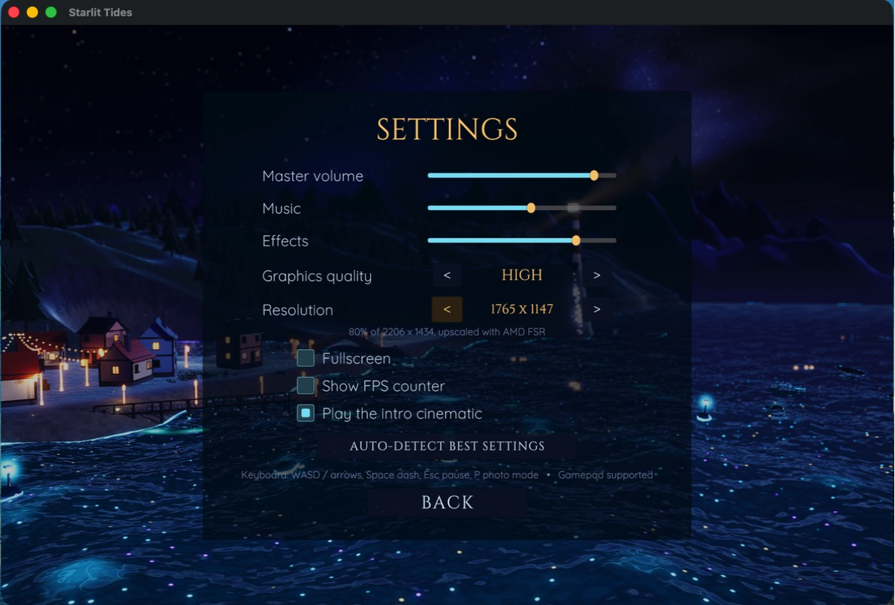

# Starlit Tides — Phase 8, Step 9: resolution settings and auto-detect

**Feedback:** *"Add a resolution setting with different resolutions, and auto-select the best resolution for the device the first time. The game doesn't have the correct resolution for my Mac: it looks blurry, choppy and low-res."*

## 1. Why it looked blurry and choppy

**Blurry.** Unity saves the last screen size and reuses it on the next launch. On the dev Mac that saved size was **1280 × 720**. Two things wrote it: test launches, and another Unity game that shared the same default bundle ID (fixed in the previous commit). The display is **2940 × 1912** pixels (a 13" MacBook Air at its default scaling), so macOS stretched a 720p picture across the screen, about 2.3× in each direction.

**Choppy.** At the true native size, High runs at about **41 fps** on an M4 MacBook Air (measured with vSync off). That's 5.6 million pixels a frame, about 2.7× a 1080p screen. With vSync on, missing 60 fps means uneven frame pacing, which feels choppy.

## 2. How resolution works now

`DisplayManager` (new, on the same object as `SettingsManager`):

| | |
|---|---|
| **Fullscreen** | Always at the display's real pixel size (`Display.main.systemWidth/Height`). Not `Screen.currentResolution`, which in fullscreen reports the game's own mode: it said 1280 × 720 here. |
| **Windowed** | A window at 75% of the display, instead of whatever size Unity saved last. |
| **Resolution** | The size the **3D world** is rendered at: 100%, 90%, 80%, 70%, 60% or 50% of the screen, shown in pixels (e.g. `1764 x 1147`). It sets URP's **render scale** on the active quality level's asset. |
| **Below 100%** | The picture is upscaled with **AMD FSR 1** (edge-adaptive upscale plus sharpening), and the game's own sharpening pass gets a little stronger. |

Why a render scale rather than switching the screen mode? The window or screen stays at its real size, so **text, the HUD and menus stay pixel-sharp** at every setting. Only the 3D is rendered smaller, and FSR upscales it far better than the OS stretching a whole small screen.

## 3. Auto-detect: the best resolution for the device

It runs on the **first launch**, and again whenever you press **AUTO-DETECT BEST SETTINGS** in Settings.

1. Switch to fullscreen at native size, 100%.
2. Turn **vSync off** while measuring. Otherwise the frame rate is capped at the refresh rate and shows no headroom.
3. Let the picture settle (1.5–2.5 s), then measure the average frame rate for 2.5 s. The count restarts if the game is paused or loses focus.
4. The goal is the display's refresh rate (60 Hz at most) **plus 10% headroom**, because a busy run is heavier than the menu. If it's not met, estimate the scale that would meet it. Frame time grows with the number of pixels, which is scale², so:

   `wanted scale = current scale × √(fps / target)`

   Pick the highest step at or below that, and measure again.
5. If even **60%** wouldn't be enough, lower the **graphics quality** one step instead (below 60% the picture gets soft). Then test again from 100%.
6. Save the choice and restore vSync.

On the dev Mac (M4 MacBook Air, 2940 × 1912, 60 Hz), with the same result on every run:

| Tested | Uncapped fps | Decision |
|---|---|---|
| 100% (2940 × 1912), High | 41 | too slow: √(41/66) ≈ 0.79 → try 70% |
| 70% (2058 × 1338), High | 63 | just under → 60% |
| 60% (1764 × 1147), High | 77 | **picked**: High, 60%, FSR-upscaled to the full screen |

The result shows under the Resolution row ("Auto-picked for this device: ..."). You can always pick a different step with ◀ ▶; the choice is saved.

## 4. The Settings screen

New rows, built by `UIBuilder`:
- **Resolution ◀ ▶** with a detail line underneath, for example *"80% of 2206 x 1434, upscaled with AMD FSR"* or *"Native: every pixel of the ... screen"*.
- **AUTO-DETECT BEST SETTINGS**.

The **Fullscreen** toggle now switches to native fullscreen or the 75% window. The game also starts in the mode Settings says: before, Unity restored the last mode it saved.

## Checked

- **The built Mac app, first launch simulated:**
  - native fullscreen
  - auto-detect picked 60% on High (log above)
  - the choice saved and reused on the next launch
- **Windowed mode:** a 2206 × 1434 window. The Resolution arrows step through the sizes (picture above), and the detail line follows.
- **AUTO-DETECT from the Settings screen:** it switches to fullscreen and starts the test. Switching away from the game pauses it, so the frame count now restarts after any pause.
- **In the editor:** the Game view sets the size, so auto-detect doesn't run there. URP's render scale is put back when Play mode ends, so the project's assets never save a runtime value.

## Files

**New:**
- `Scripts/Core/DisplayManager.cs`

**Changed:**
- `Scripts/Core/SettingsManager.cs`
  - adds `DisplayManager` if it's missing
  - Fullscreen goes through `DisplayManager`
  - quality changes re-apply the render scale
- `Scripts/UI/SettingsView.cs` (Resolution row, detail line, Auto-detect button)
- `Scripts/Editor/UIBuilder.cs` (Settings layout)
- `Scripts/Editor/GameBuilder.cs` (the game's own bundle ID, from the previous commit)

Apply: **Starlit Tides → Rebuild Everything** (rebuilds the Settings screen), then build.
