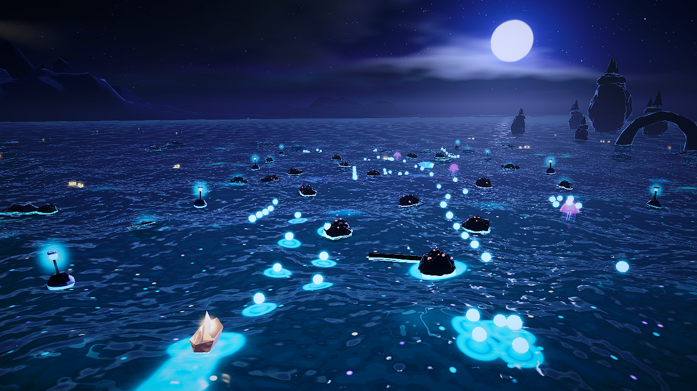

# Starlit Tides — Phase 8: Stylized Overhaul

**The feedback:** *"The graphics are too low poly and look bad. Make them stylized and beautiful. The play area is too narrow: the camera shows a wide view, but only a small section of the map has objects in it."*

Phase 8 answers that in six steps (plus a seventh, VFX polish, from later feedback), each with its own guide, before/after pictures and an explanation of the graphics technique behind it. The plan they follow is in [`Phase8_Plan_Stylized_Visuals.md`](Phase8_Plan_Stylized_Visuals.md).

| Step | Guide | What it does |
|---|---|---|
| 1 | [Wider play area](Phase8_Step1_Play_Area.md) | Lane ±13 → ±22 m with matching spawn density (`PlayArea`), a 48° camera that follows only half of the boat's sideways movement, glowing channel buoys and reefs, a darker ocean outside the channel, the land slid back, the moon lowered |
| 2 | [Stylized shader](Phase8_Step2_Stylized_Shader.md) | `StarlitStylized.shader` for every solid prop: banded light, indigo shadows, moonlit rim, painted gradients and noise, inverted-hull outlines |
| 3 | [Smoother geometry](Phase8_Step3_Smoother_Geometry.md) | `MeshBuilder` smoothing groups, sphere normals, accent mask and bevelled boxes; heightfield mountains with snow, soft pines, a round lighthouse, bevelled houses, a lofted log, mossy rocks with coral lichen |
| 4 | [The sea field](Phase8_Step4_Sea_Field.md) | Scenery beyond the lane in bands (algae blooms, lanterns, sea stacks, a rock arch, fishing boats, whale spouts), horizon islands and set pieces |
| 5 | [Ocean and grade](Phase8_Step5_Ocean_And_Grade.md) | A painted ocean ramp, star glints, foam lines, the boat's glowing wake, a colour LUT built in code, and a fix for a bug that randomly dropped the night grade |
| 6 | [Performance](Phase8_Step6_Performance.md) | Per-tier features, feature-by-feature timing, wake and ripple optimisations |
| 7 | [VFX polish](Phase8_Step7_VFX.md) | A new particle shader (white-hot cores, soft particles), a procedural texture set, and every effect rebuilt in layers: shockwaves on the waves, light trails, mist, coral hit sparks, rain ripples, stardust |
| 8 | [Fixes, scale, camera](Phase8_Step8_Fixes_Scale_Camera.md) | Fixed glow halos drawn as white squares after an in-editor rebuild (synchronous texture imports + an asset check), life-size large creatures, a lower and closer camera |
| 9 | [Resolution](Phase8_Step9_Resolution.md) | Native-size fullscreen (it was stuck at a stretched 1280 × 720), a Resolution setting (3D render scale with FSR upscaling, sharp UI), and a first-launch auto-detect that measures the frame rate and picks the best resolution and quality for the device |

To apply it all: open the project and run **Starlit Tides → Rebuild Everything** (steps 4–8, 10 and **11. Build Sea Field**).

`_StarlitTides/` here mirrors every script and shader that Phase 8 added or changed. `Preview/` holds the before/after renders used in the guides.

## Still open

- The **terrain** (beach, hills, cliffs) still uses Unity's Terrain Lit shader.
- The **sea creatures, whale and jellyfish** have no outlines or stylized rim yet.
- The **pier** is unchanged.
- **High at 1440p** runs at about 47 fps in editor timings (see Step 6). This needs a check in a standalone build.
