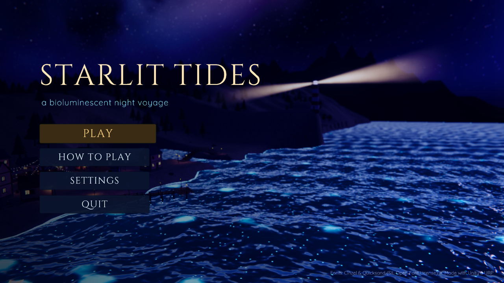
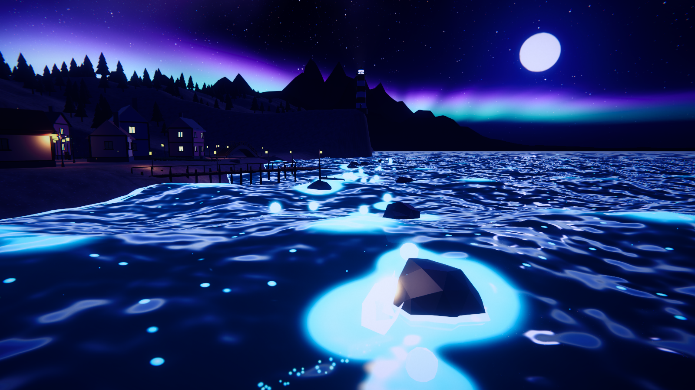

# 🌊 Starlit Tides

A 3D arcade survival game for a university **Computer Graphics** course, built in **Unity 6 (URP)**.

Steer a small glowing paper boat out across a dark night sea, away from a sleeping coastal village. Real bioluminescent beaches inspired the setting: the boat's light slowly fades, so you keep collecting glowing plankton orbs to stay alive while dodging rocks, drifting logs, jellyfish and glowing sea creatures: manta rays, sea turtles and leaping dolphins. If the light runs out, darkness swallows the boat.

| | |
|---|---|
|  **Gameplay** |  **The glowing whale** |
|  **Storm weather** |  **Aurora night** |

## Highlights

**Graphics**
- **Bioluminescent ocean shader** (hand-written URP HLSL): Gerstner waves, depth colour, refraction, Fresnel reflections, shoreline foam, and neon plankton glow around every object that touches the water
- **Procedural night sky**: twinkling stars, Milky Way, moon, animated aurora, storm clouds with lightning, sunset
- **One-click world builder**: village with glowing windows, lantern-lit square, market stalls, pier, arched bridge over a lagoon, lighthouse with sweeping volumetric beams, forest, grassland and layered mountains
- **Procedural sea creatures**: a manta ray, a sea turtle and a dolphin, built in code and animated by one shader that reads fin and tail masks from vertex colours. They have glowing spots, turtle-shell seams and flank stripes
- **Sharp image**: 4× MSAA, a contrast-adaptive sharpening pass (CAS) after post-processing, 1024 px terrain textures with normal maps, and detailed rocks
- **Procedural whale**: a lofted mesh with a custom shader (swimming vertex wave, plankton spots, glowing belly grooves, Fresnel rim)

**Gameplay**
- Light meter, pooled orbs and obstacles, Cinemachine camera with impulse shake, hit-stop and a difficulty ramp
- **Six extra features**:
  1. a light meter that visibly shrinks your light and darkens the screen
  2. combos
  3. a golden shooting star that triggers *Starburst*
  4. weather that changes with your score (calm → storm → aurora)
  5. near-miss slow motion
  6. a Timeline day-to-night intro cinematic
- **Five bonus features**:
  7. the glowing whale event
  8. a living village with hidden orbs revealed by the lighthouse
  9. Photo Mode with filters and depth of field
  10. fully procedural adaptive music and sound (no audio files)
  11. saved high scores and stats

**Finished game**
- Main menu with a living 3D background, HUD with a radial light meter, How to Play, Settings, Pause and Game Over screens with fades
- Saved settings (volumes, fullscreen, FPS counter, intro on/off) and **Low / Medium / High** quality presets, with a cheaper ocean shader on Low
- **Global leaderboard** on Vercel + Neon Postgres: live at <https://starlit-tides.vercel.app/api/scores>

## Getting started

1. Install Unity **6000.6.11f1** with Unity Hub. Add **Windows Build Support (Mono)** if you want to build the `.exe`.
2. Unity Hub → **Add project from disk** → select the [`StarlitTides/`](StarlitTides/) folder.
3. Open `Assets/_StarlitTides/Scenes/StarlitBay.unity` and press **▶ Play**.

The scene is built by the **Starlit Tides** menu in the editor (steps 4–8 and 10). **Starlit Tides → Rebuild Everything** runs them all and saves the scene. To make the game:
- **Starlit Tides → 9. Build Windows (.exe)**, written to `StarlitTides/Builds/Windows/`
- **Starlit Tides → Build macOS (.app)**, written to `StarlitTides/Builds/macOS/`

Builds are not stored in git; make them from the project.

## Repository layout

| Folder | What's inside |
|---|---|
| [`StarlitTides/`](StarlitTides/) | **The Unity project**, with all phases applied |
| [`Phase1/`](Phase1/Phase1_Setup.md) | Project setup guide + editor setup script (folders, packages, settings) |
| [`Phase2/`](Phase2/Phase2_Environment.md) | Environment: shaders (ocean, sky, light beam), environment scripts, world builder |
| [`Phase3/`](Phase3/Phase3_Gameplay.md) | Core gameplay: boat, light meter, orbs, obstacles, spawners, camera, gameplay builder |
| [`Phase4/`](Phase4/Phase4_Features.md) | Extra features 1–6: light vision, combos, Starburst, weather, near misses, intro cinematic |
| [`Phase5/`](Phase5/Phase5_Bonus.md) | Bonus features 7–11: whale, living village, Photo Mode, procedural audio, high scores |
| [`Phase6/`](Phase6/Phase6_Polish.md) | UI, settings, quality presets, optimisation and the build tools |
| [`Phase7/`](Phase7/Phase7_Visual_Upgrade.md) | Out to sea: turned the bay, made the image sharper, added sea-creature obstacles |
| [`Online/`](Online/) | Unity `LeaderboardClient.cs` that talks to the leaderboard API |
| [`leaderboard-api/`](leaderboard-api/README.md) | Vercel serverless API (`/api/scores`) backed by Neon Postgres |
| `starlit_tides.cpp`, `Makefile` | An earlier C++ / OpenGL (GLUT) prototype of the game |

Each `PhaseN/` guide explains that phase: its scripts, shaders, editor steps and the graphics techniques behind it. Each `PhaseN/_StarlitTides/` folder mirrors `Assets/_StarlitTides/` as it was after that phase.

## Requirements

- Unity **6000.6.x** with URP, Input System, **Cinemachine 3.1.8**, Shader Graph, ProBuilder, Timeline, TextMeshPro (uGUI)
- For your own leaderboard: a Vercel account and the Neon integration (free tiers are enough)

## Controls

| Action | Keyboard | Gamepad |
|---|---|---|
| Steer | WASD / arrow keys | left stick / d-pad |
| Dash | Space | South button (A) |
| Pause / back | Esc | Start |
| Retry (after game over) | R | North button (Y) |
| Photo Mode | P | Select |
| Skip the intro | Space / Enter / Esc | South button (A) / Start |

Menus work with the mouse, the keyboard (arrows + Enter) or a gamepad.

## Credits

- Fonts: **Cinzel** and **Quicksand**, SIL Open Font License 1.1 (see `StarlitTides/Assets/_StarlitTides/UI/Fonts/`)
- All models, shaders, textures, music and sound effects are generated by the project's own code
