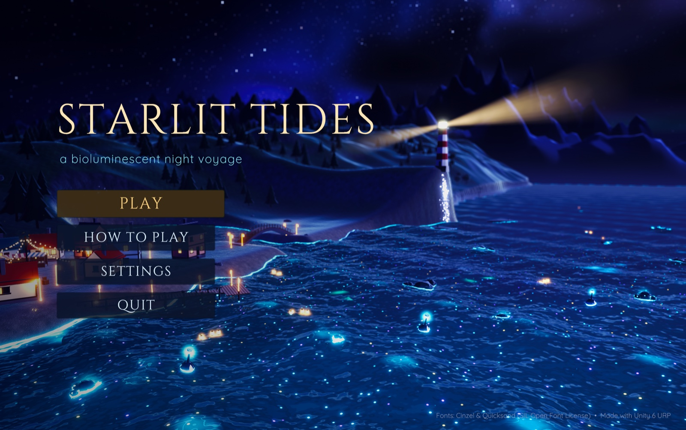
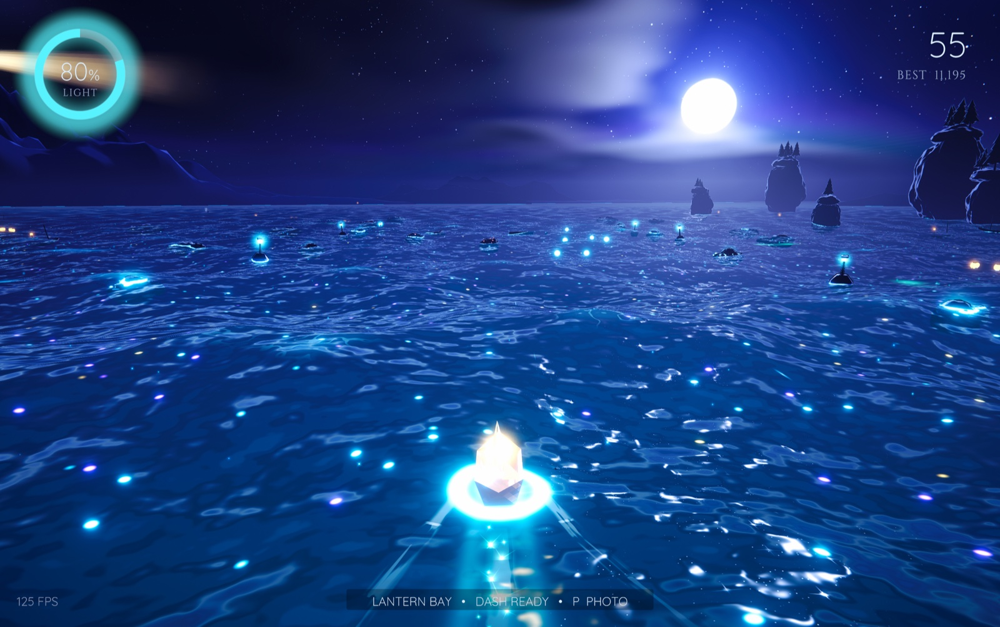
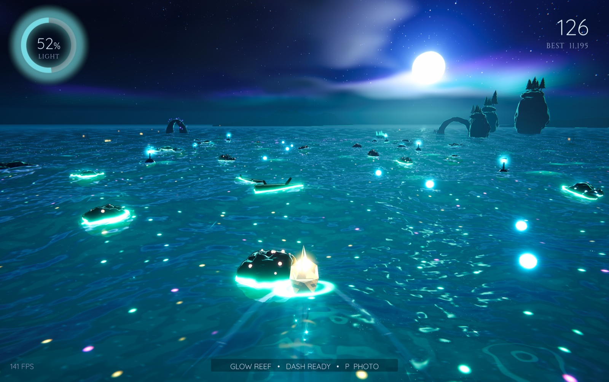
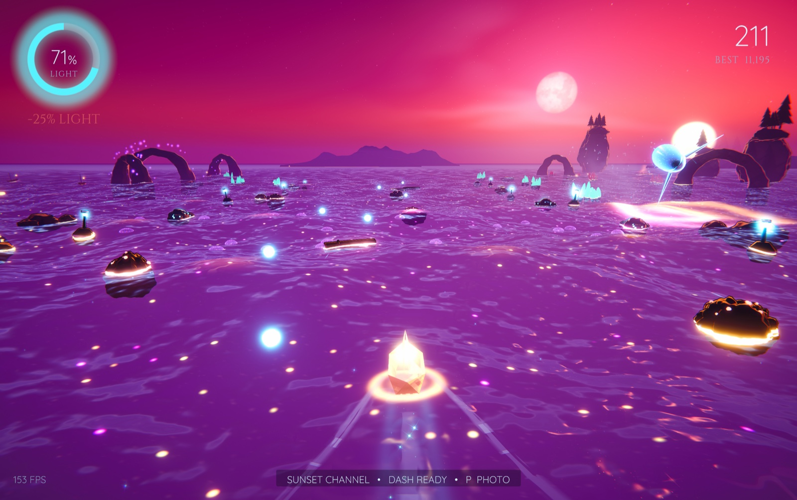
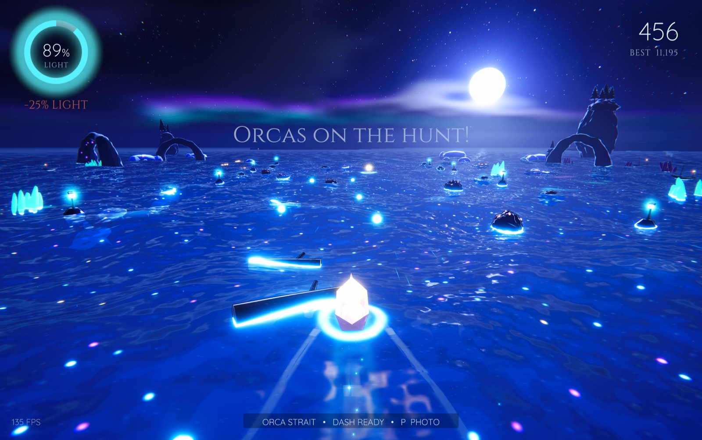
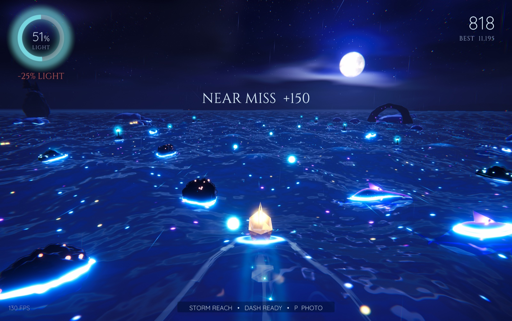
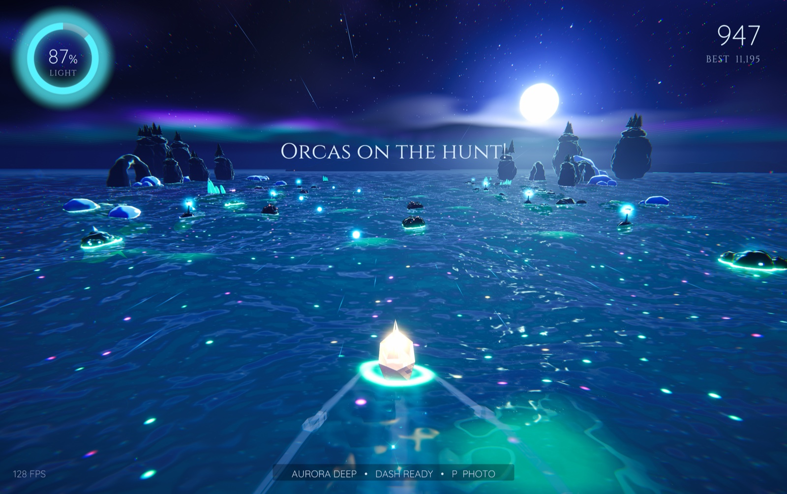
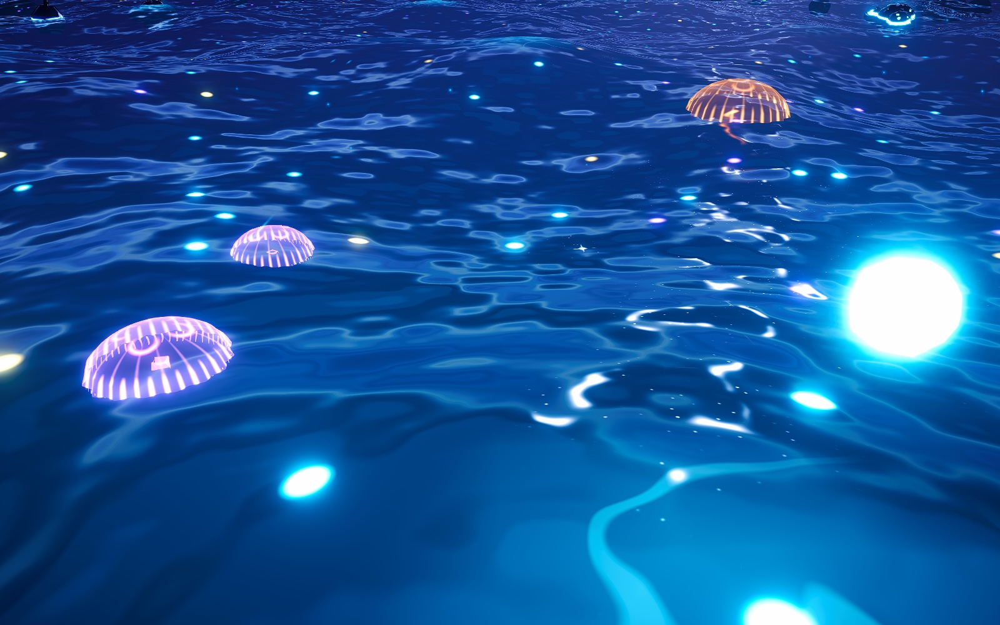

# Starlit Tides

A 3D arcade game made in Unity 6 (URP) for my Computer Graphics course.

You sail a small glowing paper boat out of a sleeping harbour and into the open sea at night. The boat's light slowly fades, so you keep it alive by collecting glowing plankton orbs. Hitting rocks, logs, jellyfish or sea creatures costs light, and when it runs out the boat sinks into the dark. The voyage passes through six zones, each with its own sky, sea and animals, and each one lasts longer and gets harder than the last.

## Playing the game

Ready-made builds are in [`StarlitTides/Builds/`](StarlitTides/Builds/):

- **Windows (10/11, 64-bit):** unzip `StarlitTides-Windows.zip` and run `StarlitTides.exe`. If SmartScreen warns about an unknown app, click *More info* and then *Run anyway*.
- **macOS (12 or newer, Apple Silicon or Intel):** open `macOS/StarlitTides.app`. The app isn't notarised, so the first time macOS may refuse to open it. Right-click it and choose *Open*, or allow it in *System Settings > Privacy & Security*.

On the first launch the game measures your computer and picks a 3D resolution and quality level that keep it at around 60 fps. You can change everything afterwards in Settings.

### Controls

| Action | Keyboard | Gamepad |
|---|---|---|
| Steer | WASD / arrow keys | Left stick / d-pad |
| Speed up / slow down | W / S (up / down arrows) | Left stick |
| Dash (left, right or forward) | Space | A / Cross |
| Pause / back | Esc | Start |
| Retry after game over | R | Y / Triangle |
| Photo mode | P | Select |
| Skip the intro | Space, Enter or Esc | A or Start |

The dash makes you briefly untouchable but needs 2.5 seconds to recharge. Menus work with the mouse, the keyboard or a gamepad.

## The voyage

| | |
|---|---|
|  **1. Lantern Bay** - leaving the harbour |  **2. Glow Reef** - jellyfish blooms drifting with the current |
|  **3. Sunset Channel** - dolphin pods racing across |  **4. Orca Strait** - orcas hunting the boat |
|  **5. Storm Reach** - humpbacks feeding under the storm |  **6. Aurora Deep** - everything at once, under the aurora |

The first zone lasts 45 seconds, and each zone after it lasts 25% longer. The light drains faster, the orbs get sparser and the obstacles get denser as you go. After the last zone the voyage starts again, a little harder each time.

The animals are modelled on real ones, at roughly real size, and behave like them. Sea turtles come up to breathe (bubbles warn you first), dolphins porpoise across the lane, orcas stalk at the edge of the lane and then charge, humpbacks lunge up through a ring of bubbles, and jellyfish drift in blooms.

*Moon jellies (left), a lion's mane jellyfish (back) and a light orb (right).*

## What's in it

**Graphics**
- A hand-written ocean shader (HLSL): Gerstner waves, depth colour, refraction, Fresnel reflections, foam and bioluminescent plankton
- A procedural night sky with stars, the Milky Way, the moon, aurora, storm clouds with lightning, and a sunset
- A stylised "storybook" look: a custom toon shader with soft banded light, a moonlit rim and outlines, plus a colour-grading LUT built in code
- Every model is generated in code: the village, lighthouse, rocks, boat, whale, dolphins, orcas, turtles, manta rays and jellyfish
- A custom particle shader for the effects: sparkles, splashes, shockwave rings, mist and rain ripples
- A boat wake built from the physics of a real ship wake (Kelvin angle, 19.47°)
- Moon god rays, volumetric lighthouse beams, bloom, depth of field and a contrast-adaptive sharpening pass

**Gameplay**
- The light meter, orbs, obstacles and a camera with impulse shake
- Combos, a golden shooting star that gives *Starburst*, near-miss slow motion, and weather that changes as you go
- A glowing whale event, a living village with hidden orbs, a photo mode with filters, and procedural music and sound (no audio files)
- Saved high scores and stats, plus a global leaderboard (Vercel + Neon Postgres)

**Settings**
- Volumes, fullscreen, display resolution, 3D resolution (FSR upscaling), anti-aliasing (SMAA / MSAA), shadows, reflections, colour depth, frame-rate cap, a battery saver, and an auto-detect button
- Changes take effect when you press *Apply*

## Opening the project

1. Install Unity **6000.6.11f1** with Unity Hub. Add *Windows Build Support (Mono)* if you also want to build for Windows.
2. In Unity Hub, choose *Add project from disk* and select the [`StarlitTides/`](StarlitTides/) folder.
3. Open `Assets/_StarlitTides/Scenes/StarlitBay.unity` and press Play.

The scene and its assets are generated by editor scripts. *Starlit Tides > Rebuild Everything* regenerates the whole scene. *Starlit Tides > 9. Build Windows (.exe)* and *Build macOS (.app)* make the builds in `StarlitTides/Builds/`.

## Repository layout

| Folder | Contents |
|---|---|
| [`StarlitTides/`](StarlitTides/) | The Unity project, with the Mac and Windows builds in `Builds/` |
| [`docs/`](docs/) | Development notes for each stage of the project, with screenshots (see below) |
| [`leaderboard-api/`](leaderboard-api/README.md) | The online leaderboard: a small serverless API on Vercel with a Postgres database |
| [`opengl-prototype/`](opengl-prototype/) | The first version of the game in C++ with OpenGL/GLUT (build it with `make`) |

The notes in `docs/` follow the order the game was built in:

1. [Project setup](docs/Phase1/Phase1_Setup.md)
2. [Environment](docs/Phase2/Phase2_Environment.md): ocean and sky shaders, the village and coast
3. [Core gameplay](docs/Phase3/Phase3_Gameplay.md): boat, light meter, orbs, obstacles, camera
4. [Features](docs/Phase4/Phase4_Features.md): combos, Starburst, weather, near misses, the intro cinematic
5. [Bonus features](docs/Phase5/Phase5_Bonus.md): whale, living village, photo mode, procedural audio, high scores
6. [UI and polish](docs/Phase6/Phase6_Polish.md): menus, settings, quality presets, build tools
7. [Visual upgrade](docs/Phase7/Phase7_Visual_Upgrade.md): out to sea, a sharper image, sea creatures
8. [Stylised overhaul](docs/Phase8/Phase8_Stylized_Overhaul.md): toon shader, outlines, the sea field, VFX, performance
9. [The voyage](docs/Phase9/Phase9_Plan_Voyage.md): zones, real animal behaviour, difficulty, settings, the jellyfish redesign

## Credits

- Fonts: Cinzel and Quicksand, both under the SIL Open Font License 1.1 (see `StarlitTides/Assets/_StarlitTides/UI/Fonts/`)
- All models, textures, shaders, music and sound effects are generated by the project's own code
