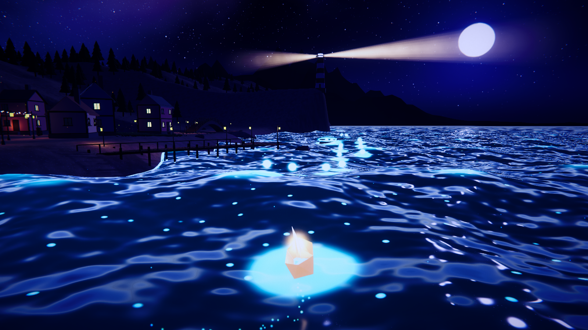

# 🌊 Starlit Tides

A 3D arcade survival game for a university **Computer Graphics** course, built in **Unity 6 (URP)**.

Steer a small glowing paper boat across a dark night sea beside a sleeping coastal village. Real bioluminescent beaches inspired the setting: the boat's light slowly fades, so you keep collecting glowing plankton orbs to stay alive while dodging rocks, drifting logs and jellyfish. If the light runs out, darkness swallows the boat.

## Highlights

- **Bioluminescent ocean shader** (hand-written URP HLSL): Gerstner waves, depth colour, refraction, Fresnel reflections, shoreline foam, and neon plankton glow around every object that touches the water
- **Procedural night sky**: twinkling stars, Milky Way, moon, animated aurora, storm clouds with lightning, sunset
- **One-click world builder**: village with glowing windows, lantern-lit square, market stalls, pier, arched bridge over a lagoon, lighthouse with sweeping volumetric beams, forest, grassland and layered mountains
- **Core gameplay**: light meter, pooled orbs and obstacles, Cinemachine camera with impulse shake, hit-stop, difficulty ramp
- **Global leaderboard** on Vercel + Neon Postgres

## Repository layout

| Folder | What's inside |
|---|---|
| [`Phase1/`](Phase1/Phase1_Setup.md) | Project setup guide + editor setup script (folders, packages, settings) |
| [`Phase2/`](Phase2/Phase2_Environment.md) | Environment: shaders (ocean, sky, light beam), environment scripts, world builder |
| [`Phase3/`](Phase3/Phase3_Gameplay.md) | Core gameplay: boat, light meter, orbs, obstacles, spawners, camera, gameplay builder |
| [`Online/`](Online/) | Unity `LeaderboardClient.cs` that talks to the leaderboard API |
| [`leaderboard-api/`](leaderboard-api/README.md) | Vercel serverless API (`/api/scores`) backed by Neon Postgres |
| `starlit_tides.cpp`, `Makefile` | An earlier C++ / OpenGL (GLUT) prototype of the game |

Each `PhaseN/_StarlitTides/` folder mirrors `Assets/_StarlitTides/` in the Unity project. Copy the phases in order (merging folders) and follow each phase's guide.

## Requirements

- Unity **6000.5.x** with URP 17.5, Input System, **Cinemachine 3.1.8**, Shader Graph, ProBuilder, Timeline
- For the leaderboard: a Vercel account and the Neon integration (free tiers are enough)

## Controls

WASD / arrow keys to steer, **Space** to dash, **Esc** to pause, **R** to retry. Gamepad supported.
